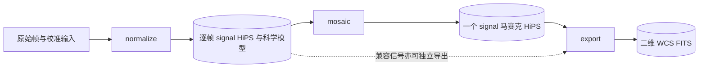
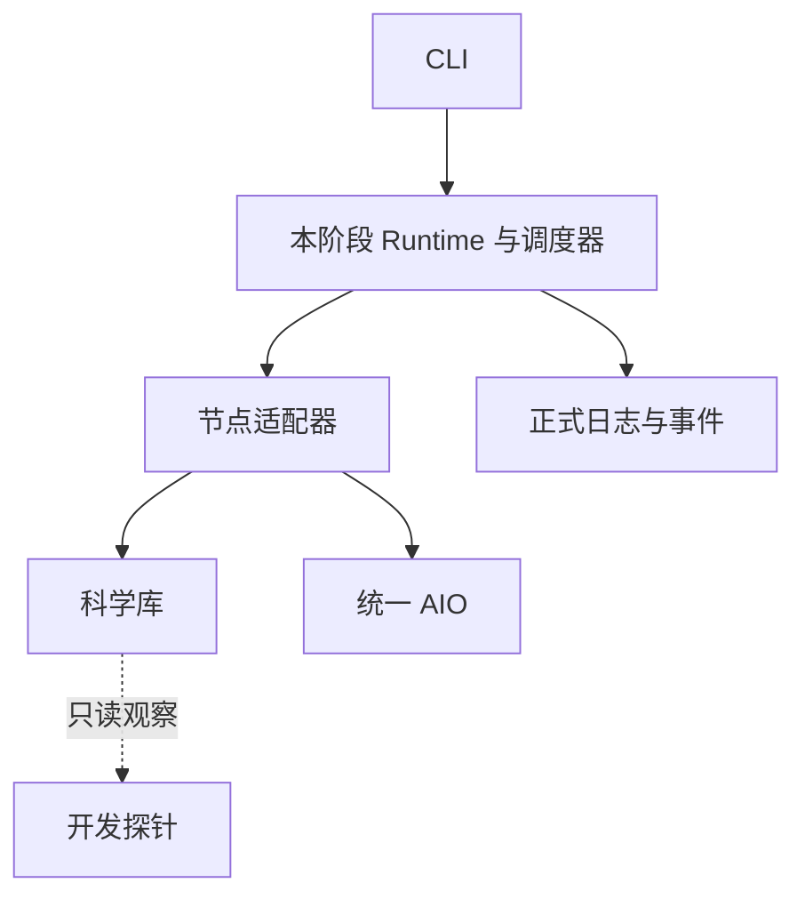

# ACSD 最高设计

ACSD 将天文 CCD/CMOS 观测转换为具有明确坐标、光度尺度、能力状态与来源链的球面科学产品，再合成马赛克并导出普通平面 WCS FITS。本文规定目标、阶段产品、系统边界与交付责任；数学定义由[统一科学模型](science/unified/UNIFIED_SCIENCE_MODEL.md)及专题分册展开，实际代码与目标的差异见[实施差异](engineering/architecture/SCIENCE_IMPLEMENTATION_DELTA.md)。

全新核心设计以[五份科学地基](science/foundation/OBSERVATION_COORDINATES.md)及[新架构规范](engineering/rebuild/README.md)为准。下文保留产品目标和旧系统说明；其中固定节点、旧对象/ABI、资源结构及FP32默认等工程细节不约束新核心。新架构只交付设计，经过独立审核和负责人接受后再建立独立重构分支实施；不表示现有生产实现已经替换。

## 1. 项目目标与科学边界

系统服务于原始观测标准化、多帧成像和后期处理。科学链由五个相互支持的研究问题组成；每项方法的贡献需要与已有理论、参考实现和独立实验比较。

| 研究问题 | 责任 |
|---|---|
| P1 光度 | 由 Gaia DR3 XP 与实际仪器响应拟合逐帧标度，明确参考光谱、目标或混合响应及颜色系统差异 |
| P2 参考精度 | 在明确参考通量、PSF、背景自由度和条件协方差下估计通量信息量，区分实际源 SNR、空间参考 SNR 与帧摘要 |
| P3 球面映射 | 在 HEALPix NESTED 上计算 drop 分配与面亮度归一，评价真实曲边、有效 PSF 和协方差传播 |
| P4 稀疏重建 | 从参考控制点重建空间精度，处理支持域、预测误差及点源通量到面亮度精度的转换 |
| P5 背景合成 | 在有效重叠图中估计逐帧加性差、固定分量规范，分离响应/PSF 失配并保留真实低频结构 |

用户自主选择合并不同相机、望远镜、曝光、滤镜和带宽。软件解释真实响应与系统差异，不以设备或滤镜字符串相同作为准入条件。恒星色项不能保证未知扩展源 SED 的无偏通带转换；“可以组合”与“测量同一物理响应”分别说明。

生产使用纯 CPU，面向 Windows amd64 与 Linux amd64。GUI 仅 Windows。GPU、ARM、Linux GUI 和 GUI 内的科学算法不属于当前产品范围。

共同物理定义与适用域见[统一科学模型](science/unified/UNIFIED_SCIENCE_MODEL.md)、[数据语义](science/unified/DATA_SEMANTICS.md)和[科学范围](science/unified/SCIENCE_SCOPE.md)。

## 2. 三个独立命令与产品

每个命令独立启动、独立调度、独立内存管线、独立重跑与验证。阶段之间只交换已发布的磁盘 HiPS、科学辅助数据与 manifest，不共享跨阶段会话或内存状态。

| 命令 | 输入 | 正式输出 |
|---|---|---|
| `normalize` | 单帧观测、校准输入、本地 Gaia、响应与配置 | 每帧 signal HiPS、唯一 `frame_science.json`、必要模型、能力与来源 |
| `mosaic` | 用户选择的兼容帧产品集 | 一套仅有 signal 科学图像通道的马赛克 HiPS 及来源/运行摘要 |
| `export` | 可解释坐标和单位的兼容 HiPS signal | 普通二维浮点 WCS FITS 信号图像 |

Normalize 可保留有来源的 variance/ivar/support 等辅助对象；它们不替代稀疏参考精度。Mosaic 的方差、背景、支持、权重和排异对象用于内部计算或诊断，不成为最终第二个科学图像通道。HiPS 多分辨率层级及标准元数据属于同一信号表示。

Export 不从单信号图制造缺失的方差、协方差或点源信息量。三个命令的产品交换由[阶段产品合同](engineering/data/PHASE_PRODUCT_EXCHANGE.md)规定。

## 3. Normalize：从传感器到单帧球面观测

Normalize 构建同一帧一致的几何、光度、PSF、噪声与参考精度。其科学依赖顺序如下；与 WCS 无关的初始噪声统计可以并行。

1. 读取并解释 lights、母版、单位和有效性，完成校准与缺陷处理，保留误差来源和修复状态。
2. IPV 从校准像元自行盲检 solver 候选、匹配本地 Gaia 并求 TAN/SIP。指向、焦距、像元尺度及邻帧解提供初值。
3. 完整 WCS 后，以 Gaia 引导生成独立 science_sources 并拟合 PSF。
4. 按本帧实际响应拟合测光标度，恰好一次施加到线性图像，保留参考、单位与 application 身份。
5. 在应用后平面上建立条件噪声和参考模型，区分参考源、实际场景、源测量及帧摘要。
6. 用本帧 WCS/SIP 与已应用标度的图像完成球面 Drizzle；noise 库使用同一次实际算子传播模板、协方差与背景基，完成球面参考 controls。
7. writer 发布逐帧信号、模型、sidecar 与完成清单，运行清单列出全部输入及逐帧结果。

原始 FITS 缺 CRVAL/CD 只是头部属性，应实际尝试求解。IPV 解、用户显式提供的合法 WCS 与粗指向分别记录来源；无可用解的帧记 unsolved，不发布伪球面图。solver_detections 服务于天测，science_sources 服务于测光和 PSF，两者职责不同。

校准明确 dark 是否含 bias、曝光比和 flat 归一；共享母版、修复和测光参数的不确定度与独立像元噪声分开。负线性值和有限零合法，未知 gain 或方差不能填 1 或 0 冒充测量。

参考由具名 SED/response 或显式积分通量定义，不从检出星中位流量自动发明。局部精度在球面完成，唯一正式载体为 `frame_science.json`；Catalogue 是浏览投影，规整 sparse_snr_layer 是兼容视图。合法信号允许 precision unavailable，缺项和原因随产品保存。

输入 JSON 可用单块或 blocks 列表，两种形态互斥；每块规定输入、母版、输出及科学参数。block 是模型共享范围，帧响应不同应逐帧绑定或内部拆组。

阶段一完整定义见[Normalize 科学链](science/normalize/NORMALIZE_SCIENCE.md)、[生产架构](engineering/architecture/NORMALIZE_PIPELINE.md)、[数据合同](engineering/contracts/NORMALIZE_DATA.md)与[接口规格](detail/normalize/contracts.md)。

## 4. Mosaic：相对背景、精度与合成

Mosaic 在共同 HEALPix 网格上读取合法帧信号，确认单位与响应约定，在有效域内重建参考精度，将其换算到所合成的面亮度估计量，估计相对背景、排异并归约。

参考点源信息量与面亮度精度分别定义。只有同位置、同支持和同协方差条件配对时，才可由传递因子 T 连接；参考源 Poisson 不自动等于实际场景。T 不能默认取 1，只有同一输出位置各帧共有的正因子才可从归一权中消去。稀疏重建保留空洞、外推、模型误差与支持状态，不以大幅长期驻留方差图替代设计。

相对背景由真实有效重叠图约束，各连通分量固定规范；无外部锚时不能恢复断连分量的绝对零点。加性天空、残余乘性、PSF 与通带差分别解释。背景控制使用其统计量自身的方差；Normalize 已施加的标度不再次盲乘。

排异先决定样本资格，集成再对接受样本按明确物理量求和。共享校准误差、数据拟合与后选择效应限制简单逆方差公式的解释。接缝评价同时检查足迹边界、恒星光度、扩展源通量、低频结构和随机效率。

数学定义见[噪声与精度重建](science/noise_snr/NOISE_SNR.md)、[背景模型](science/sky/UPM.md)、[排异](science/integration/REJECTION.md)和[集成](science/integration/INTEGRATION.md)，实现阅读入口为[Mosaic 管线](detail/mosaic/pipeline.md)。

## 5. 球面几何与平面导出

Drizzle 用真实未收缩源面积、收缩 drop 面积和交叠面积定义分配与归一。drop 分配守恒、常值面亮度保持、输出孔径通量和覆盖并集是不同对象，分别验证。HEALPix 等面积不意味着其叶边界是四条大圆弧；近似几何须报告真实曲边误差和候选完备性。

信号、PSF 和噪声使用相同实际算子。重采样产生空间相关；更小的像元 RMS 不证明测光信息增加。所有阶段共享 NESTED 与 tile/FITS 坐标实现，并用独立实现核验面缝、极区和手性。

Export 根据中心、尺寸、尺度、方向及生产支持的投影构造目标 WCS，选择已有 HiPS 层级并按声明核重采样。可用投影和核以实际实现列明；配置枚举不等于能力完成。内部零基像元中心与 FITS 一基 WCS 只转换一次，裁剪同步更新 CRPIX。

输出继承实际光度单位与响应说明，无支持位置用 NaN，保留负信号和有限零。评价分离 CCD→球面、HiPS 层级派生、球面→平面各段误差。

详细定义见[Drizzle](science/drizzle/DRIZZLE.md)、[HiPS 格式](science/formats/HIPS_TILE_FORMAT.md)、[平面导出](science/projection/HIPS_TO_FITS.md)和[重采样](science/resample/RESAMPLE.md)，生产接口见[Export 管线](detail/export/pipeline.md)。

## 6. Runtime、数据与资源

对外只有一个 `acsd` 可执行入口。CLI 负责解析、预检、运行控制、事件、取消与退出码；数学在算法库，读写在 AIO，线程资源由阶段调度器管理。

Runtime 拥有带 run/frame/type/revision/输入版本的只读发布对象与命名数组块。节点借用输入、生产新输出，最后一个消费者完成后回收；异步视图、取消和异常都需保持寿命正确。模块不私藏大数组、不读全局配置、不私建线程池、不直接退出、不写未声明文件。

阶段内科学 cache/spill 有显式身份、版本、容量、失效与 I/O 合同。工作文件、正式产品和开发快照具有不同消费者，不能凭文件碰巧存在推断依赖完成。跨 DLL 使用版本化 C ABI、POD/span、host allocator 或 opaque handle，不传 STL、异常和编译器私有类型。

稠密图像、球面累加器与 tile 默认 FP32；WCS、标定、稀疏控制及相关元数据 FP64，配置显式声明时按对象处理。星表只读本地数据。线程预算考虑亲和性、cgroup/Job Object 与实测画像；帧并发和帧内并行共享预算，缓存和队列有界。浮点归约按声明次序，跨并发度等价以指定容差实测。

CPU baseline、AVX2/FMA 与 AVX-512 内核分别构建，按硬件能力和 benchmark 选择；无画像时保守运行，缺可选后端可用数学等价基线。源码按 `lib/algorithms/`、`lib/infrastructure/`、`lib/include/` 组织，工程 schema、测试、构建和打包位于 `eng/`。

机制由[系统架构](engineering/architecture/ARCHITECTURE.md)、[数据流](engineering/architecture/DATA_FLOW.md)、[对象合同](engineering/UNIFIED_OBJECTS.md)、[Runtime](engineering/contracts/RUNTIME.md)、[调度](engineering/contracts/SCHEDULER.md)和[公共 API](engineering/api/PUBLIC_API.md)细化。

## 7. I/O、CLI 与诊断

三个命令共享配置形状、正式 I/O 服务和错误模型，各自拥有独立运行上下文。阶段科学配置可跨机器使用；benchmark 画像绑定机器；运行 manifest 记录实际输入、配置、算法、版本、后端、能力与产品。

产品经私有 staging 写入，等待 I/O 完成，核对内容、引用与哈希，原子发布完成清单。失败或取消不留下可当完整产品消费的半成品。裸 `.hips/` 与 `.hips.zst` 是同一产品的互斥存储形态。缺块如实返回，无数据不用零或 Inf 代替。

运行 `<command> --json <config>` 的 stdout 为 JSONL 事件流；`--version --json`、`doctor --json` 和模板等非运行响应使用独立 JSON 文档。普通日志与事件分流，正式日志写入失败按合同报告；敏感信息不进入日志。错误沿模块→Runtime→CLI 传播，退出码由唯一工程合同映射。

`ACSD_DEV_MODE` 默认 OFF，ON 编入被动快照和详细性能探针。发布构建不接受环境变量绕过编译边界激活探针。诊断不改变科学输入、权重、分配或发布结果；快照单独落工作区，失败只影响诊断完整性。正式 cache/spill 不由开发开关关闭，改变执行路径的续跑另行定义。

具体见[CLI 协议](engineering/contracts/CLI_PROTOCOL.md)、[I/O](detail/infrastructure/aio.md)、[原子发布](engineering/contracts/ATOMIC_PUBLISH.md)、[日志与错误](engineering/contracts/LOG_AND_ERROR.md)、[开发模式](engineering/architecture/DEV_MODE.md)及[探针规范](engineering/standards/DIAGNOSTIC_PROBES.md)。

## 8. Windows GUI 与交付

GUI 是 Qt6/MSVC 独立程序，不进入命令行的根构建目标。它管理配置、按 FITS 头与可定制 PCRE 规则分组、生成命令配置、启动 CLI、订阅 JSONL 事件，并整合 Qt6/OpenGL 球面及 HiPS 浏览组件。分组根据实际母版和响应条件组织，不在 GUI 复制科学算法。配置和事件之外的内部结构不构成 GUI 接口；产品浏览通过声明的读取组件。

根目录 VERSION 是版本事实源，CLI、GUI 展示和产品 manifest 由其派生。Windows 交付 Inno Setup 安装包，包含 CLI、GUI、动态库、schema 与配置；Linux 交付解压可用的 tar.gz，可附 AppImage。先完成双平台命令行端到端与视觉评价，再完成 GUI；二者同发 0.1.0。只有实际通过验收的阶段才在发行 manifest 标 available。

发布与 alpha 预览决定属于项目负责人。Agent 报告的状态至多为 READY_FOR_OWNER_REVIEW，不替负责人宣布发布。详细设计见[GUI](engineering/gui/GUI_DESIGN.md)、[构建](engineering/build/BUILD_GRAPH.md)及[发行](engineering/build/RELEASE.md)。

## 9. 独立验证与文档责任

科学证据分别来自一手论文/标准、参考实现、解析与高精度 oracle、控制真值前向仿真、真实重复观测及真实生产调用。HST 处理后图像可作结构模板，不能冒充原始探测器噪声真值。记录输入身份、环境、代码、命令、种子、单位、样本量、分母、失败和适用域；保留独立反例。

验证沿单帧、马赛克和导出三条完整路径，量化坐标、光度、PSF、条件信息、几何、低频保真与接缝，同时保留使用者的图像评价。文档定义、源码存在、构建、模拟、真实帧运行与独立科学支持分别报告。退出码、测试数量或流程状态不代替科学结论，项目不设研发审批门。

文档自本文向 science/engineering 展开，再到 detail 和代码；每个主题有唯一归属。[文档索引](DOCUMENT_INDEX.yaml)是轻量地图，[术语表](GLOSSARY.md)引向正式定义。实验档案保存过程，正式设计说明现行模型，源码差异集中维护。本轮需要重新推导的问题保存在[研究记录](../实验/documentation-refactor/docs/SCIENTIFIC_QUESTIONS.md)，其疑点身份不改变现行公式。

维护与证据要求见[文档维护规范](engineering/governance/DOCUMENT_GOVERNANCE.md)、[测试规范](engineering/testing/TEST.md)与[验证证据](engineering/testing/VALIDATION_EVIDENCE.md)。
