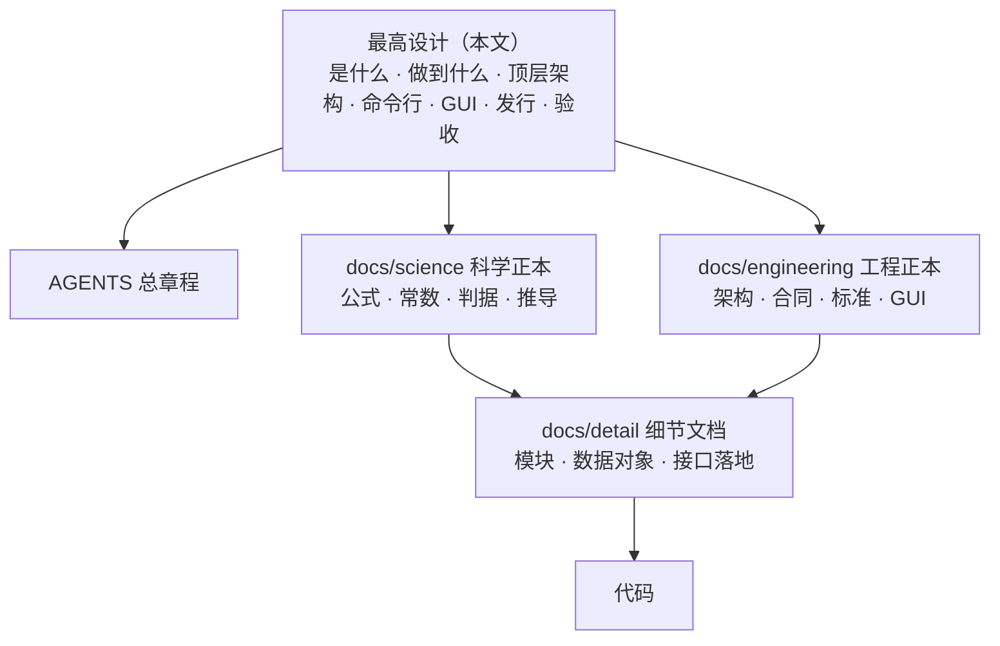
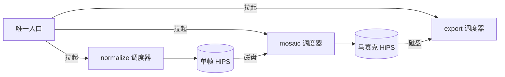

# ACSD 最高设计

本文档定义 ACSD 的用户目标、三阶段产品、基本科学边界、软件架构和发行责任。**阶段一唯一完整科学链见 science/normalize/NORMALIZE_SCIENCE.md；它如何映射生产代码见 engineering/architecture/NORMALIZE_PIPELINE.md；多份旧说明的冲突裁决见 engineering/governance/NORMALIZE_CONVERGENCE.md。**它描述**目标设计**，不因某段文字存在就表示生产代码已实现。科学基础唯一解释来自 docs/science/unified/UNIFIED_SCIENCE_MODEL.md，专题公式在各 science 正本细化；现状差异记录于 docs/engineering/architecture/SCIENCE_IMPLEMENTATION_DELTA.md。下级文档按三个目录组织：`docs/science/` 承载科学公式、常数、判据与推导；`docs/engineering/` 承载架构、行为合同、工程标准与 GUI 设计；`docs/detail/` 承载模块工作细节、数据对象与接口落地。开发与验收的标准动作是：审查实际代码与本文档集的偏差并消除之。

## 0. 文档权威与索引



- 本文档与任何其他文档冲突时以本文档为准；修改本文档由项目负责人批准。
- 权威链自上而下递减：本文档；一级正本 science 与 engineering；二级细节 detail；代码。
- 科学公式与推导的权威在 science；架构的权威在本文档第 8 章；GUI 的权威在本文档第 12 章与 engineering/gui。
- 本文档只写顶层结论，公式推导、数值表、源码位置与实验数据由下级文档承载。
- 每份下级文档标注来源，每个机制都能追溯到本文档一条要点；追溯不到的机制先补要点再实现。
- `docs/DOCUMENT_INDEX.yaml` 是全文档集唯一地图，与文件树一致；同一主题只有一份正本。

### 0.1 文档写法

- 只写现行设计要怎样，用自然语言讲清楚，配必要的 mermaid 图。
- 文档间引用按论文格式（正文编号、文末参考文献），不使用机械跳转锚。
- 文档随代码持续维护，保持自解释；文件树与 DOCUMENT_INDEX 一致，无孤儿旧文件。

---

## 1. 项目定位

### 1.1 是什么

ACSD 是天文 CCD/CMOS 图像标准化与 HEALPix 球面合成系统：利用 Gaia XP 光度标定、PSF/噪声信息与球面守恒 Drizzle，生成单帧 HiPS；基于阶段一的稀疏参考 SNR 控制点进行阶段二稠密精度重建、加性背景与接缝校正、样本排异及统计集成；阶段二最终只发布**单通道科学信号 HiPS**；阶段三把它重投影为后期处理使用的平面 WCS FITS。

不同相机、望远镜、曝光与滤镜（包括不同厂商宽带和不同带宽窄带）**由用户自由决定是否合并**。算法不因仪器和通带差异设置准入限制；正确的随机精度权重与通带系统失配需要分别估计和解释，不能把“允许合并”写成“物理通带完全等价”。

### 1.2 三个命令与科学产品

`normalize`：原始传感器帧 → 校准、Gaia XP 测光、噪声/PSF、稀疏参考 SNR、Drizzle → **逐帧球面信号 HiPS + 稀疏控制数据、标定与处理辅助数据**。

`mosaic`：一组阶段一 HiPS → 稀疏 SNR 现场重建、面亮度精度转换、加性背景/残余相对差、排异、加权合成 → **一套只有 signal 科学图像通道的马赛克 HiPS**。计算所需方差/支持度等中间对象只留计算、诊断或运行摘要，不作为最终 HiPS 科学图像层。

`export`：阶段二 HiPS signal → 目标 WCS、受控重采样 → **普通二维 FITS 信号图像**，供 PixInsight 等后期程序继续处理。仅由单信号图不能恢复完整方差或协方差。

三个命令独立启动、使用磁盘产品交换、互不保持跨阶段内存状态；它们的**科学主流程**是 normalize → mosaic → export。HiPS 包含标准要求的 properties、文件头、NESTED 分块及多分辨率层级，这些元数据和层级**不构成额外科学图像通道**。

---

### 1.3 非目标

- GPU 与 CPU/GPU 混合生产路由；
- Linux 图形界面；
- 在 GUI 内实现科学算法（GUI 只做命令行的前端）；
- ARM 及非 amd64 架构；
- 从任意路径加载未经产品清单授权的第三方插件；
- 为未发生的假设故障堆叠回退、重试、兼容层与重复校验。

---

## 2. 核心科学链与研究问题

五个研究方向服务于一个科学目标，不预先承诺它们构成五个独立原创理论；既有 P1–P5 历史实验仍保留，各自实证适用域优先于旧版功能描述。可发表贡献需由可证伪的物理结论和独立实测确定。

### 2.1 P1：Gaia DR3 XP 跨设备光度

利用校准星光谱、已知/估计的滤镜+QE/总响应对匹配恒星作合成测光，解算本帧稳健零点和可辨识空间乘性场。用户可以选择跨设备和近似通带合并，甚至 3 nm/7 nm Hα；若未知天体逐像元 SED，恒星色项不能保证对发射线云气执行无偏通带变换。目标通带或混合响应规则、适用恒星颜色范围与系统误差必须明确。数学正本：science/photometry/PHOTOMETRY.md。

### 2.2 P2：条件参考 SNR、噪声与协方差

阶段一在明确参考通量、局部 PSF、噪声与背景自由度下估计参考点源 SNR=F_ref/σ_F。真实泊松/读噪、校准/零点共同误差和球面像素相关噪声应分开；测光 SNR 的逆方差恒等式**只针对相同点源通量被估量**，不是任意弥散像元的通用最优权。数学正本：science/noise_snr/NOISE_SNR.md。

### 2.3 P3：HEALPix 球面守恒 Drizzle

用源 drop 与真实目标球面像元的交叠面积构建面亮度保持的线性算子，分别验证分配通量守恒、球面曲边求积误差、像元支持和 C_out=R C_in Rᵀ。HEALPix 叶等面积不意味着用四个大圆弦构成了精确叶边界。NESTED、HiPS tile FITS 方向和层级单点实现并与独立参考对拍。数学正本：science/drizzle/DRIZZLE.md。

### 2.4 P4：稀疏 SNR → 稠密精度场

沿用阶段一稀疏控制点，阶段二按位置现场重建同参考通量下的条件通量精度；必须建立 PSF、球面面积、相关性支持下的**点源通量方差到球面面亮度方差**转换，不能直接混淆两种估计量。研究插值（样条、IDW、双线性）、支持域、空洞、过冲、模型偏差、跨 tile 连续性以及最终叠加效率。生产参数以独立留出证据确定，不因历史默认值强行修正。数学正本：science/noise_snr/NOISE_SNR.md。

### 2.5 P5：加性背景、响应差与无接缝合成

阶段二在真实重叠图连通分量内拟合加性差模并处理规范自由度；光度归一与残余乘性差只各处理一次；PSF 和通带失配不得被假设为纯加性天光。降低边缘台阶必须同时保持真实星云低频结构、扩展源总通量与恒星光度。内部可以维护多种噪声、背景与排异中间对象，但最终 HiPS 只输出 signal。数学正本：science/sky/UPM.md。

全链科学实验同时比较解析可解场、独立数值实现、HST 结构前向合成与真实重复帧，不设与物理问题无关的流程门禁。

---

## 3. 数据对象与配置

### 3.1 数据对象与最终发布对象

**阶段一**：可包含 signal、内部 support/coverage、variance/ivar、WCS、PSF、参考通量、frame_snr、稀疏 SNR 控制点、标定参数、有效域和 provenance；它们服务于阶段二物理估计，不强制全部以二维 HiPS 子产品形式写出。阶段一的稀疏 SNR Catalogue 与现有规整 sparse_snr_layer 必须通过单一明确格式/转换生产链衔接，不能因名字相似而视为已闭环。

**阶段二内部**：按球面位置现场重建 SNR/条件方差与面亮度精度的转换，拟合背景，执行排异及集成；支持度、方差、控制点和权重可为临时工作量或诊断。

**阶段二最终**：只发布一个科学图像层 signal；HiPS 文件头、properties、目录层级、无效像元标识和运行摘要不是第二个数据层。未知值/无覆盖用 NaN，不以零模拟空洞。

**阶段三最终**：一个平面 FITS signal 图像及应有的坐标/光度元数据；不凭信号值制造未观测的方差或 SNR。

---

### 3.2 三类配置

- 阶段配置 JSON：科学配置，可跨机迁移；
- 机器画像：机器绑定，由 benchmark 生成；
- 运行 manifest：冻结本次运行。

### 3.3 精度归属

- 稠密大面（图像面、球面累加器、方差/覆盖面、HiPS tile）默认单精度；
- 稀疏与元数据（帧级信噪比、WCS 解、星表匹配、测光定标、manifest）全程双精度；
- JSON 显式指定位深时以 JSON 为准。
- 全链一套球面索引（HEALPix NESTED）与一套帧标识；星表只解析本地文件，离线、零网络。

每个科学量写清单位、坐标系、归一化、精度要求与有效有限域。统一观测模型与字段正本见 detail，配置合同见 engineering。

---

## 4. normalize：单帧标准化

### 4.1 使命

把一帧传感器观测变成可独立消费的观测模型：光度与天球坐标已定义、噪声可传播、PSF 可解释、帧级信噪比可靠独立，使 mosaic 不回读原始帧即可做方差正确的扩展源合并与 PSF 感知的点源检测测光。

### 4.2 唯一科学链与 WCS 解算责任

Normalize 在同一帧上构建相互一致的几何、光度、PSF、噪声与参考精度模型；**不是只读取原始 FITS 已有的 WCS**。完整理论与实际实现分别以 science/normalize/NORMALIZE_SCIENCE.md、engineering/architecture/NORMALIZE_PIPELINE.md 为唯一横向正本，本章只固定次序与外部合同：

1. 输入/校准/缺陷和背景有效性；保留 master 与像元状态。
2. **IPV 独立 PlateSolve**：在校准像元上私有盲检 solver_detections、Gaia 星表匹配与 TAN+SIP 求解，近似指向可以来自 OBJCTRA/OBJCTDEC、FOCALLEN/XPIXSZ、配置或此前自解邻帧；**原始 FITS 无 CRVAL/CD 不是未解 WCS 的证据**。失败逐帧记录真正 unsolved 原因。
3. 得到本帧权威 WCS 后，再用完整 WCS+SIP 把 Gaia 星点投到像素，生成独立的 **science_sources** 与空间 PSF 模型。解算器私有 star candidates 和科学测光星表不可互相冒充。
4. Gaia XP **每帧实际通带 R_k** 测光拟合并对线性像元**恰好一次**施加比例，记录参考/混合光度约定、颜色限制、scale 状态与真实单位。
5. 在真实 PSF、背景/噪声及逐帧响应下计算 frame reference SNR 和位置相关 canonical sparse reference-SNR control points，明确 F_ref,k、V_F、空间支持与模型完整性。旧 source/median SNR 不等于条件稀疏信息量。
6. 由该帧已解 WCS+SIP 和已施加光度的线性面完成 HEALPix 球面 Drizzle，保留适当几何、相关噪声及 provenance；统一 writer 发布每帧 signal HiPS 和必要科学模型/控制数据。

这是依赖顺序，不阻止 WCS 无关的噪声初估并行。调度边要靠真实 typed ports 和对象版本，不由工作文件是否碰巧出现决定。开发数据快照只是旁路，不供科学消费者读取。Normalize 不负责最终跨帧权重/接缝。

### 4.3 输入合同

输入是 JSON 配置，只含必要参数与帧路径；容差与默认参数在程序 config 目录。一个 JSON 可写多个数据块，只有一块时可用单块简写，两种形态互斥。

```jsonc
{
  "blocks": [
    {
      "name": "red",
      "input_lights": ["path/light1.fits", "path/light2.fits"],
      "master_bias": "path/bias.fits",
      "master_dark": "path/dark.fits",
      "master_flat": "path/flat_red.fits",
      "output_dir": "path/out/red",
      "filter_passband": "Baader R",
      "wcs": { "gaia_data_dir": "path/gaia" }
    }
  ]
}
```

- 三个命令配置同一形状：顶层块列表，每块含输出名称、运行参数、一组输入帧。
- 一个 block 是复用共同校准母版与科学参数的组织单位，建议把需要同一 master/滤镜响应模型的帧归组；同命令可以多个 block。**这是参数/物理模型共享范围，而不是禁止不同设备或滤镜参与阶段二合成。** 同块若实际包含不同 R_k，也须按帧建模或内部拆光度子组，不能把第一帧响应强加给其它帧；现有代码的组内响应全等拒绝属于待修实现。
- 滤镜型号/响应曲线若已知则用于 Gaia XP 绝对/颜色模型；未知型号或通带差不构成禁止跨设备合并的理由，应使用可辨识的相对标度并报告响应模型未知。缺失必要图像文件、损坏 WCS 或非法数值仍是普通输入错误。计算精度按 3.3。

### 4.4 输出合同

每个有可用真实天体测量解、合法球面化信号的 light 帧对应一份独立的阶段一 HiPS 及其辅助模型/运行摘要；未解帧保留 WCS 求解与数据错误归因，不发布伪 HiPS。必要对象包括信号、WCS/坐标、参考通量及其光度尺度、帧级 SNR、稀疏 SNR 控制数据（若可估计）、PSF/噪声条件模型、可解释的有效域与处理来源；若部分科学估计不可辨识，明确报告其能力边界。不同的稀疏对象载体（SNR Catalogue、sidecar、规整重建层）必须统一生产者—消费者关系。

### 4.5 运行输入检查与诊断（不设流程门禁）

输入文件不存在、格式损坏、真实 IPV 求解失败而缺可用 WCS、或必要数值无定义时，应记录精确错误/逐帧状态，避免产出伪科学图像。**原始文件头未提供 WCS 不是错误本身**，应按初始指向、设备尺度和 Gaia 星表进行实际求解。对不同相机/滤镜、通带宽度、数据质量、控制点密度和计算资源给出解释性诊断，**不以评审、用户确认、设备一致性或科学质量分数设强制流程关卡**。

科学模型的误差大小、颜色残差与支持域应保留为观测读数供用户决策，不用大量“必须全绿才能继续”的机制替代理论设计。现存预检/确认 UI 和相关自动化门禁属于后续工程调整范围；保留有实际意义的输入错误处理与产品原子性。

---

## 5. mosaic：球面背景、稀疏精度重建与信号合成

### 5.1 使命

在用户选定的同一 HEALPix NESTED 球面网格上，把阶段一单帧 HiPS 按科学定义的信号与统计权重合成为**一个 signal 马赛克 HiPS**。不同相机、望远镜、曝光、宽/窄通带可由用户自由组合；本阶段尽量修正可辨识的光度和天空背景差，保留无法由当前数据辨识的系统混合限制。

### 5.2 数学与生产次序

输入帧身份、WCS/HEALPix 与有效像元确定 → 统一光度参考约定与响应诊断 → 将阶段一稀疏 SNR 控制点重建为位置相关的参考通量精度 → 根据有效 PSF/面积/噪声相关模型换算**面亮度被估计量自己的方差权重** → 重叠图/差模天空求解与应用 → 按球面像元异常样本排异 → 已接受样本的科学合成 → **单科学信号 HiPS** 写出。

实际数值实现可为了性能流水并行，但不能将某个先验无法比较的参考 SNR 直接当成普适球面像元权重。

### 5.3 稀疏 SNR 的真实含义

frame_snr、sparse_snr_layer 与真实 source_snr 是不同数据对象。P4 使用固定 F_ref,k 定义的空间精度场；SNR²/F_ref,k² 严格等于参考通量方差的倒数。球面面亮度的权重还需 PSF、噪声核、像元面积、背景处理和曝光响应定义共同确定精度传递因子。仅在传递因子对被比较帧为共同正比例时可以消去。具体证明见 science/noise_snr/NOISE_SNR.md。

稀疏重建研究是核心方案，不以生产大幅逐像素方差图替代它；最终密集场可现场求值且只在阶段二内部存在。样条、IDW、帧级常量及其它方法应使用相同真值世界对照，而非历史默认参数独断。

### 5.4 相对天空背景与结构保真

加性天空、恒星/星云通带差、PSF 差异及残余乘性响应不可混为同一个“接缝”原因。重叠图每个连通分量各自固定可辨识规范；跨断连分量无外部锚时绝对低频零点不能自动求得。背景控制采用其统计量自身的控制方差，不能借用点源参考 SNR 充当背景方差。恒星色项与星云发射线差异在未知天体 SED 下不可任意转换，不用高阶天空面抹去真实梯度。

### 5.5 排异与合成

宇宙线、卫星线、热像素等异常样本先识别，再对合格帧按相同面亮度物理量加权；排异是由数据决定的非线性选择，对输出方差宣称需单独验证。输出信号允许负值，无覆盖/不可计算值保留 NaN。最终 HiPS **没有 support、variance、ivar、SNR 等伴随科学图像层**。

---

## 6. export：HiPS 信号到通用平面 FITS

### 6.1 使命

以**阶段二单通道信号 HiPS**为科学输入，按指定中心、像元尺寸、图像大小及 WCS 投影生成普通二维 FITS 图像，供 PixInsight 等软件的后期处理使用。阶段三不重新估算来自各原始帧的相对背景、SNR 或叠加权重。

### 6.2 投影与重采样

对输出平面每个目标像元，按独立生成的 WCS 映射到天球/HEALPix，使用已声明采样核读取/重建 HiPS 信号。研究两次几何变换对星点 FWHM、光通量、扩展源低频与噪声纹理的影响；从单信号层仅可生成**图像数据**，不得无输入协方差信息却宣称精确的最终方差或点源信息量。没有数值支持时以 NaN 表示无数据，不把零当无效。

### 6.3 投影算法

支持注册的 WCS 投影（TAN、SIN、CAR、AIT 等依具体生产实现列明），明确适用域、极点/RA 回绕、像元中心和手性。nearest、局部线性或面积重采样的选择影响输出 PSF/噪声，应记录实际生效方法。HiPS 标准目录/坐标/元数据与 FITS 头必须可由独立读者解释。数学正本见 science/projection/HIPS_TO_FITS.md 与 science/resample/RESAMPLE.md。

---

## 7. 命令行合同

### 7.1 命令树

```text
normalize --json <config.json>      运行（输入合法性检查与诊断，不依赖审批门）
normalize --template [-o <path>]    生成 JSON 模板
normalize --help

mosaic --json / --template / --help
export --json / --template / --help

help                                详细帮助
--version                           版本
doctor                              环境自检
benchmark                           生成/更新机器画像
```

- 全部命令由唯一可执行程序提供：Windows 为 `acsd.exe`，Linux 为 `acsd`；其余能力以动态库形式存在或在程序内部实现，不设子入口。
- 命令行是薄入口：解析、预检、运行控制、机器输出、取消与退出码；科学公式在算法库，读写在统一 I/O，线程池在调度器。
- normalize/mosaic/export 是命令名，phase1/2/3 仅为内部指代，不出现在命令与算法目录命名中。

### 7.2 机器输出与退出码

- `--json` 时 stdout 恰为一个 JSON 文档；运行事件默认走 JSONL 事件流（progress、resource、artifact、backend、final），stdout 无日志污染。
- 退出码按失败类型区分；退出码唯一定义在 engineering 正本。
- 取消（Ctrl-C）：协作取消、关 writer、写未完成 manifest、隔离临时产物。

### 7.3 错误传播与日志

- 每个失败产生稳定错误码上行并在命令行收敛为退出码；空捕获、忽略返回码、只写日志、降级为警告继续均属未传播。
- 降级在显式、可溯、不改科学语义三要件齐备时合法，否则 fail-closed；未捕获异常产生脱敏 crash report。
- 每次运行在输出目录下产出完整日志；日志写入失败即运行失败；日志不含凭据与绝对用户路径。

---

## 8. 软件架构

### 8.1 总原则：唯一入口、阶段独立调度器

- 对外一个命令行入口，负责解析、预检、事件流与退出码，按命令拉起对应阶段调度器。
- 每个阶段实例化自己的调度器与内存管线，互不共享内存、会话或运行时状态，一次调用只驱动一个阶段。
- 阶段间唯一交换媒介是磁盘 HiPS 与 manifest，不存在跨阶段内存传递与贯穿三阶段的全局会话。



### 8.2 命名块内存管线与块生命周期

- 一个运行帧承载一组命名块，每个块冻结元数据：名字、形状、类型、单位、生产者、消费者、生命周期。
- 模块标准动作：读入参块、计算、写新块；块被其全部消费者用完后由管线显式销毁，内存立即归还。
- 长生命周期块随帧存活到导出；短生命周期块在下游块产出后立即消耗。
- 峰值内存由在途块集合与分块大小决定；缺块时显式降级并写溯源。

### 8.3 三个阶段调度器

| 调度器 | 工作特征 | 编排形态 |
|---|---|---|
| normalize | 工序多、单帧链长、多帧独立 | 异步工作流编排：帧内按 DAG 流水、多帧并行，I/O 与计算重叠，星表查询合并与缓存 |
| mosaic | 天球像素相互独立 | 空间窗口并行：以天球窗口为调度单元，窗口大小权衡内存与并行 |
| export | 输入输出均为大块 | 子块流式：读子块、投影、写 FITS，有界队列与背压 |

- 一个进程一个资源预算源，线程池唯一来源是调度器，科学内核单层并行。
- 编排基于静态预算与探针校正；编排参数据探针迭代。
- 数值结果与并发度无关，1/N worker 在事前冻结的浮点容差内等价。

### 8.4 顶层结构

```text
lib/
├── algorithms/             科学算法唯一家，模块并联放置
├── infrastructure/         工程基建
│   ├── cli/{normalize,mosaic,export}
│   ├── pipeline/          运行帧、命名块、typed DAG
│   ├── scheduler/         三阶段调度器
│   ├── aio/               唯一 I/O、原子提交、缓存
│   ├── benchmark/         kernel 测量与机器画像
│   ├── observability/     日志、事件、探针、资源监控
│   ├── gaia_xpsd_client/  本地星表解析（离线）
│   └── hips_browser/      Qt6/OpenGL 球面与 HiPS 浏览组件（GUI 复用）
├── include/
└── third_party/
gui/                        Windows GUI（独立外挂，Qt6 + MSVC）
eng/
├── contracts/             合同 schema
├── tests/                 独立测试代码集
├── cmake/
├── tools/
└── packaging/config/
docs/
├── science/
├── engineering/
└── detail/
实验/
testdata/
```

- 算法模块在 `lib/algorithms/` 并联放置；依赖方向单向。
- 科学模块不读全局配置、不建无预算线程池、不直接退出、不写未声明文件、不绕过统一 I/O。
- GUI 在仓库 `gui/` 独立构建，不进入命令行 CMake 目标。

### 8.5 模块与 ABI

- 每个可独立调度模块具备：README、模块声明、版本化公开头、单一入口、独立构建目标、共址测试。
- 跨动态库不传 STL、异常、RTTI 与编译器私有类型，第三方库隔离在动态库内部。
- 每个生产 DAG 节点映射唯一真实模块入口。

---

## 9. CPU 后端与资源

- 生产仅纯 CPU，支持 amd64 baseline、AVX2/FMA、AVX-512 子集；能力上限由 benchmark 实测决定。
- 不同指令集的计算核分别编译为动态库，运行时检测 CPU 能力并结合 benchmark 选取，缺失时回退基线；指令集核与基线数学等价。
- benchmark 按 kernel 测量数值误差、吞吐、线程扩展与内存带宽，生成绑定 CPU 特征的机器画像写入 config，运行时自动读取；无画像时保守运行并提示。
- 一个进程一个资源调度器与预算源：可用 CPU 取亲和性、cgroup、Job Object 的交集；模块不硬编码线程数。
- 内存极简化：工作集只保留当前分块所需，可现场求值的不预计算、不驻留；缓存具备身份、容量、失效与线程模型。
- 编排连续性：locality-aware 调度，同一数据块可连续执行的节点一次走完，避免重复加载与空转。
- 并行度沿帧级并发与帧内并行两轴分配；浮点归约顺序冻结，跨 worker 无共享浮点累加器。

---

## 10. I/O 与原子产品

- 统一 I/O 是文件级唯一边界：normalize 读原始帧与校准帧、写 HiPS；mosaic 读 HiPS、写天球 HiPS；export 读 HiPS、写 FITS。
- 所有产品走：私有临时区、校验、fsync、算哈希、原子改名发布、落完成清单；失败或取消时清理临时产物，同一标识只有一个生产者。
- HiPS 产品两种形态：裸 `.hips/` 与归档 `.hips.zst`，两形态互斥且同身份。
- 无覆盖、无数据用 NaN，不用 0 或 Inf 冒充无效；请求 tile 缺失如实报缺失。
- manifest 记录产品类型、软件来源、运行标识、输入标识、科学配置、像素语义、算法标识、实际后端；缺失证据块即不许消费。
- 产品与运行日志只落块级 output_dir；资源监控伴随重计算运行，监控数据不可事后编造。

---

### 10.1 内部开发构建与发布构建（单一编译开关）

所有阶段均使用一个**公开 CMake 编译开关** `ACSD_DEV_MODE`：默认 `OFF` 为发布构建，`ON` 为内部开发诊断构建。开发构建可通过统一探针接口，在运行时按选中的帧、HEALPix tile、ROI 和预算保存真实科学中间量快照并记录详细性能事件；发布构建不编译这些诊断实现，不接受旧环境变量旁路激活它们。

**诊断是只读旁路，不是第二条科学数据管线**：任何正式 Normalize/Mosaic/Export 依赖、坐标、标度、算法权重和结果必须与编译开关无关。阶段二最终仍仅发布单 signal HiPS 通道。开发诊断独立落到运行工作区，不写到 HiPS `signal/` 或最终 FITS 中，也不供后续阶段读取。诊断写盘失败只影响诊断完整性，不遮蔽科学错误；正式科学产物及正式日志仍依原有错误合同处理。

现有 `ACSD_PROBES` 与 `ACSD_DEV_INTERMEDIATE_CACHE/ACSD_DEV_PROBES/ACSD_DEV_CHECKPOINT` 并存、部分中间数据写后读回等属于代码待统一项；前台此处明确目标，不宣称已经落地。检查点续跑是可能改变运行路径的业务功能，不属于被动开发探针。

构建/文件生命周期权威：[engineering/architecture/DEV_MODE.md](engineering/architecture/DEV_MODE.md)；快照/计时点的统一插入规范：[engineering/standards/DIAGNOSTIC_PROBES.md](engineering/standards/DIAGNOSTIC_PROBES.md)。这不是研发审批门禁。

---

## 11. 双平台发行

| 平台 | 入口 | 交付形态 |
|---|---|---|
| Windows 10+ amd64 | `acsd.exe` + GUI 程序 | 标准安装包（Inno Setup）：命令行、GUI、dll、schemas、config |
| Linux amd64 | `acsd`（ELF） | tar.gz（解压即用），可附带 AppImage：ELF + so + schemas + config |

- 双平台使用各自 CMake 配置与平台相关源码（I/O、线程、路径分开写），平台无关源码（尤其算法）复用；同一套 C ABI 与产品 manifest。
- Windows 命令行官方工具链为 MSVC；GUI 为 Qt6 + MSVC 独立构建。
- alpha 的 Windows 版本含 GUI；Linux 版本只有命令行。


---

## 12. 图形界面（Windows GUI）

GUI 是仅 Windows 的独立外挂程序，技术栈 Qt6（MSVC 构建），不与命令行一起编译；它是命令行的前端，科学计算全部交给命令行进程序。GUI 权威设计见 `docs/engineering/gui/`。

### 12.1 五个功能


1. 配置管理：可视化编辑程序 config（容差、默认参数、滤镜库路径、benchmark 画像）。
2. 预配置分组：扫描帧并按 FITS 文件头（帧类型、滤镜、曝光、温度）归类，用标准正则（PCRE）按日期等进一步细分，支持手动调整；暗场按曝光与温度容差、平场按滤镜匹配亮场。
3. 运行：分组结果生成符合 normalize 输入合同的 JSON，启动命令行进程序执行。
4. 状态展示：订阅命令行 JSONL 事件流，实时显示进度、日志与调度情况。
5. 产物查阅：整合现有 Qt6/OpenGL 球面与 HiPS 浏览组件，查看标准化帧、马赛克与导出图。

### 12.2 边界

- GUI 不实现、不复制任何科学算法，不直接读写产品内部数据结构；与命令行只通过 JSON、命令行参数与事件流交互。
- GUI 独立安装、独立版本展示，其运行依赖命令行程序在位；命令行缺失时明确提示。

---

## 13. 独立科学实验与真实图像评价（不用流程门禁代替设计）

### 13.1 核心方法

科学公式先从物理估计量、误差模型和可辨识性正向推导，再写算法与数据对象。实际复核通过：独立数学/高精度 Oracle、控制真值前向模拟、HST 处理后结构作**信号模板**的合成、真实 CCD/CMOS 重复帧及生产调用。结果必须有脚本、输入哈希、随机种子、量纲、实测样本量及失效域，不以恒等式/自我验证误认为独立证据。

保留真实失败结果；检查对科学错误是否有判别力，重点是解释偏差、统计散度、天空梯度丢失和实际成像效果。不创建“审稿通过才能写代码”“所有检查绿才允许构建”等开发流程门禁。程序面对非法或损坏输入仍应直接报错。

### 13.2 数据与观测实验

- 可解析、已知天体场与随机探测器噪声的模拟；混合设备、PSF、滤镜响应、时间差、WCS/dither、亮星和星云。
- 真实处理后的 HST FITS 用于构造含细节的信号/PSF 模板；不能把它当独立未重采样的传感器噪声真值。
- 服务器 /testdata 中的真实原始/校准观测和 HST 成品。原始 FITS 不上传 Git，只索引必要帧属性、文件哈希、许可及使用方法。

### 13.3 现有研究及其责任

| 单元 | 应回答的独立科学问题 |
|---|---|
| P1 photometric-magnitude | Gaia XP 光度、空间乘性场、颜色项与未知 SED 系统差 |
| P2 absolute-snr | 参考通量条件方差、真实经验覆盖、相关噪声与点源-像元精度转换 |
| P3 healpix-polar | 真实 HEALPix 曲边交叠、分割守恒、数值误差、tile 手性与尺度 |
| P4 dense-snr-reconstruct | 稀疏精度模型、支持域、插值偏差与最终像元权重统计效率 |
| P5 additive-sky-seamless | 连通图规范、加性/乘性辨识、低频保真与真实边界接缝 |

实验脚本与失败记录保存在各自单元，科学推导由 science 正本统一，不再使每篇实验报告成为第二套生产定义。

### 13.4 全链实测目标

从阶段一真正生成控制点和 HiPS，到阶段二真正消费并重建密集精度，再到阶段二只写单信号、阶段三正确输出平面 FITS：沿真实生产路线复跑，量化 SNR/噪声统计误差、几何/光度误差、星点与扩展源保真、异常排除和接缝。最后由使用者目视评价最终拉伸 FITS/PNG，并同时保留独立定量结果。

需要观察的失败有：过度平滑、相关噪声被误判为信息增益、tile 面缝、坐标反转、PSF 膨胀、丢失星云低频、背景台阶、亮星晕圈、错误颜色补偿等。**测试是测量工具，不是审批制度**。

### 13.5 记录状态不是门禁

明确区分仅完成文档、代码存在、构建执行、模拟实测、真实帧运行和用户视觉评价；不得把旧报告的 PASS、测试数目或运行退出码当成科学证据。用户决定何时改进、检查、预览和发布，Agent 报告客观状态，不代替用户作科学判断。

---

## 14. 版本、打包与负责人决定

根目录 VERSION 是软件版本事实源。Linux、Windows 构建与 GUI/发行包按工程文档维护，发行清单与内容哈希、可重现运行结果及主要未解决问题应透明。没有算法审核“绿灯”即自动发布的权力，也没有为了形式审批设置强制程序门禁。**最终是否预览、试用、发布、合并主分支由项目负责人决定**。任何 Agent 不能以文档改写宣称科学链路和真实 E2E 已验证。

---

## 附录 A. 术语

signal、variance、ivar、source_snr、frame_snr、point_information、sparse_snr_layer、support、coverage、validity、rejection、provenance、UPM、PSF、HiPS、HEALPix、WCS、projection、stacking、drizzle、GUI、STF、机器画像、运行 manifest —— 定义见 detail 与 `docs/GLOSSARY.md`。

## 附录 B. 外部标准与文献

- IVOA HiPS、HEALPix（Górski 2005）、FITS WCS 系列、FITS 标准、Drizzle（Fruchter & Hook 2002）；
- 测光标定、PSF 信噪比、逆方差叠加的专项文献与开源对照（Horne 1986；Zackay & Ofek；Gaia DR3 XP 文档；SExtractor、photutils、SEP、Siril、SWarp、SCAMP、DrizzlePac、Astropy、HEALPix、Qt6 等）。
- 文献正本与编号见 engineering 的参考文献表与各实验单元文献台账。

阶段一数据对象、端口、单一科学 sidecar 与兼容迁移由 [Normalize 数据合同](engineering/contracts/NORMALIZE_DATA.md) 和 [接口落地规格](detail/normalize/contracts.md) 定义。先生产平面噪声模型，Drizzle 后完成球面参考精度，再由统一 writer 发布；不把未实施的 typed 合同称为现有实现。
