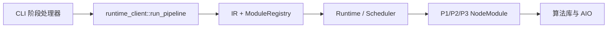

# 阶段 Runtime 与调度实现

本页把[系统架构](../../engineering/architecture/ARCHITECTURE.md)、[Runtime 合同](../../engineering/contracts/RUNTIME.md)和[命名块合同](../../engineering/contracts/PIPELINE_BLOCK.md)连接到实际入口。科学定义由阶段和专题文档拥有，调度代码只组织依赖、资源、服务和执行。

## 1. 生产调用

CLI 入口位于[commands.cpp](../../../lib/infrastructure/cli/commands.cpp)，本阶段资源/IR/运行绑定位于[runtime_client.cpp](../../../lib/infrastructure/cli/runtime_client.cpp)。实际节点在[module_adapters.cpp](../../../lib/infrastructure/scheduler/src/module_adapters.cpp)分派 p1_op_*、p2_op_*、p3_op_*，不是把完整科学流程藏进某个局部 session。

Normalize 有八个调度节点，Mosaic 七个，Export 五个；具体输入输出见各阶段[Normalize](../normalize/modules.md)、[Mosaic](../mosaic/modules.md)、[Export](../export/modules.md)。算法先后由依赖图决定，switch 分支或 descriptor 数组顺序不是拓扑执行证明。

legacy orchestrator 的 DllLoader、run_stage_* 与独立工具构建保留各自身份，不能与当前 CLI 的构建内工厂装配混称。生产没有跨三个命令存活的全局会话。

## 2. 模块计划与对象

ModuleDescriptor 与 ModulePlan 在[module.h](../../../lib/include/acsd/core/module.h)声明。descriptor 描述 ID、端口、schema、单位、坐标和执行类型；plan 报告工作量、估计内存、并行轴、kernel 和 worker 请求。每个工厂返回独占 IModule，实际成员为 descriptor、validate_config、plan、execute、inspect、last_manifest。

[RunContext](../../../lib/include/acsd/core/context.h)提供预算、日志、指标、artifact、取消与 trace。当前 CLI 在 run_pipeline 的栈上构造 ctx，调用同步 Runtime::run 后才离开作用域。节点不得假定可以把该引用保存到下一次命令。

[BlockFrame](../../../lib/include/acsd/core/block_frame.h)是数值块容器，提供块元数据和消费/销毁机制。[DataArtifactDescriptor](../../../lib/include/acsd/core/artifact.h)是描述记录，其 storage 可以定位文件；它本身不持有完整科学模型。目标 typed metadata/模型仓、版本校验与消费者 lease 还需迁移，不以这些类存在宣布完成。

## 3. 生产载体与迁移边界

当前节点跨边仍使用 p1/p2/p3 的 JSON、FITS 或二进制工作对象。工作文件可能是实际科学消费者依赖，不能作为开发快照统一停写。目标是 Runtime 管理的只读对象，必要 spill/cache 经 AIO 绑定 run、frame occurrence、对象与上游版本。

修改一条边时同时核对真实生产者、消费者、descriptor、IR、port registry 和序列化。输出路径存在不证明同版本数据完成；模型 unavailable 也不等于对象缺失或图像损坏。Normalize 的逐边规格见[接口合同](../normalize/contracts.md)，当前差异由[实施地图](../../engineering/architecture/SCIENCE_IMPLEMENTATION_DELTA.md)集中维护。

## 4. 资源、局部性与取消

ThreadBudget/ThreadLease 由阶段预算注入，调度节点和节点内部并行共享授权。租约通过原子预留及 RAII 归还；帧级和帧内两轴按[数据流](../../engineering/architecture/DATA_FLOW.md)分配，不能重复消费同一预算。

内存预算用于控制在途工作集、块大小与回压。缓存必须有容量、身份与失效规则；数据局部性优化只能选择已满足依赖的工作，不能跨阶段共享内存或改变科学次序。可现场求值不表示相应计算已经消除全部密集驻留，峰值与实际 I/O 仍须测量。

CLI 的取消监视线程把外部取消转发到 Runtime::cancel，等待同步 run 返回并 join。内核长调用实际是否可中断按其接口说明；取消信号不允许提前释放仍被任务访问的数组。checkpoint 记录与可持久恢复协议分别说明，不以标记存在推断续跑已经实现。

## 5. 可观测性与错误

运行状态、node manifest、trace、资源读数和正式日志描述真实执行。节点和 provider 归属由上下文的线程本地信息关联；预算配置、授予 lease 和实际忙碌率是不同量。不存在 trace 汇时不能补造观测。

错误经 Result/Error 返回 Runtime，再由 CLI 映射退出码，详见[日志错误](../../engineering/contracts/LOG_AND_ERROR.md)。本页不复制第二份数字表。能力受限、数据损坏、算术不可计算、磁盘写失败和取消分别记录，不用日志警告掩盖返回失败。

开发探针遵循[DEV_MODE](../../engineering/architecture/DEV_MODE.md)和[探针规范](../../engineering/standards/DIAGNOSTIC_PROBES.md)，只观察已存在科学对象，不成为数据边或恢复来源。

## 6. 验证入口与限制

从 runtime_client、公开 Runtime/Module/Context 和实际 NodeModule 分派检查图装载、工厂、计划/执行、预算归还、取消、错误映射、manifest 与 trace。资源实验固定二进制、输入和生效预算，报告工作集、搬运、等待和吞吐；不能预设 locality 策略在任意输入必有固定加速。

本页对真实入口和公开类型作静态核对，没有编译或运行。typed 完成度、全局缓存、内存边界、取消粒度与科学并发等价按实际独立证据说明；source 字段、模块清单和测试名字都不替代该证据。
