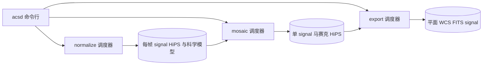

# ACSD 系统架构

本文依据最高设计[1]，定义组件责任、阶段隔离、数据与资源边界。科学量和最终产品由统一科学模型及各专题正本定义[2]；Normalize 的逐节点合同由阶段架构和数据合同细化[3–4]。本文的目标要求与静态可见实现分别说明，不以设计图代替运行证据。

## 命令与产品

ACSD 对外一个命令行程序，提供三个平级命令。每次调用只运行一个阶段，实例化自己的调度器、内存管线和运行上下文；三个命令可独立启动、重跑和检查。其科学主流程由磁盘产品连接：

Normalize 逐帧发布合法球面信号、WCS、光度/PSF/噪声模型、参考精度状态与必要控制数据。Mosaic 内部使用重建精度、背景、排异及支持对象，最终只发布一个 signal 科学图像通道。Export 消费该信号，按目标 WCS 重采样输出普通二维 FITS；单信号输入不提供重建精确方差或协方差所需的信息。

不同设备与通带由用户选择组合。模块报告实际响应、单位、可辨识性及系统失配，不能用仪器或滤镜字符串构造准入条件。无有效 WCS、损坏输入和不可计算数值按正常数据错误处理；原始 FITS 没有 WCS 头时，Normalize 应实际尝试 IPV 求解。

## 组件边界

| 组件 | 责任与数据关系 |
|---|---|
| 命令行 | 解析、加载配置、选择本阶段、事件流、取消与退出码；经 Runtime 驱动科学节点 |
| 阶段 Runtime/调度器 | 构造 typed DAG、管理对象与消费者寿命、资源预算和线程租约、取消及错误传播 |
| 科学模块 | 消费明确输入、计算本主题模型、发布新对象；数学在所属库内共享 |
| 统一 AIO | 图像、模型、manifest 与正式缓存读写，异步队列和原子发布；不拥有科学调度 |
| 模块描述与端口登记 | 描述生产者、消费者和入口；与实际取数及 IR 同步维护 |
| CPU 后端 | 按可用指令与实测画像执行数学等价内核；不决定科学流程 |
| 可观测性 | 正式日志、事件、资源读数；开发探针旁路观察科学输出 |
| Windows GUI | Qt6/MSVC 独立外挂，通过 JSON 与命令行事件交互，复用球面浏览组件 |

上述边界在一个阶段内形成唯一执行平面，不存在跨三个命令持久存活的全局会话。调度实现可复用基础设施，每次运行的预算、对象和状态独立。

[ARS 总体设计](PROCESS_RUNTIME_ARS.md)与[ARS 可编码设计](PROCESS_RUNTIME_DETAILED_DESIGN.md)进一步落实 Frame（所有权和可回滚事务）、Operation（科学语义）与 WorkUnit（CPU 分片）的职责及 Host 服务边界。当前 BlockFrame、静态 NodeModule 和内存压力 governor 尚未完全实现 ARS 目标；迁移时必须保留这一实现差异。

## 阶段内数据与所有权

目标载体为 Runtime 持有的 typed 模型与命名数组块，每个对象有帧/run 身份、类型、版本、单位、坐标、有效性、来源及输入版本。生产者发布后只读；最后一个消费者完成后释放。模块不长期私藏大数组，不读全局配置，不私建无预算线程池，不绕过 AIO 写未声明文件。

科学 spill/cache 是预算管理或明确恢复能力的一部分，须注册身份、版本与原子读写，发布和开发构建一致。开发 snapshot 不作下游输入或恢复来源。正式跨阶段交换仅用磁盘产品和 manifest；模型文件及 sidecar 与 signal 同帧同版本，并由统一 writer 发布。

Normalize 保持八个调度节点：校准、修饰、WCS/IPV、科学源与 PSF、测光、平面噪声、Drizzle 与球面精度完成、writer。WCS 消费校准面；引导源/PSF 消费 cleaned 与已解 WCS；photometry 生成施加一次标度的面，noise 与 Drizzle 消费该面。球面 precision 由 Drizzle 提供同次几何后调用 noise 库完成，不回写上游形成循环。完整字段、端口与不可用状态见[4–5]。

Mosaic 和 Export 的专题步骤由对应科学正本定义，不把现有节点命名或端口表当作数学定义。独立节点可以并行，生产调用序需满足真实因果关系。

## 依赖、资源与平台

依赖从 CLI 经 Runtime 到节点适配器和算法库；算法依赖公开数据合同与统一服务，AIO 和计算后端不反向驱动管线。跨 DLL 采用版本化 C ABI、POD 或 opaque handle，不传 STL、异常与隐含分配器所有权。详细边界见接口与资源合同[6–8]。

一个进程的资源预算由调度器管理，CPU 可用性考虑亲和性与系统限制，帧级与帧内并发共同消费预算。缓存有容量与失效规则，队列有界并具备背压、取消和错误传播。并发度对数值的影响须按预定容差实测，不能凭线程租约存在推断结果等价。

命令行支持 Windows amd64 与 Linux amd64，平台无关科学代码复用。Windows GUI 独立构建，不进入命令行科学目标。Windows 交付安装包，Linux 交付可直接使用的压缩包；内容和发布决定服从最高设计。开发诊断统一由 ACSD_DEV_MODE 编译边界控制，目标与插入规范见[9–10]。

## 静态实现对应与验证边界

源码可见的 Normalize 主入口为 CLI 的 `run_phase1_block`，经阶段 IR 和 Runtime 到 `P1NodeModule::execute`，再分派 `p1_op_*`。适配器表声明八个节点；`lib/phase1_session/p1_session.cpp` 的 io_read/calibrate/cosmetic/io_write 是局部校准会话，不能作为另一条完整产线。

`module_adapters.cpp` 中已存在球面模型与控制点构造、私有 staging，以及 writer 对 `publish_staged_frame_science` 的调用。它们表明实现入口存在；不能仅凭调用证明数据合同所有字段、typed 生命周期、GLS 数学、完整事务和真实产品能力已成立。同阶段仍有正式工作文件消费者，迁移需逐边核对，不能按开发快照统一关闭。

实现位置详见模块地图[11]；差异与证据归因分别见[12–13]。架构维护必须核对实际代码，状态说明可能随实现变化，需要具体调用和独立证据更新。文档检查不执行编译或科学实验，也不声明三阶段端到端已验证。

## 参考文献

[1] [ACSD 最高设计](../../ACSD_DESIGN.md)。

[2] [统一科学模型](../../science/unified/UNIFIED_SCIENCE_MODEL.md)。

[3] [Normalize 生产链架构](NORMALIZE_PIPELINE.md)。

[4] [Normalize 数据合同](../contracts/NORMALIZE_DATA.md)。

[5] [Normalize 接口与迁移规格](../../detail/normalize/contracts.md)。

[6] [C ABI 合同](../api/abi/ABI.md)。

[7] [调度合同](../contracts/SCHEDULER.md)。

[8] [并发标准](../standards/CONCURRENCY.md)。

[9] [开发构建](DEV_MODE.md)。

[10] [诊断探针](../standards/DIAGNOSTIC_PROBES.md)。

[11] [模块地图](MODULE_MAP.md)。

[12] [实现差异](SCIENCE_IMPLEMENTATION_DELTA.md)。

[13] [Normalize 收敛记录](../governance/NORMALIZE_CONVERGENCE.md)。
