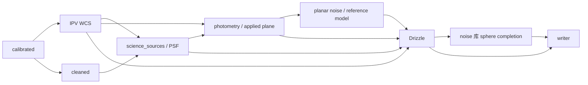

# Normalize 生产链与模块责任

Normalize 将单帧校准观测变为独立 HiPS 信号及可解释的科学模型。科学因果链以阶段一科学正本为准[1]，字段、所有权和发布合同由数据合同规定[2]。本文说明真实调用、目标端口及其实现边界；函数存在、调度连接、已有运行和独立科学支持分别陈述。

## 1. 用户入口与八节点

用户调用经 `lib/infrastructure/cli/commands.cpp::run_phase1_block` 构建 IR，再由 `lib/infrastructure/scheduler/src/module_adapters.cpp::P1NodeModule` 调度实际 `p1_op_*`。八个节点的职责如下。

| 节点 | 实际入口 | 实际数据流与责任 |
|---|---|---|
| calibration | `p1_op_calibrate` | lights/masters → calibrated 积分线性面 |
| cosmetic | `p1_op_cosmetic` | calibrated → cleaned、有效性与修复记录 |
| astrometry | `p1_op_wcs` → `ipv_solve_from_memory_with_callback_d` | calibrated 像元、Gaia、粗指向/尺度 → 逐帧 TAN+SIP 或 unsolved |
| guided sources / PSF | `p1_op_star_psf_impl` | cleaned、已解 WCS → Gaia 引导 science_sources、PSF 参数 |
| photometry | `p1_op_photometry` | 源/PSF 记录、WCS、实际平面与响应拟合 → 标度、photoapplied、photprov |
| noise | `p1_op_noise` | cleaned、sources、photprov → 平面噪声诊断及兼容帧级 SNR |
| Drizzle / sphere completion | `p1_op_drizzle` → `hp_drizzle_run_phase1_hips`；`stage_frame_precision` → `complete_spherical_reference` | 逐帧应用面与 WCS → HiPS；捕获同次交叠 → 局部球面参考模型及 sidecar staging |
| writer | `p1_op_writer` → `publish_staged_frame_science` | 检查 HiPS、发布模型与 frame_science.json、登记逐帧产品状态 |

IPV 内部自行盲检 `solver_detections`，不消费解算后的 science_sources。科学源表在 WCS 已解后使用完整投影；两种候选不能互作替代。原始 FITS 不含 CRVAL/CD 只说明输入头部属性，不能推出 IPV 无法解算。`explicit_config` 与 `ipv` 必须保留不同来源。

`lib/phase1_session/p1_session.cpp::run_session` 只实现读取、校准、坏点和校验写出，并将其余科学域标为 unavailable。它是局部会话/兼容 facade，不是另一条完整 Normalize 生产链。

## 2. 因果依赖与现行载体

图中是合同要求的科学依赖；sphere completion 在 Drizzle 节点内调用 noise 库，不增加调度环。当前 `p1_*_descriptor` 已声明 WCS→sources/photometry/Drizzle、photprov→noise/Drizzle、sources/SNR→Drizzle 等排序边。但跨节点取数仍读取工作区 `p1_wcs.json`、`p1_sources.json`、`p1_phot.json`、`p1_snr.json`、平面 FITS 和逐帧 `p1_stack.json`。声明 typed port 并不等于这些边已承载 Runtime 类型对象。

光度实际读取 sources 所指的 cleaned 面，descriptor 仍声明 calibrated；光度施加与 Drizzle 选面还须按逐帧 provenance 核对。noise descriptor 的 `fluxes` 仅用于合成 IR，生产 noise 没有对应读取点。独立 `psf` 输出尚无完整显式消费者；部分参数随 sources 工作文件传递。球面 precision 经 Drizzle 局部向量与 staging 传给 writer，descriptor 与实际 CLI IR 已补 frame_science 输出/输入边；载体仍是 output_dir 工作文件，不等于 Runtime 已传输完整 typed 模型或完成消费者 lease。

目标是 Runtime 管理、发布后只读的有名对象；路径仅用于 AIO spill、正式缓存或产品定位。对象键绑定 run、输入 occurrence、对象类型、revision 与输入版本。`BlockFrame`/`RunContext` 的数值块和 artifact 服务可复用，但当前没有完整的 metadata/model typed 对象仓和消费者 lease。具体接口及逐边迁移由实现规格承载[3]。

## 3. 算法所有权与完成边界

| 对象或计算 | 所有者 | 生产与消费边界 |
|---|---|---|
| `AstrometrySolution` | IPV 与 WCS adapter | 校准像元求解；下游只消费本帧解及 SIP，不重新求天测 |
| `ScienceSourceCatalogue` / `EffectivePsfModel` | detection / PSF | 完整 WCS 引导测量；photometry、noise、Drizzle 使用相同模型身份 |
| `PhotometricSolution` / `PhotoAppliedPlane` | photometry | 逐帧响应、标度、实际应用身份；随机协方差按二次幂变换 |
| `ConditionalNoiseModel` / planar reference | noise | 应用后平面的条件噪声；原生 gain 与数组单位分开 |
| `DrizzleObservation` | Drizzle | 实际 WCS、面积、算子 R、支持与 AIO staging；不另造近似几何供 precision |
| `SparseReferencePrecision` / frame summary | noise 的 sphere completion | 用同次 R 形成 h、C、Z，计算局部 V_F、SNR 和条件 transfer |
| `FrameScientificProduct` | writer / 统一 AIO | 唯一正式 sidecar、模型引用、哈希、信号与运行清单 |

`lib/include/acsd/normalize_data.h` 已声明参考、状态、控制点和摘要等类型；`lib/algorithms/noise_snr/include/acsd/sparse_reference.h` 与其实现已有球面 GLS；`lib/algorithms/integration/normalize_science/` 已有 serializer、reader 和发布函数。不能继续将这些接口统称为未实现，也不能由它们的存在推断完整数据合同已满足。

当前 canonical 可执行参考路径为 `explicit_linear_flux`。`parse_reference_config` 对 `sed_response` 明确记录响应积分未接线；逐帧 response/SED 与 Runtime 完整迁移仍受实现限制。PSF 已从逐帧 psf_params 构建空间三角模型，逐控制点求积；无三角支持时仍回退具名帧常宽度。空间alpha已按窗口求值并有真实applied运行记录。当前模板改用位置alpha_star约定，支持空洞、回退状态与科学总通量定义仍需核对，不能把新接线等同完整合同。实际限制及可追踪符号集中在差异地图[4]，不在本页复制待办台账。

## 4. 产品发布与能力状态

每个合法 signal 是独立帧产品；precision 的 availability 为 available/unavailable，available 对象另记 accuracy=conditional_complete|approximate|upper_bound；各字段由数据合同规定，不能把未建模误差当零。缺 WCS 不发布伪球面图；缺参考或 PSF 只限制相关精度能力。运行清单应枚举所有输入 occurrence 和逐帧原因，保留可用帧且准确报告集合完整性。

现行 Drizzle 已直接写 HiPS；precision 模型与 sidecar 先写工作区 staging，writer 再调用统一发布函数。该实现具有模型文件哈希核对、sidecar 原子写及回读，但不等于“signal、全部模型、sidecar、完成 manifest”已形成一个完整事务。正式目标仍是 writer 在所有 AIO 完成后统一发布；发布失败、损坏输入和合法 unavailable 必须分开。[2]

阶段一可有必要的 support/variance/ivar 辅助数据；阶段二最终只发布 signal，阶段三只导出信号 FITS。这不要求阶段一删除物理模型或制造第二份 canonical 精度真源。

科学 spill/缓存属于正式数据流，不能由开发开关关闭；snapshot/perf 是只读旁路。根 CMake 已将相关探针子项由 `ACSD_DEV_MODE` 派生，不能再据保留的兼容 option 名称认定其能独立激活。运行等价和误差仍须依实际证据判断。

## 5. 证据的解释范围

已有验证日志直接调用生产 GLS 源，覆盖异方差、背景 nuisance、秩亏、非平凡标度和 Monte Carlo，支持所给合成条件下的局部数学行为[5]。它没有运行当前全部 CLI、真实逐帧响应、空间 PSF、独立模型 reader 和完整发布事务。已有原始头无 WCS 的单帧 IPV 记录证明该次尝试发生且产出解；拟合内点残差不等于独立留出误差，也不代表全部输入成功率。文档、静态接线、已有运行和独立支持的区别由收敛说明维护[6]。

## 数值与模型载体的模块责任

条件协方差允许用 CSR(R) 与源像元方差 v 的精确因子表示 C=R diag(v)Rᵀ，不要求每控制点默认写稠密矩阵。该精确性限于已声明的平面独立条件模型；共享母版、标度和修复相关项仍需独立表达。`local-factor/v2` 分别保存源方差与派生球面协方差的 shape、线性单位和 sr 幂次，reader 验证真实载荷；字段由数据合同拥有[2]，接口由实现规格细化[3]。

像元积分 PSF 由 `lib/algorithms/psf` 提供；适配器传位置、参数和像元足迹，不能另存未归一中心轮廓。噪声库从同一 R、P、v 和背景模型计算可辨识的通量分量。数值求解可以使用可靠 QR/SVD 或等价子空间实现，不能为了加速静默截断选定叶的真实随机贡献。逐点模型与帧摘要分别记录，科学状态不由求解器成功标志代替。

生产已具备逐输入响应绑定、QR 投影、像元积分 PSF 和因子 v2 的实现路径；当前真实覆盖与剩余差异统一见[实施地图](SCIENCE_IMPLEMENTATION_DELTA.md)。typed Runtime、参考 SED 积分、空间模型的支持/误差状态、applied 空间 alpha 的真实运行和共同误差分别核对，不从局部数值修复推断八节点整体闭合。独立审查与运行记录保留在收敛文档[6]及其引用的实验单元，不在架构正文复制历史耗时和 SNR。

## 参考文献

[1] [Normalize 科学正本](../../science/normalize/NORMALIZE_SCIENCE.md)。

[2] [Normalize 数据合同](../contracts/NORMALIZE_DATA.md)。

[3] [Normalize 接口实现规格](../../detail/normalize/contracts.md)。

[4] [科学设计与生产源码差异地图](SCIENCE_IMPLEMENTATION_DELTA.md)。

[5] [局部 GLS 与 Monte Carlo 验证记录](../../../实验/normalize-precision-p5/evidence/ROUND1_VERIFY.log)。

[6] [Normalize 设计与证据收敛](../governance/NORMALIZE_CONVERGENCE.md)。
