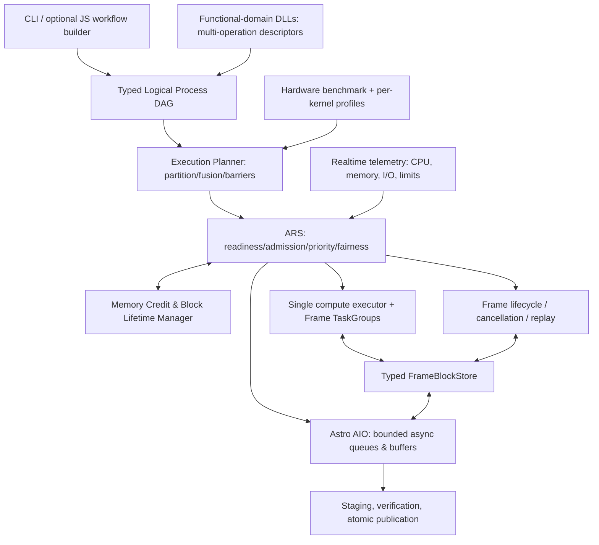

# ACSD Process Runtime 与自适应资源调度（ARS）架构设计

**性质：目标工程设计；非已实现能力声明。** 适用：Normalize、Mosaic、Export 三个独立 CLI 科学命令，共用实现库而不跨命令共享活跃内存。本文承接 [最高设计](../../ACSD_DESIGN.md)、[系统架构](ARCHITECTURE.md)、[统一科学模型](../../science/unified/UNIFIED_SCIENCE_MODEL.md)、[Runtime 合同](../contracts/RUNTIME.md)、[Block 生命周期](../contracts/PIPELINE_BLOCK.md)、[异步 I/O](../contracts/ASYNC_IO.md)、[原子发布](../contracts/ATOMIC_PUBLISH.md) 与 [所有权](../contracts/OWNERSHIP_LIFETIME.md)。工程拆分和迁移见 [实施路线](PROCESS_RUNTIME_IMPLEMENTATION.md)；v2 C ABI、typed IR/store、MemoryCredit 原子转换、取消状态机、AIO ticket、revision 提交、调度伪代码与反例的函数级目标设计见 [ARS 可编码详细设计](PROCESS_RUNTIME_DETAILED_DESIGN.md)。科学算法及估计量以科学正本为准，本文不改写算法物理定义。

## 1. 动机与预期边界

ACSD 同时追求：PixInsight 风格可组合的科学 Process；跨 DLL 的标准数据与 Host 服务；用户可用 JS 风格脚本定义三阶段及新工作流；Normalize 的帧级流水与帧内并行；Mosaic 的全局模型与局部 tile 混合异构并行；基于操作资源声明、整机 benchmark 和实时反馈的高吞吐调度；有界内存及可恢复的整帧进度牺牲；异步 Astro AIO 不长期占据 CPU compute worker。

独立原则：
- **Frame/Execution Transaction 是内存所有权与回滚粒度**：每帧 Block 流水线有独立可取消上下文；内存压力时可以放弃该帧**全部尚未正式提交的处理进度**，释放后从可靠输入重算。资源调度不得永久从科学输入集合中删帧。
- **Process/Operation 是科学语义粒度**：独立输入、输出、参数、单位、坐标、有效性、版本、数值规则。一个功能域动态 DLL 可导出多个 operation；不得将 DAG 节点等同于 DLL。
- **Work Unit 是 CPU 执行粒度**：Process 内部可以按 source、row-band、tile、stripe、batch 并行切分；work unit 不自动成为科学产品或恢复事务。
- **Runtime 是唯一全局编排及资源授权者**：模块不私建永久 worker 池，不绕过共享内存账本与 AIO，不因观测压力改变科学权重、物理模型、输入有效集合或数学归约要求。
- **性能目标为最小端到端墙钟/最大稳定吞吐量**，前提是科学等价、安全上界和有限资源约束。CPU 利用率是诊断，不是唯一优化目标；I/O 带宽不足时 CPU 不可能被无界缓存强行维持满载。

## 2. 分层架构



CLI 仍仅有一个 `acsd` 可执行入口，支持三个独立命令。每次命令建立单独 Runtime/资源账本；JS 工作流是声明/编译层，不负责逐像素热路径，不直接操作调度器线程。先支持既有 JSON IR 的受控兼容转换，脚本逐步替换 CLI 硬编码的模块组合。建议**静态主体 DAG + 受控动态子图**：例如 WCS 重试或自适应计算可根据数据派生子任务，但须声明上限、类型、幂等/取消与科学依赖；不允许执行中自由修改已提交数据的依赖。

DLL 只通过版本化 C ABI 和 Host 服务交互。公共科学对象借用、CPU executor、内存 credits、AIO、Gaia/星表及 CPU Provider 均由 Host 注入；科学 DLL 间的数据交换经 typed Runtime，不通过隐藏磁盘路径或跨 DLL 的 STL/allocator。共享**纯数学内部库**可独立复用；不得在不同 DLL 中复制拥有状态的 AIO、CFITSIO、目录缓存等基础设施。

## 3. 标准 Process/Operation 合同

每个动态 DLL 使用稳定 module_id、版本、build digest，枚举多个 operation_id。每个 operation 注册：
- 科学面：typed input/output ports（schema_id、shape、dtype、unit、坐标/像元原点、optional/status、模型/有效域）、参数 schema、determinism、数值误差约定和科学依赖。
- 执行面：`plan(input_metadata, config)` 以**真实输入尺寸**估算 work units、并行轴、临界/串行段、最大有效并行度、读写字节量、固定/可变/按 worker 的内存、scratch、输出与 staging 峰值；允许明确表示估算不确定，绝不将 unknown 当 0。
- 能力面：`partition` 描述物理 work units；`execute` 使用只读输入借用与预先授权的输出/暂存缓冲；`reduce/commit` 固定数学合并语义；`cancel/checkpoint_safe` 声明本操作安全点；可选 kernel/provider 画像和允许的 in-place/fusion 条件。
- 服务面：Host V2（版本协商）提供 buffer/typed-object/map/read/write、alloc/free、work submission、cancel、metrics、AIO、Gaia、CPU kernel provider。ABI v1 可暂留适配，不能擅自改变已部署的 v1 struct 布局。Host/DLL/module-instance/异步借用的寿命必须相容。

`plan()` 不应执行科学计算或暗中读取未声明文件。真实计划与最终实测（RSS、bytes、CPU、I/O、worker grant）分开记录。科学参数属于脚本/IR，机器绑定策略属于 Runtime/profile；不把机器调优参数写回科学 config。

## 4. Frame–Block 生命周期与整帧事务

一帧 `FrameExecution` 绑定 `run_id/input_occurrence/frame_id/attempt_id`，持有不可变 Block 版本及其已知消费者、科学元数据句柄、CPU TaskGroup、MemoryCredit、AIO tickets、取消令牌和发布状态。状态至少包括 `QUEUED -> ADMITTED -> RUNNING -> PUBLISHING -> COMMITTED` 与 `RUNNING/PUBLISHING(uncommitted) -> CANCELLING -> QUIESCED -> RECLAIMED -> RETRY_QUEUED`；非资源错误单独记录。

Process 消费旧 Block 并创建新 Block，**新旧块与 scratch 在计算期间可能同时存活**。旧 Block 仅在它所有真实消费者（包括异步 I/O）释放 read lease 后销毁。生产者先将完整有效输出发布到本帧的只读版本表，随后释放失效的输入；失败时不暴露半成品。真实分支依赖（WCS、PSF、phot、noise、Drizzle）通过消费者引用而非节点顺序决定旧块寿命。复合模型不强行塞入单个浮点数组：typed metadata/model handle 与数值 Block 同属本帧生命周期。

操作内部的 work unit 可分片、窃取、融合，但**压力恢复仅以整个未提交 FrameExecution 为回滚事务**。资源回收顺序：
1. 锁定待牺牲 attempt，不再派发此 attempt 的新任务与写入；
2. 协作取消，在已定义安全点退出所有在飞内核；同步等待 TaskGroup 静止；
3. abort/drain 属于该 attempt 的 AIO tickets，等待 DMA/OS I/O 与借用完全收尾；
4. 放弃私有 staging/临时模型/Block/scratch，归还实际保留的 credits，记录回收字节和重算代价；
5. `RECLAIMED` 后把原始输入 occurrence 原样排队重算，并采用降低峰值的执行计划；避免无限反复牺牲。
**选择 victim 不是内存已释放的证明**，且不允许对已发布对象、共享模型或其他 Frame 持有的借用提前 free。

Mosaic 的全局背景模型、共同统计、积分累加器不能被伪装成每帧私有状态。**跨帧共享的 committed 对象归 Run/Global Execution 所有**；只可回滚尚未合入全局结果的帧私有尝试。并入前必须保证副作用隔离，或提供严格证明的补偿/重放；默认对不可逆全局合并禁用 victim 选择。不能因内存紧张直接删除科学输入帧或已经合入的科学贡献。Export 采用产品执行事务，而非假造原始观测帧语义。

## 5. 全局内存账本与安全准入

每个 Runtime 有单一 `MemoryCreditManager`。大数组、scratch、AIO buffer、cache、output staging 和共享模型必须经授权管理；账本区分 `owned_live`、`reserved_not_allocated`、`reusable_pool`、`borrowed`、`external_overhead`（不能重复计算同一物理分配）。共享 Block 只在一个 owner 账本计费，多个 read lease 不重复占用实际字节数。

定义随时可收紧的安全预算 `B_safe`，综合 OS/容器/Job 限额、进程已提交/物理内存、外部内存竞争、不可控第三方峰值及紧急保留空间。受管对象满足：
```text
owned_live + reserved_not_allocated <= B_safe
transition_need = new_output + scratch + extra_per_worker + AIO_hold
```
旧输入尚需借用时仍在 owned_live 中。**预算只计算增量**：不能把现有输入在新任务估算里双计入，否则虚假限流。实际分配和估算偏差须单独观测。OS RSS 不一定随着 pool free 立即下降；可复用池额度与物理 RSS 分别统计，避免误判。

任务从 `ADMISSION` 原子取得后继计算所需的 credit 才能开始；不足时优先缩小并发宽度/暂存窗口、暂停新帧准入、回收可淘汰缓存。不能因为没有在途任务就**绕过预算**派发大块，未知估算不能自动解释为零；无法推进则尝试受支持的更小切分或受控失败，而不是制造 OOM。需要为至少一个已准入帧的下一个合法 Block 过渡和收尾保留可推进额度，防止“所有帧装得下、下一步都装不下”的僵局。

紧急压力动作分层：NORMAL 增加高价值工作；PRESSURE 缩预取、停新增大帧、降 scratch 和回收 cache；CRITICAL 立即停止危险分配并发出整帧取消；RECOVERY 使用滞回与更保守计划恢复。普通波动按持续时间与 hysteresis 判定，硬阈值危险无需等待多 tick。探针失效时采取**保守、可解释**的准入预算或资源不足错误，不能将 fail-open 作为 OOM 安全保证。

无法提供绝对 OOM 不发生的承诺：外部进程、内核、第三方 allocator、突发 cgroup 变化均可能突破用户态预测。辅以 Linux cgroup/PSI、Windows Job Object/内存通知与可预留 emergency pool，测试受控的 OOM 风险降低与失败恢复。

## 6. CPU/I/O 资源模型与调度策略

CPU 计算池由 Runtime 唯一持有。work unit 有 `run/frame/operation/attempt` 身份、估计时长、实际已借 credits、有效并行上限、数据局部性及取消点。worker 空闲时动态领取已满足 typed 依赖的工作；模块若仍有内部 OpenMP，则必须在同一租约内执行，禁止二次超额订阅。实际 grant、等待、阻塞和计算时间须记录，不能把配置的线程数冒充有效工作量。

ARS 每次关键事件（task/object/I/O completion、释放内存、取消、输入到达）更新 ready queue，周期性采样 OS 资源。候选优先级结合 critical path、预计 CPU 时间、可用并行宽度、增量 memory/cost、I/O pressure、数据亲和性、重新计算代价及 aging/fairness。**先判科学依赖和严格内存准入，再进行收益排序**。可采用可解释启发式、运行时在线校正，初期不引入缺数据支撑的机器学习。不会因为 CPU 低于某固定百分比机械增加线程。

整机 benchmark 不是一个分数：应区分 CPU compute、memory bandwidth、SIMD backend、tile size/核数曲线、AIO 读写带宽与延迟、压缩和并发干扰；使用输入/版本/平台有效域和置信度。不同 operation 的 `T_k(work, workers, bytes, cache, ISA)` 与 `M_k(workers, inflight)` 由 benchmark 初始化并在实际运行中校正，科学数值不由 benchmark 修改。不同机器有各自的实测画像和保守回落。

## 7. Astro AIO 与慢磁盘的背压

CPU compute worker 只负责提交异步读写意图、传递持有 lease 的 immutable buffer，并继续执行可运行工作；磁盘等待、文件句柄操作和 I/O completion 位于 Astro AIO 独立、有界通道。Linux 可选择 io_uring / 受控线程后端，Windows 可选择 Overlapped/IOCP / 受控后端，具体依实际文件系统能力和兼容性选择；压缩、校验、FITS/HiPS 编码若消耗 CPU，按 CPU 任务预算计费。

I/O buffer、预取缓存、待编码 tile、队列条目与在飞请求共同计入 MemoryCredit。**队列有界不等于总内存有界**；每次提交须先取得 I/O buffer/slot credit，完成、取消收尾或失败后释放。优先借用或所有权移交，不必再次拷贝整幅图像；如果数据已复制至独立 AIO buffer，原 Block 可在其最后消费者释放后回收；若为零拷贝借用，则持续 pin 到 I/O 完成。

如果生产速率长期大于写入带宽，任何有限 RAM buffer 都必定填满。ARS 根据写队列积压、耗时及未来 credit 占用调整预取和产出任务并发，优先分派不受该 I/O 路径阻塞的科学任务；无独立任务时允许 CPU 空闲，决不以无界缓冲追求虚假的满载。

产品以私有 staging 提交，必须完成 I/O、必要的持久化、模型/sidecar/索引一致性校验后发布完成标记。HiPS 多文件产品的提交不是“每个文件单独 rename 成功”就等价事务；读者只能消费 manifest 指向的 complete revision。取消/失败保留可诊断的不完整状态，不得以文件偶然存在当作依赖完成。

## 8. 各阶段的具体物理计划

### Normalize
每个观测帧拥有独立 FrameExecution 与 FrameBlockStore。按科学依赖形成 WCS/IPV、Cosmetic、science_sources/PSF、Photometry、Noise、Drizzle/spherical precision、Writer 的帧内 DAG；独立帧构成 wavefront，帧 A 可进入 WCS/PSF，而帧 B 仍在 calibration。帧级任务与帧内 source/pixel/row-band 共享 CPU 租约，内存紧张时优先让已驻留帧取得下一步过渡 credit，以释放旧 Block，然后再引入新帧。共享 Gaia/master 与校准模型使用有边界的只读 cache。
一帧最终的 signal、WCS、PSF、响应、噪声和 spherical reference precision 等满足最高科学设计的所有来源与精度状态，并统一由 AIO 发布。整帧重算不得导致 frame_science / signal 版本混杂。

### Mosaic
全局 coverage、连通分量背景/UPM 模型、条件权重统计与本地 tile 任务拥有**不同依赖范围**。必要全局求解完成并发布 immutable model revision 后，可高度并行消费 tile。每个输入帧的局部可取消尝试同其 Run 共享模型显式分离；已经合入全局不可逆状态的贡献不能借“整帧重算”重复累加。浮点归约由数学合同决定固定次序，不能因为 task 完成先后改变权重、reject 资格或天区。延续最终只发 signal 科学图像通道，内部统计、模型和 provenance 明确载体。

### Export
可按输出 WCS 区域/子块调度并重采样，采用有界输出写队列和一致发布事务；其取消对象是导出 transaction。不得因 Runtime 统一而强行施加原始观测帧生命周期。

## 9. 现有实现的已知差距（2026-10-16 复核）

- `lib/infrastructure/cli/runtime_client.cpp` 组装阶段特定的静态 module_id；`module_adapters.cpp` 为巨大 C++ 节点适配器，CLI 的生产科学主路径未改为动态 DLL 执行。
- `lib/include/acsd/abi/module_api_v1.h` 是 module 级一个 descriptor；虽有 declarative `module_ports.registry.json` 的 operations，但 runtime v1 ABI 尚非标准 operation 级执行与 typed ports 实现；当前 module_entry 仍有 Base64/JSON 大数据传输路径。
- `lib/infrastructure/scheduler/src/scheduler.cpp` 的 `heavy_gate` 与节点级派发限制并行，内存回压在无在途节点时存在绕过预算的保推进路径。
- `lib/infrastructure/scheduler/src/memory_pressure.cpp` 实现 RSS 滞回和低进度帧牺牲，但治理不可判定时可 fail-open；标记 victim 不能证明该帧实际停止、释放或可重算。
- `lib/infrastructure/scheduler/src/block_frame.cpp` `BlockFrame::create` 只检查单块/单帧上限，未统一原子 MemoryCredit；`StageBlockFlow::run_unit` 在收集产品时执行新建及整块复制，应优先零拷贝转移所有权。
- `lib/include/acsd/abi/artifact_api_v1.h` 仅有打开、`read_all` 和 manifest 查询，缺少 typed view/ownership leases、写入/提交、分块借用与内存额度接口。
- `lib/infrastructure/aio/src/aio_pipeline_engine.cpp` 仍有旧块自动丢弃及自己的批量线程模型；科学模块 DLL 重复编译部分 Calibration/AIO/CFITSIO 依赖闭包，妨碍统一服务所有权。
- `lib/infrastructure/benchmark/backend_host/worker_advisor.cpp` 与 `plan_estimator.cpp` 已有有价值的资源模型，但未成为贯通所有 operation、Runtime、真实分配和自动复算的统一闭环。

以上为源码静态核验，不宣称已构建、运行或证明 E2E 通过。主线由其他 Agent 并行推进，实施前应重新定位最新代码与提交。

## 10. 科学与工程不变量及验收

1. 给定相同科学输入 occurrence、模型版本和配置，调度仅影响执行时序；不可改变已选择的数据集合、通带/物理单位、WCS、PSF、SNR/方差统计量与用户混合决策。浮点执行改变时采用专题事前声明的误差界与确定性归约，不能笼统承诺逐位一致。
2. 任一受管 Buffer allocation 必须先有 credit；引用者和异步 I/O 未结束不得销毁物理载荷，不能跨 DLL allocator/free。Frame 重算以 attempt 隔离，旧 attempt 输出不会被新 attempt 误消费。
3. RAM/磁盘/线程资源未知时采取明确保守策略；执行可重排/缩小/等待/受控失败，不静默超预算。必须分别证明用户态受控分配的严格额度，以及 OS 级近 OOM 时的尽力保护，不能给绝对 OOM 不发生保证。
4. 取消必须真正 quiesce CPU 与 I/O，确保 staging 不成为 complete 产品；释放成功后才允许重分配原 credit。已 commit 的全局 Mosaic 贡献不可再次重放。
5. 核对端到端吞吐、allocated/granted/busy CPU、RSS 与 ledger、peak vs estimated 的偏差、I/O buffer 占用与写完成、cancel/retry 损失、校验/压缩 CPU 用量。需有“慢磁盘、外部内存侵占、不同尺寸帧、缺 WCS、AIO 失败、崩溃恢复”独立实验和真实科学链对照。

## 11. 参考实现入口

- `lib/include/acsd/core/{block_frame.h,context.h,executor.h,scheduler.h,plan_estimator.h,memory_pressure.h}` 与对应 `lib/infrastructure/scheduler/src/` 实现。
- `lib/infrastructure/pipeline/module_ports.registry.json`、`typed_dag.py`、`module_loader/{module_registry.c,secure_loader.c}`、`lib/include/acsd/abi/{module_api_v1.h,host_api_v1.h,artifact_api_v1.h}`。
- `lib/infrastructure/cli/runtime_client.cpp`、`lib/infrastructure/scheduler/src/module_adapters.cpp`。
- `lib/infrastructure/aio/`、`lib/infrastructure/benchmark/backend_host/`、`eng/packaging/config/runtime_resources.json`。
- [工程资源模型](../resources/PERFORMANCE_MODEL.md)、[数据流](DATA_FLOW.md)、[实验与验证](../testing/TEST.md)。

本文是统一目标设计，旧 ABI 和科学实现由分阶段迁移兼容，并不是在本次文档提交中已经变更。
