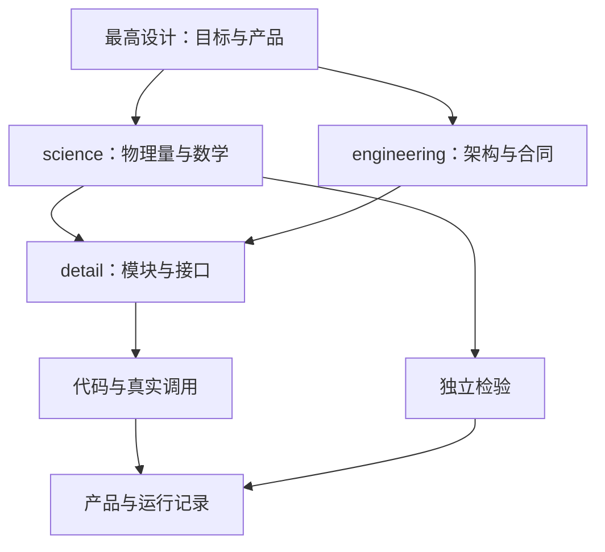

# 文档维护、协作与证据

本文落实[最高设计](../../ACSD_DESIGN.md)的设计分层和可复核要求，统一文档归属、写法、协作、索引与追溯。研发质量通过明确设计、实际实现与独立证据保证，结构检查用于发现问题。

## 一份定义，按职责展开

science 与 engineering 同级。前者拥有被估计量、符号、单位、假设、公式和适用域；后者拥有组件职责、数据类型、接口、生命周期及工程行为。detail 说明如何落实到公开头、函数、生产者与消费者。README 和[文档索引](../../DOCUMENT_INDEX.yaml)只提供阅读路径；登记状态不说明科学验证程度。

一个主题只有一份正本。其它文档解释上下文时引用正本，不复制可独立演变的定义。机器 schema 描述可读写形状，不能以其冻结措辞推翻科学定义。实验与研究稿说明特定条件下的证据，不另立生产合同。

## 阅读、协作与变更

先读最高设计，再通读任务对应的科学、工程与模块文件，涉及实现事实时沿真实入口读到消费者。修改文档也应读上层和同主题其它正本。脚本可以建立文件清单和定位符号，语义判断仍需阅读。

科学与架构负责人维护统一模型和正式定义，给出明确模块所有权与 typed 数据合同；执行者按规格实施并记录命令、输入、输出及未覆盖范围。委派任务应点名先读文件、目标、写入范围和所需证据。没有读清的科学冲突先记录，由负责人统一处理。

协作按具体文件划分，写同一文件前协调顺序；保留他人工作，不重置或覆盖未整合修改。分支、提交和推送遵循用户当前授权，[根协作约定](../../../AGENTS.md)记录本次工作方式。实验任务包用于组织一次实施，不自动获得持续执行权。

模型变化需要一手依据、独立反例或实验支持，先统一科学定义，再同步合同、实现与测试。保持数学行为的重构应对照相同输入和估计量。一般路径修正、接口说明和已授权实施直接完成，不新增登记审批。

## 正式文档怎样写

开篇说明主题和上层依据，再解释问题、关键机制及边界。正文使用连贯技术语言，图、公式、接口表服务于理解，不为满足模板堆空章节。

| 文档 | 必须解释的内容 |
|---|---|
| 科学分册 | 问题与目标量、符号与单位、前向模型、假设与可辨识性、必要推导、数值算法、误差和失效域、独立验证及参考资料 |
| 工程架构与合同 | 职责、依赖、生产者/消费者、字段与载体、所有权/寿命、并发/资源、错误/取消、持久化与兼容 |
| 模块说明 | 真实入口和调用方、公开签名、输入输出、单位/坐标/原点、资源所有权、错误/异常、线程安全、配置与测试入口 |
| 排障与证据 | 症状、输入身份、复现、统计分母、预期与读数、失败原因、适用范围及实际代码 |

常数应有值、单位、来源和适用条件。可从几何推导的量给出关系，经验参数说明标定范围。缺测误差记为缺项，不能填零。接口说明区分实际签名和目标接口，不以相似名称推断调用或单位。

正式正文不堆日期、提交号、任务流水、裁决过程或历史状态；API/schema 标识及文献出版信息按技术意义保留。每个目录的 README 用一两句说明内容和入口。运行数据写配置声明的目录，真实观测大文件只读引用。

## 引用与路径

仓内引用用相对 Markdown 文件链接，正文直接链接到拥有定义的文件。学术引用给作者、题目、出版信息与 DOI 或稳定地址；阅读原文确认其支持的数学量、假设与范围。源码证据给实际路径、符号和必要行号，符号存在不能证明本次运行命中。

模块说明沿 CLI、调度器、适配器、算法和 I/O 追到真实消费者。库、独立工具、兼容会话与生产路径分别标识；同一合同可以被多个模块使用，一个模块也可以实现多种合同。既有 ID 的拼写以其登记来源为准，未找到定义就记缺口，不制造占位 ID。机器合同导航见[合同登记](../../../eng/contracts/data/contract_index.yaml)。

Normalize 依[生产架构](../architecture/NORMALIZE_PIPELINE.md)、[数据合同](../contracts/NORMALIZE_DATA.md)和[接口规格](../../detail/normalize/contracts.md)对照。descriptor、IR、端口注册和实际取数必须一起核对；排序边存在不等于 Runtime 模型已传输。

## 实验与证据范围

| 可陈述的事实 | 所需依据 | 仍不能推出 |
|---|---|---|
| 目标已定义 | 正式设计和合同 | 代码已实现 |
| 代码存在、静态可达 | 实际符号与调用链 | 本次运行命中 |
| 构建或测试执行 | 环境、命令和输出 | 未测输入域也正确 |
| 运行产生可读产品 | 输入身份、命令、实际产品 | 全部科学量已独立验证 |
| 独立科学支持 | 解析参照、外部实现、仿真或重复观测 | 遗漏系统项或其它适用域也成立 |

这些事实可以并列报告，不是审批阶梯。自写自读、相同公式往返、字段一致、测试数量和退出码不能替代独立真值。查阅历史报告需说明其源码、构型及证据限制，未运行就写未运行。

实验记录保留输入来源与哈希、代码身份、环境、复现命令、输出、样本量、单位、分母、失败过程和局限。阶段分析从运行及帧产品清单枚举输入，几何取自产品；核对同次运行、同一天区，缺几何逐帧登记，天区不符的分析无效。

失败尝试、撤回结论、文字/JSON/脚本留在单元内，整理不覆盖原始过程；大体积二进制中间量可按磁盘需要清理并保留再生依据。HST 成品可作结构模板，其处理噪声不冒充原始探测器噪声。

## 索引、归并与检查

索引覆盖当前 Git 跟踪的 `docs/` 文件，路径唯一，职责和上游可解释。新增、移动、合并或删除时同步树、README、链接及索引。索引不用手抄易失真的引用计数，也不承担准入或发布控制。

归并先明确有效内容的新归属，保留必要公式、接口语义与参考资料。历史实验原文保留，通过处置记录和迁移路径解释其引用。全仓重构范围从 Git 文件树枚举，不能只依索引推断。

自动检查适合发现重复 YAML 键、索引差集、失效路径、重复条目和链接；报告扫描范围和排除项。检查通过只说明结构一致，不能证明科学正确。文档变更按影响选择验证，无须为纯路径整理跑科学程序。

## 问题与后续工作

问题记录给具体原文、依据、分歧、影响及所需证据。已由正本确定且可直接修复的事项属于实现工作，记录在[实施差异](../architecture/SCIENCE_IMPLEMENTATION_DELTA.md)。尚缺输入或设计取舍的事项见[未决登记](UNRESOLVED.md)。

文档整理中需重新推导的数学、科学问题集中在[研究问题记录](../../../实验/documentation-refactor/docs/SCIENTIFIC_QUESTIONS.md)，标明待推导和待核实，不把疑点写成已证伪，也不通过修辞宣布实现缺陷已解决。发布与用户视觉验收由项目负责人决定。
