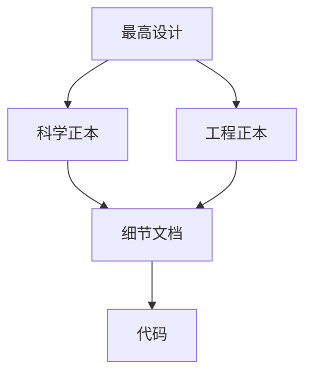

# 文档治理规范

本文落实最高设计的文档权威、唯一正本和持续维护要求[1]，规定文档归属、引用、索引与订正方式。文档应让读者判断设计的依据、实施边界和证据强度；检查用于发现问题，不构成研发审批条件。

## 权威与职责

最高设计定义用户目标、阶段产品和顶层边界。science 与 engineering 是同级一级正本：前者定义被估计量、公式、假设和适用域，后者定义架构、数据合同、接口与工程行为。detail 说明这些定义怎样落实到模块和调用点。索引与 README 提供导航，其登记状态不改变正文的权威层级。

同一主题由一份正本拥有。跨主题文档可以解释上下文，但应引用该正本，不另立通带、WCS、SNR、误差模型或产品政策。Normalize 的科学、工程与数据合同分别由对应正本拥有[3–5]。实现登记、机器 schema 和实验结果不能反向改写科学定义。

## 阅读与修改

实施前通读最高设计，再读本主题的 science、engineering 和 detail；涉及实现事实时阅读真实入口与消费路径。派单应明确这些文件和允许写入的范围。回报应列实际阅读文件、采用的关键定义和未覆盖范围。

修改沿依赖关系展开：先确认上层与同主题正本，再修订负责该主题的正文，随后同步受影响的细节、引用和索引。发现上层内部矛盾或独立数学反例时，记录分歧、证据、影响与所需裁决；在定义明确前不让各实现自行选择模型。一般路径修正、接口说明和已授权实施无需另设登记审批。

协作以具体任务的文件分工为准；写入同一文件前协调，保留其他执行者的修改。协作边界见[6]。

## 文档与证据的落位

| 内容 | 位置与职责 |
|---|---|
| 顶层用户目标与产品边界 | `docs/ACSD_DESIGN.md` |
| 科学定义与推导 | `docs/science/` |
| 架构、合同、标准与 GUI | `docs/engineering/` |
| 模块、数据对象与接口实施 | `docs/detail/` |
| 文档地图 | `docs/DOCUMENT_INDEX.yaml` |
| 可执行 schema、配置与工具 | 各自工程目录，由负责的人读合同引用 |
| 实验方法、试错、命令与读数 | 各实验单元的文档与代码目录 |

正式设计正向说明现行机制，开头不放元信息块，正文不堆日期、提交标识、任务流水或沿革。技术 schema 标识、软件字段和真实文献出版信息按其语义保留。实验过程和收敛记录具有证据身份，允许保留其复现所需的时间、输入、代码身份与失败记录；不得按正式设计的写法要求删除它们。文档内容要求由文档标准细化[7]。

每个目录用极简 README 说明内容与阅读入口。运行产品落配置声明的输出位置，过程记录留在实验单元；数据集只读引用，真实大体积观测 FITS 不入 Git。文档治理不维护一份限制仓库根目录的人工白名单。

## 引用与索引

正文使用编号引文，文末给出真实可打开的文档或一手资料。仓内引用优先用相对 Markdown 文件链接；确需定位章节时给可读标题。源码证据给文件、符号及必要行号，并核对实际内容。文档不依赖机械锚合同、内容指纹或人工逐字匹配标题维持权威。

文档索引[2]登记 Git 跟踪的 docs 全部文件，包含目录 README 和索引本身。根章程、工程 schema、源码与实验单元由正文按需引用，不混入这个覆盖集合。新增、移动或删除文档时同步条目，双向检查“文件有而索引无”和“索引有而文件无”。每条路径唯一，职责完整，上游指向真实负责的文档；活动分类表示文档用途，不表示代码或科学结论已验证。

下游引用可由工具按实际扫描范围提取；索引不手抄容易失真的引用计数或缩写文件名清单。正式索引中的职责与权威关系由维护者阅读确认，不能从目录名或扫描命中数推断。

## 复核与自动辅助

复核覆盖本次改动及其上游依据、下游消费者。自动工具适合检查 YAML 语法与重复键、路径存在性、重复条目、索引差集和可解析链接；应报告输入集合、排除项和发现的问题。检查器使用的 YAML loader 应显式检测重复映射键，避免覆盖值隐藏缺陷。

人工复核重点是语义：引用是否支持所述结论；单位、坐标与估计量是否一致；目标设计是否被写成实现事实；测试和证据是否支持其宣称范围；是否出现同主题多份正本。工具可提示这些问题，最终判断需回到文档、代码与证据。结构检查通过不等于科学验证，缺少工具也不免除语义复核。

回报说明改了什么、读了什么、核对了哪些路径或集合、还存在哪些问题；不强制每次通读整树、逐键人工计数或产生固定审核包。未执行的构建、实验与真实运行明确写为未执行。

## 问题与订正

问题记录给出具体位置、冲突或缺项、依据、影响范围与可执行修改。可直接确认的错误在职责范围内修复；科学定义冲突交由科学设计负责人统一修正。只有确实缺输入或尚无足够证据的事项进入未决登记[8]，写清分歧与所需证据，避免把已定设计再次交给执行者选择。

实现存在、生产可达、产品可读和独立数值成立分别报告。追溯规则见[9]；文档、索引和检查数量均不能代替实际科学证据。

## 参考文献

[1] [ACSD 最高设计](../../ACSD_DESIGN.md)。

[2] [文档索引](../../DOCUMENT_INDEX.yaml)。

[3] [Normalize 科学正本](../../science/normalize/NORMALIZE_SCIENCE.md)。

[4] [Normalize 生产链架构](../architecture/NORMALIZE_PIPELINE.md)。

[5] [Normalize 数据合同](../contracts/NORMALIZE_DATA.md)。

[6] [协作与文件分工](DUAL_LINE.md)。

[7] [文档标准](../standards/DOCUMENTATION.md)。

[8] [未决登记](UNRESOLVED.md)。

[9] [追溯规范](TRACEABILITY.md)。
