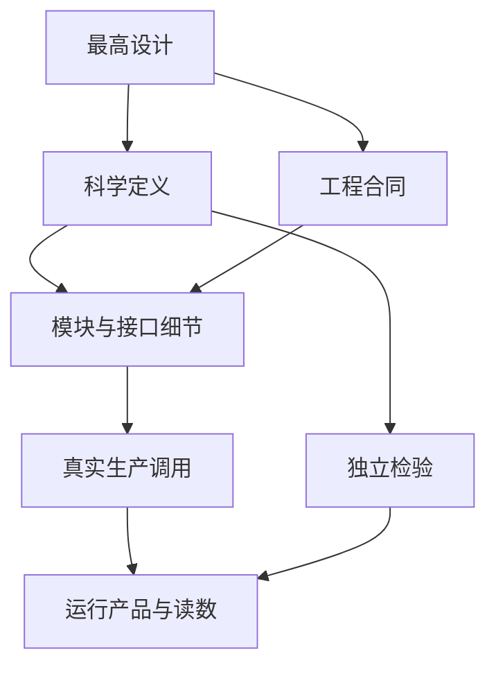

# 追溯规范

本文依据最高设计的文档权威、产品来源和独立科学证据要求[1]，规定如何把科学定义、工程合同、实现、测试与观测结果联系起来。追溯解释证据支持什么，不授予开发或发布许可。

## 追溯关系

科学与工程正本同级。科学定义说明被估计量、公式、单位、假设与适用域；工程合同说明数据字段、坐标、所有权、错误和持久化；细节文档连接这些定义与真实 API。源码实现和测试不是更高层权威。工程服务不必伪造科学合同，科学方法也不因登记了模块 ID 就得到证实。

同一合同可被多个模块消费，一个模块也可实现多个合同。已有 ID 保持其所属登记的真实拼写；引用 ID 时给出拥有该定义的正本路径。未找到定义就记录缺口，不从名称推断科学内容，不为填齐矩阵制造占位 ID 或虚构层级。文档地图由索引维护[2]，本页不另存全模块清单。

## 实现对应与 ID 导航

模块说明至少回答：消费谁的什么对象、生产什么对象、被谁消费、公共入口在哪、单位与坐标如何传递、数组由谁持有以及何时释放。数据接口变化同时核对真实 producer/consumer、descriptor、IR、端口注册与统一 I/O 的读写；声明边存在不能证明实际取数来自该边。

源码定位给出仓库相对文件、实际符号和必要行号。符号存在只证明实现位置；检查生产可达性要从命令入口沿调度、适配器和算法调用阅读。生成登记页需说明生成来源，生成结果不改写上层合同，也不自动证明 ABI、单位和运行行为一致。

以下保留科学合同标识的主题映射，拼写和承载路径可由机器登记[9]定位；科学定义和适用范围以链接正文为准。登记的状态与下游列表需随正本核对，列出 ID 不表示实现或证据已验证。

| 标识 | 主题正本 | 实现导航 |
|---|---|---|
| SCI-CAL-001 | [校准](../../science/calibration/CALIBRATION.md) | [校准模块](../../detail/registry/acsd.phase1.calibration.md) |
| SCI-AST-001、SCI-WCS-001 | [天体测量](../../science/detection/ASTROMETRY.md) | [WCS 模块](../../detail/registry/acsd.phase1.wcs-platesolve.md) |
| SCI-PHOT-001 | [测光](../../science/photometry/PHOTOMETRY.md) | [测光模块](../../detail/registry/acsd.phase1.photometry.md) |
| SCI-NOISE-001 | [噪声与参考精度](../../science/noise_snr/NOISE_SNR.md) | [噪声模块](../../detail/registry/acsd.phase1.noise-snr.md) |
| SCI-DRZ-001 | [球面 Drizzle](../../science/drizzle/DRIZZLE.md) | [Drizzle 模块](../../detail/registry/acsd.phase1.drizzle.md) |
| SCI-PSF-001 | [PSF](../../science/psf/PSF.md) | [源与 PSF 模块](../../detail/registry/acsd.phase1.star-psf.md) |
| SCI-UPM-001 | [相对天空](../../science/sky/UPM.md) | [背景拟合模块](../../detail/registry/acsd.phase2.upm-fit.md) |
| SCI-REJ-001、SCI-INT-001 | [排异](../../science/integration/REJECTION.md)、[集成](../../science/integration/INTEGRATION.md) | [排异模块](../../detail/registry/acsd.phase2.reject.md)、[集成模块](../../detail/registry/acsd.phase2.integrate.md) |

各 DATA/API/ALG 标识在相应合同和模块页说明；[模块登记入口](../../detail/registry/README.md)保留定位用途，登记正文与现行正本不符时按上层修订，不能据其冻结或 VERIFIED 字样认定科学成立。

Normalize 的正式对应由生产链架构[3]、数据合同[4]和接口规格[5]维护。入口核对从 CLI 的 `run_phase1_block` 到 Runtime 的阶段 IR，再到 `P1NodeModule::execute` 与具体 `p1_op_*`。校准局部会话按其实际能力描述；阶段内工作文件、正式跨阶段产品与开发快照分别按消费者和生命周期归属。

## 证据状态

报告针对一个具体断言说明其证据，不把它压成单个 VERIFIED 或 PASS：

| 事实 | 支持范围 | 不能据此推出 |
|---|---|---|
| 正本已有定义 | 目标与接口明确 | 代码已实现 |
| 源码存在并静态接线 | 可定位实现和预期调用 | 本次真实运行命中 |
| 构建或测试执行 | 指定环境和用例下的结果 | 真实观测与全域科学正确 |
| 真实命令产生可读产品 | 指定输入的功能和持久化事实 | 产品中每个量已独立定量验证 |
| 独立解析、数值或观测对照 | 指定估计量、误差与适用域得到支持 | 未测数据域或遗漏系统误差也成立 |

状态可以并列说明，不构成审批阶梯。找不到证据路径、未运行或证据已不可取得时，应明确说明；测试文档、函数同名或字段自洽均不能补成执行证据。生产侧存在 sidecar 发布调用，不意味着全部模型输入、条件 GLS 和端到端取数已成立。

## 可复现的科学记录

实验记录包含断言及其正本、输入来源和身份、使用的代码与环境、复现命令、输出位置、实际样本量、单位、统计分母、预期与读数、失败及适用范围。代码身份和输入哈希留在证据记录，正式规范不复制运行流水。

阶段产品实验从对应运行清单和逐帧产品清单枚举输入，几何取自产品本身。核对运行和目标天区，记录 CRVAL/CRPIX/CD 等实际几何；天区不匹配则停止该分析，缺几何的帧逐帧登记。不得按目录名或记忆挑一组历史产品代替本次帧集。

科学结论用一手文献或标准、可查的开源科学实现和仓内独立实验相互校对。数值检验应能区分正确与错误模型，包含独立真值和有针对性的负例；共享公式的往返、自身 JSON 与头字段一致只说明自洽。随机条件噪声、共同参数误差和模型失配分别报告，不用单次退出码或测试数目代表完整精度。

实验过程边做边保留在单元自己的文档和代码目录。失败尝试、撤回结论及原因、脚本、JSON 与文字证据均保留；大体积二进制中间量可按磁盘需要清理并说明再生方式。阶段完成后的整理不覆盖过程记录。真实观测 FITS 不上传 Git。

## 问题与维护

复核发现缺口时给出断言、实际位置、证据、影响和需要的输入。能按现行正本修复的实现问题明确为实施项；需要改变模型的独立反例交给设计负责人统一修订。未决事项与收敛事实分别进入对应登记[6–7]。

引用检查可自动辅助发现悬空文件、符号、重复 ID 或空集合；语义判断仍须阅读真实内容。治理维护规则见[8]。追溯不设固定层数、模块数量上限、烧毁阈值或“全绿后才可开发”的条件。

## 参考文献

[1] [ACSD 最高设计](../../ACSD_DESIGN.md)。

[2] [文档索引](../../DOCUMENT_INDEX.yaml)。

[3] [Normalize 生产链架构](../architecture/NORMALIZE_PIPELINE.md)。

[4] [Normalize 数据合同](../contracts/NORMALIZE_DATA.md)。

[5] [Normalize 接口与迁移规格](../../detail/normalize/contracts.md)。

[6] [未决登记](UNRESOLVED.md)。

[7] [Normalize 收敛记录](NORMALIZE_CONVERGENCE.md)。

[8] [文档治理规范](DOCUMENT_GOVERNANCE.md)。

[9] [机器合同登记](../../../eng/contracts/data/contract_index.yaml)。
