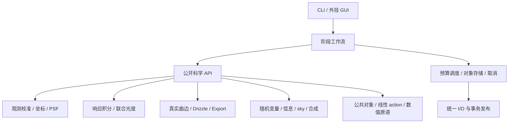

# 系统边界与算法调用

依据及状态见[架构入口](README.md)。模块按观测形成、几何变换、误差传播和估计量求解划分。Runtime 执行已经声明的因果关系，不能通过历史节点或缓存形状选择科学模型。

## 模块与依赖

| 模块 | 拥有的运算与输出 | 明确依赖 |
|---|---|---|
| `observation` | 原始单位解释、母版校准、有效域、DQ、G 重组、独立及共享噪声根 | 公共对象、线性 action；不依赖球面网格 |
| `coordinates` | FITS1 边界、规范 WCS、前逆/导数/区间/单射证书、连续 footprint、仿射复合 | 数值原语；唯一生产坐标实现 |
| `astrometry` | 原生像元盲检、Gaia 匹配、WCS 拟合、天测参数影响与能力状态 | coordinates、catalogue、拟合器；solver 候选不充当科学源 |
| `sources_psf` | WCS 后科学源、像元积分 PSF/PRF、有限窗/孔径定义、源测量、有效观测核 | observation、coordinates、catalogue、noise action |
| `response` | response/SED 身份、XP 基积分与积分误差、谱支持及共享 Gaia 潜变量 | catalogue、数值求积；未知响应不造曲线 |
| `photometry` | counts/Gaia 联合潜变量拟合、可估秩、空间标度及同数据影响、恰好一次应用 | sources_psf、response、noise、求解器 |
| `geometry` | Ω/A/a、完整候选、affine-strip 主核、包含型 fallback、原始几何约束 | coordinates、HEALPix、区间/精确原语 |
| `operators` | 分块线性 action、转置、组合、R 构造、同一算子作用于 signal/PSF/背景基 | geometry 结果、公共对象；不另造交叠 |
| `uncertainty` | 随机根/共享因子、C action、PSD 约束、孔径方差、同数据影响、数值扰动界 | operators、数值求解器；不拥有另一套 signal |
| `information` | 具名参考下 V_F、actual-scene V_B、V_ctrl、稀疏 actual-scene 支持内预测 | uncertainty、实际 PSF/背景基/R；三类量不互换 |
| `relative_sky` | 可比响应控制、公共天空 H、gauge、秩/支持、K/T/E/P action | uncertainty、sources_psf、operators；拟合/输出共用 basis |
| `selection_coadd` | DQ 资格、小 N 可选单步 LOO、BLUE/非负 QP/equal、有效混合核 | 帧邻域 provider、noise、sky；不拥有几何和参考 SNR 换权捷径 |
| `projection` | 目标 TAN[-SIP] WCS、支持交叠、面积平均/积分及 Q action | coordinates、geometry、operators；Export 不收缩 pixfrac |
| `products` | HiPS/FITS 序列化、模型图、manifest、能力及原子发布 | 统一 I/O、公开对象；不拟合和修补科学模型 |
| `runtime` | typed 工作项、对象租约、单一线程/内存/I/O 预算、spill、确定归约、取消 | 公共对象、I/O；不依赖各科学算法内部类型 |
| `catalogue` / `numerics` | 本地 Gaia 访问与历元传播；QR/SVD/LSQR、PSD/区间/MPFR/GMP 原语 | 显式上下文，不读进程全局科学配置 |

这是逻辑模块图，不要求每个模块成为一个 DLL 或一个调度节点。首期科学库静态链接到 CLI 与独立合同驱动器；跨语言通过版本化 C API。可替换 provider 必须实现同一数学合同；不建设依赖旧 descriptor/IR 的插件加载框架。

## Normalize 的因果图

1. 读取观测、校准输入、响应与时间上下文；建立源身份、单位和校准随机根。校准/修复输出新观测版本，显式保留 G 或非线性条件。
2. 校准像元 → solver 候选 → 本地 Gaia 匹配 → 完整 WCS；输入合法 WCS 是具名的另一来源。无头 WCS 必须实际求解；unsolved 帧进入运行清单，不能发布伪球面帧。
3. 完整 WCS + 校准观测 → 独立 science_sources → 像元积分 PSF 与 counts 测量。Gaia 历元传播、DCR 假设及源选择随结果保留。
4. 实际响应 + XP 表示 → 分段积分；counts + XP 共享 latent → 联合 photometry；对原生每像元应用 α(u) 一次。application_id 与输入/输出单位验证重复应用；空间 α 同样作用于模板，不用星心标量替代全 PSF。
5. 校准/标度后的观测、实际场景噪声根和拟合影响构成统一 NativeObservation。纯初始噪声统计、响应基积分及已知 WCS 的几何准备可并行；最终噪声模型必须绑定实际应用版本。
6. footprint + WCS + 网格 + science budget → Ω/A/a → R；R 同时变换 signal、PSF、噪声根和背景基。先请求粗界、按 B/F/Cov 等目标反馈细化，直至达标或资源耗尽。feedback 是同一次操作的受控求解，不是下游改写上游对象。
7. information 按同一次 R 计算参考 V_F、actual-scene V_B 及需要的 controls，各自带 condition。writer 发布单帧产品闭包；噪声未知仍可有合法 signal，数值未达标不能当认证结果。

跨帧共享 Gaia 星、母版和响应参数不被帧边界截断。首期支持多帧 photometry 的按 source 分块联合求解；独立 normalize 调用也必须保留相同外部 latent 身份、源测量依赖和影响 action，供后续恢复交叉 covariance。若联合输入依赖不完整，降为具名 conditional/unknown，不能只存每帧参数协方差后声称相互独立。

## Mosaic 的计算屏障

1. 从完整发布 manifest 打开用户选定产品；统一 ICRS/NESTED、同 leaf order、可解释单位。混 order 明确拒绝；不同仪器/滤镜名不是拒绝条件。缺失参考 SED 转换时要求显式混合目标，不伪造相同物理量。
2. provider 暴露逐帧 signal、邻域、support、PSF/response、noise 和原生到叶 action。重复产品/source 身份核对，重复读取不能制造新观测。actual-scene 方差优先直接 action；仅有稀疏控点时按其条件、有限支持及外部曲率界重建。
3. 对响应和有效空间观测可比较的帧构造控制 T、共同天空 H 与 A；需要 PSF 匹配时只使用可实现的共同较宽核。不同响应不建伪差模边；无可比控制的帧保留零修正规范及“未测相对背景”状态。
4. 逐真实连通分量拟合相对 sky，保存全部共同常量/斜坡及其它不可辨识模式、gauge、秩、K/T/E。控制足迹外的修正带预测状态。背景拟合形成全局屏障，不能边写最终 tile 边改变 β。
5. 应用 P=I−EKT；逐目标块确定资格和可选排异，再按 policy 求权及归约。Γ 必须含 shared_id 和 sky 同数据项。需要几何依赖的 K/权/选择精度时，反馈至可持久恢复的 primitive；不可恢复则报未决，不冻结中心解冒充无条件界。
6. 写入唯一 signal HiPS。有效核、支持/选择、规范、数值界与可选 covariance 模型作为模型元数据/辅助块保存，不发布第二个 variance/weight/sky 科学图像通道。

共同均值且 Γ 完整才称 BLUE；要求非负响应时用非负 QP。异 PSF/通带按实际 t 与 c 保存 K_eff 的空间、光谱耦合，不能总分离为一条有效滤镜曲线。unknown noise 默认具名 equal，经验或启发式策略须显式选择；都不标 full_IVAR。小 N 默认无时间排异；启用单步 LOO 基线须 N≥4、共同可比较估计量/均值和外部固定可信 Γ，只拒一个最大 LOO，不并行拒所有超阈样本。异 PSF/响应的真实均值差、时变源不能直接送入共同均值 LOO；无足够可比性证据时跳过统计排异，保留合法混合 signal。由同数据估计的 Γ 或非Gaussian场景只能用显式启发式/条件策略，不附清洁Gaussian基线的family误拒保证。未来 SACoadd 可替换合成器，但本阶段不设计其数学算法。

## Export

目标 WCS 使用同一 coordinates/provider 模型域。支持均值 Q_ip=b_ip/Σb 与支持积分 Q_ip=b_ip 是两个独立请求，默认输出支持面亮度均值；整像元通量外推需显式选择。b=Ω(E_i∩H_p∩U_p)，不做第二次 drop 收缩。只有 full-leaf 近似支持时标明近似，不用一个比例恢复子叶形状。Q 对 signal、可用 noise 和 response 同步作用；只有最终 signal 时 noise=unknown。无支持为 NaN，负值与零保留。HiPS 层级派生也保存自身算子/支持近似，不能把低阶层伪装成重新 Normalize 的同阶独立观测。

## 可复用边界与未来源码

未来源码按 `core/{model,coordinates,observation,response,geometry,operators,uncertainty,information,sky,coadd,projection}`、`services/{catalogue,io,runtime}`、`interfaces/{c,driver,cli}` 和 `validation/` 组织；这是目录职责设计，本阶段不创建实现骨架。

复用候选为完整标准 WCS 解码、成熟 QR/SVD/稀疏求解、XP 谱表示、经审计的匹配思想和正确 w/F/N 代数。每项须给许可证、单位/原点、输入域、错误/线程及独立反例验证记录；在新接口内通过验证后才接纳。旧四角交叠、外部 cone 完备性假设、SNR 直接充当场景权、比例排异和异 basis sky 路线不进入新核心。旧实现行为不是回归真值。
