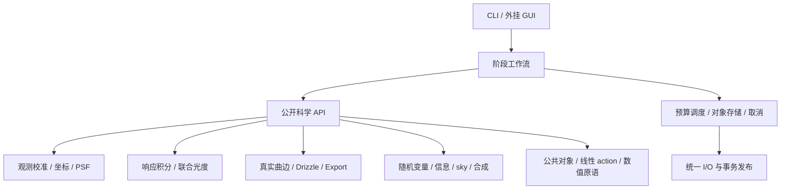

# 系统边界与算法调用

依据及状态见[架构入口](README.md)。模块按观测形成、几何变换、误差传播和估计量求解划分。资源服务执行已经声明的因果关系，不能通过历史节点或缓存形状选择科学模型。

## 模块与依赖

| 模块 | 拥有的运算与输出 | 明确依赖 |
|---|---|---|
| `observation` | 原始单位解释、母版校准、有效域、DQ、G 重组、独立及共享噪声根 | 公共对象、线性 action；不依赖球面网格 |
| `coordinates` | FITS1 边界、规范 WCS、前逆/导数/区间/单射证书、连续 footprint、仿射复合 | 数值原语；唯一生产坐标实现 |
| `astrometry` | 原生像元盲检、Gaia 匹配、WCS 拟合、天测参数影响与能力状态 | coordinates、catalogue、拟合器；solver 候选不充当科学源 |
| `sources_psf` | WCS 后科学源、像元积分 PSF/PRF、有限窗/孔径定义、源测量、有效观测核 | observation、coordinates、catalogue、noise action |
| `response` | response/SED 身份、XP 基积分与积分误差、谱支持及共享 Gaia 潜变量 | catalogue、数值求积；未知响应不造曲线 |
| `photometry` | counts/Gaia 联合潜变量拟合、可估秩、空间标度及同数据影响、恰好一次应用 | sources_psf、response、noise、求解器 |
| `geometry` | Ω/A/a、完整候选、affine-strip 主核、包含型 fallback、原始几何约束 | coordinates、HEALPix、区间/精确原语 |
| `operators` | 分块线性 action、转置、组合、R 构造、同一算子作用于 signal/PSF/背景基 | geometry 结果、公共对象；不另造交叠 |
| `uncertainty` | 随机根/共享因子、C action、PSD 约束、孔径方差、同数据影响、数值扰动界 | operators、数值求解器；不拥有另一套 signal |
| `information` | 具名参考下 V_F、actual-scene V_B、V_ctrl、稀疏 actual-scene 支持内预测 | uncertainty、实际 PSF/背景基/R；三类量不互换 |
| `relative_sky` | 可比响应控制、公共天空 H、gauge、秩/支持、K/T/E/P action | uncertainty、sources_psf、operators；拟合/输出共用 basis |
| `selection_coadd` | DQ 资格、小 N 可选单步 LOO、BLUE/非负 QP/equal、有效混合核 | 帧邻域 provider、noise、sky；不拥有几何和参考 SNR 换权捷径 |
| `projection` | 目标 TAN[-SIP] WCS、支持交叠、面积平均/积分及 Q action | coordinates、geometry、operators；Export 不收缩 pixfrac |
| `products` | HiPS/FITS 序列化、模型图、manifest、能力及原子发布 | 统一 I/O、公开对象；不拟合和修补科学模型 |
| `runtime` | typed 工作项、对象租约、单一线程/内存/I/O 预算、spill、确定归约、取消 | 公共对象、I/O；不依赖各科学算法内部类型 |
| `catalogue` / `numerics` | 本地 Gaia 访问与历元传播；QR/SVD/LSQR、PSD/区间/MPFR/GMP 原语 | 显式上下文，不读进程全局科学配置 |

这是逻辑模块图，不要求每个模块成为一个 DLL 或一个调度节点。首期科学库静态链接到 CLI 与独立合同驱动器；跨语言通过独立进程协议。可替换 provider 必须实现同一数学合同；不建设依赖旧 descriptor/IR 的插件加载框架。

## Normalize 的因果图

1. 读取观测、校准输入、响应与时间上下文；建立源身份、单位和校准随机根。校准/修复输出新观测版本，显式保留 G 或非线性条件。
2. 校准像元 → solver 候选 → 本地 Gaia 匹配 → 完整 WCS；输入合法 WCS 是具名的另一来源。无头 WCS 必须实际求解；unsolved 帧进入运行清单，不能发布伪球面帧。
3. 完整 WCS + 校准观测 → 独立 science_sources → 像元积分 PSF 与 counts 测量。Gaia 历元传播、DCR 假设及源选择随结果保留。
4. 实际响应 + XP 表示 → 分段积分；counts + XP 共享 latent → 联合 photometry；对原生每像元应用 α(u) 一次。application_id 与输入/输出单位验证重复应用；空间 α 同样作用于模板，不用星心标量替代全 PSF。
5. 校准/标度后的观测、实际场景噪声根和拟合影响构成统一 NativeObservation。纯初始噪声统计、响应基积分及已知 WCS 的几何准备可并行；最终噪声模型必须绑定实际应用版本。
6. footprint + WCS + 网格 + science budget → Ω/A/a → R；R 同时变换 signal、PSF、噪声根和背景基。先请求粗界、按 B/F/Cov 等目标反馈细化，直至达标或资源耗尽。feedback 是同一次操作的受控求解，不是下游改写上游对象。
7. information 按同一次 R 计算参考 V_F、actual-scene V_B 及需要的 controls，各自带 condition。writer 发布单帧产品闭包；噪声未知仍可有合法 signal，数值未达标不能当认证结果。

跨帧共享 Gaia 星、母版和响应参数不被帧边界截断。首期支持多帧 photometry 的按 source 分块联合求解；独立 normalize 调用也必须保留相同外部 latent 身份、源测量依赖和影响 action，供后续恢复交叉 covariance。若联合输入依赖不完整，降为具名 conditional/unknown，不能只存每帧参数协方差后声称相互独立。

## Mosaic 的计算屏障

1. 从完整发布 manifest 打开用户选定产品；统一 ICRS/NESTED、同 leaf order、可解释单位。混 order 明确拒绝；不同仪器/滤镜名不是拒绝条件。缺失参考 SED 转换时要求显式混合目标，不伪造相同物理量。
2. provider 暴露逐帧 signal、邻域、support、PSF/response、noise 和原生到叶 action。重复产品/source 身份核对，重复读取不能制造新观测。actual-scene 方差优先直接 action；仅有稀疏控点时按其条件、有限支持及外部曲率界重建。
3. 对响应和有效空间观测可比较的帧构造控制 T、共同天空 H 与 A；需要 PSF 匹配时只使用可实现的共同较宽核。不同响应不建伪差模边；无可比控制的帧保留零修正规范及“未测相对背景”状态。
4. 逐真实连通分量拟合相对 sky，保存全部共同常量/斜坡及其它不可辨识模式、gauge、秩、K/T/E。控制足迹外的修正带预测状态。背景拟合形成全局屏障，不能边写最终 tile 边改变 β。
5. 应用 P=I−EKT；逐目标块确定资格和可选排异，再按 policy 求权及归约。Γ 必须含 shared_id 和 sky 同数据项。需要几何依赖的 K/权/选择精度时，反馈至可持久恢复的 primitive；不可恢复则报未决，不冻结中心解冒充无条件界。
6. 写入唯一 signal HiPS。有效核、支持/选择、规范、数值界与可选 covariance 模型作为模型元数据/辅助块保存，不发布第二个 variance/weight/sky 科学图像通道。

共同均值且 Γ 完整才称 BLUE；要求非负响应时用非负 QP。异 PSF/通带按实际 t 与 c 保存 K_eff 的空间、光谱耦合，不能总分离为一条有效滤镜曲线。unknown noise 默认具名 equal，经验或启发式策略须显式选择；都不标 full_IVAR。小 N 默认无时间排异；启用单步 LOO 基线须 N≥4、共同可比较估计量/均值和外部固定可信 Γ，只拒一个最大 LOO，不并行拒所有超阈样本。异 PSF/响应的真实均值差、时变源不能直接送入共同均值 LOO；无足够可比性证据时跳过统计排异，保留合法混合 signal。由同数据估计的 Γ 或非Gaussian场景只能用显式启发式/条件策略，不附清洁Gaussian基线的family误拒保证。未来 SACoadd 可替换合成器，但本阶段不设计其数学算法。

## Export

目标 WCS 使用同一 coordinates/provider 模型域。支持均值 Q_ip=b_ip/Σb 与支持积分 Q_ip=b_ip 是两个独立请求，默认输出支持面亮度均值；整像元通量外推需显式选择。b=Ω(E_i∩H_p∩U_p)，不做第二次 drop 收缩。只有 full-leaf 近似支持时标明近似，不用一个比例恢复子叶形状。Q 对 signal、可用 noise 和 response 同步作用；只有最终 signal 时 noise=unknown。无支持为 NaN，负值与零保留。HiPS 层级派生也保存自身算子/支持近似，不能把低阶层伪装成重新 Normalize 的同阶独立观测。

## 可复用边界与未来源码

未来源码按 `core/{model,coordinates,observation,response,geometry,operators,uncertainty,information,sky,coadd,projection}`、`services/{catalogue,io,runtime}`、`interfaces/{c,driver,cli}` 和 `validation/` 组织；这是目录职责设计，本阶段只建立职责目录与声明。

复用候选为完整标准 WCS 解码、成熟 QR/SVD/稀疏求解、XP 谱表示、经审计的匹配思想和正确 w/F/N 代数。每项须给许可证、单位/原点、输入域、错误/线程及独立反例验证记录；在新接口内通过验证后才接纳。旧四角交叠、外部 cone 完备性假设、SNR 直接充当场景权、比例排异和异 basis sky 路线不进入新核心。旧实现行为不是回归真值。

## 实际源码与无环依赖（规范）

本节替换上文“未来源码/不创建骨架”的阶段性描述。目录已建立职责入口，空目录用 README 保留；仅 include 是类型和函数声明，不提供算法实现。全部头合同在 include/acsd/contracts.hpp，内部头不得成为独立消费者的前置。

| CMake 目标 / 源码目录 | 直接依赖；责任 |
|---|---|
| acsd_model / src/model | C++20；身份、单位、数组索引及 action recipe 数据，不含 I/O |
| acsd_numerics / src/numerics | model、Eigen、MPFR/GMP；区间、求积、QR/SVD/LSMR、PSD/QP |
| acsd_coordinates / src/coordinates | model、numerics、WCSLIB、ERFA；规范 WCS、历元、曲边 |
| acsd_observation / src/observation | model、operators、uncertainty、numerics；校准和G |
| acsd_catalogue / src/catalogue | model、coordinates；只读本地索引，Gaia/XP 解码 |
| acsd_sources / src/sources | observation、coordinates、catalogue、uncertainty、numerics；盲解、PSF、科学源 |
| acsd_response / src/response | model、numerics；响应基积分 |
| acsd_photometry / src/photometry | sources、response、uncertainty、numerics；联合尺度及影响 |
| acsd_geometry / src/geometry | coordinates、operators、numerics；唯一生产交叠与支持 Boolean |
| acsd_operators / src/operators | model、numerics；CSR、组合、transpose；消费几何数据，不调用 geometry |
| acsd_uncertainty / src/uncertainty | operators、numerics；根图、协方差、PSD 解 |
| acsd_information / src/information | uncertainty、numerics；V_F/V_B/controls 及三角重建 |
| acsd_sky / src/sky | uncertainty、information、operators；controls、全局相对 sky |
| acsd_coadd / src/coadd | sky、uncertainty、operators；选择和权及混合核 |
| acsd_projection / src/projection | geometry、operators、uncertainty；目标 Q |
| acsd_storage / src/storage | model、CFITSIO、zstd、nlohmann_json；块、products、发布、Array provider |
| acsd_resources / src/resources | model、Threads；资源预算、Storage 接口消费者、唯一线程池 |
| acsd_workflows / src/workflows | 上述全部；Normalize/Mosaic/Export 的因果编排与细化控制器 |
| acsd、acsd-contract / apps/cli、apps/contract | workflows；分别用户命令与公开操作调用 |
| acsd-gui / gui（独立 CMake 工程） | Qt6 Core/Widgets/Network；子进程协议，无核心链接 |
| validation / validation | 外部独立 oracle 与进程协议；禁止 include src 或复制旧测试 |

依赖方向按表从下往上追溯，无科学模块链接 resources/storage 的具体实现。它们只借 Context 接口。Storage 读产品时构造数据图及 recipe；具体 action 由 workflows 调用 make_action 解码，故 storage 不反向依赖科学库。公开静态入口目标 acsd_science 聚合上述科学库，不再单独包装每个算法。无动态插件、节点描述器、反射工厂或长期服务。当前只构建 acsd_contracts INTERFACE 与文档校验；上述实现目标在负责人接受后逐项建立。

## N1 校准、重组及有效观测

1. 以 u16 DQ 保存 bad=1、saturated=2、nonlinear=4、missing=8、repaired=16；前四位默认不合格，repaired 必须附 G/influence 才可使用。NaN 的值与有效位冲突为 invalid_model。
2. 原始二维 ADU 读入 FP64。dark 若含 bias，用 dark-bias 后再按曝光比缩放；不含 bias 则直接缩放。x=(d-b-t d_rate)/flat。flat 已按明确 normalization 标准化；flat≤0、溢出或饱和不做数值修复，保留 DQ。
3. 输入 raw_noise 可指定完整 electron expectation 与读出因子。没有非负 electron expectation 时，gain/read 元数据本身不足以精确恢复 shot variance；默认 noise unknown；用户显式 Poisson plug-in 可用 max(d-b,0) 的电子期望并标 approximate。母版的噪声根按 shared_id 并入 Jacobian，而非每帧重建。
4. sum/mean/crop/Bayer/flip/transpose 用显式 G、M、b。mean 恢复积分时乘成员数，noise 平方同变；有缺孔时成员及 footprint 必须对应，不用固定 bin 面积替代。G的严格维度及signed linear_view限制见下文；仅物理重组使用R_out G，原生路径只用R_native。
5. 首期无自动非线性修复或去马赛克。API 收到无 influence 的数据依赖 G 返回 unsupported；合法未修复像元继续处理。

## N2 无 WCS 盲解（可实现的有界基线）

本地 Gaia 预处理按 HEALPix order 6 sky 分片；另建立四星 quad 不变式索引。索引记录 release/epoch、源 ID、ICRS 单位向量、亮度、XP 表示及其校准 hash。quad 以最长边为基线，将另外两点投影到该基线坐标，按镜像/交换两种方向枚举规范有序四维比值；KD-tree 保存四维坐标与源四元组、角尺度。生成时限制尺度范围和每片前 max_candidates 亮星，不声称覆盖全部天体。

观测端先用固定格块的中位数/MAD 作候选检测背景（仅检测，不作 science sky），5×5 局部最大、detect_snr 阈值、按 SNR 与 (y,x) 确定排序、非极大抑制半径2像元。每格64×64最多8候选，再截到 max_candidates。候选位置用局部正值加权质心初始化并用像元积分 Gaussian 优化；零/负背景像元不被变成正 photon 均值。

按候选确定顺序枚举 quads，按规范不变式在索引容差盒中查询，镜像均尝试；粗仿射 TAN 候选以所有检出星和历元传播后的 Gaia 互近邻验证。centers 非空只搜指定圆域，空时对完整离线索引搜索。scale_rad_pixel 是明确搜索范围，不从缺头猜唯一尺度。max_hypotheses 是已验证候选数量硬上限，超过返回 unsolved（search_exhausted），不伪称不存在天空解。

匹配先以 match_radius_pixel gating、一对一最小距离（距离相同按 source_id），固定匹配后以平面+SIP 非线性最小二乘拟合，解析坐标 Jacobian，QR/SVD 线搜索。SIP 从0升至请求阶数，增加项必须满可估、留出残差改善；按源 ID hash mod5 留出1组，至少 min_matches 且每参数至少3个训练约束。列尺度、rank 和收敛见 EXECUTION。输出 WCS 仍须整 detector 域通过单射/60°准入，星点拟合成功不代替面积域准入。失败可尝试下个候选；全部失败返回 unsolved，附各原因与最优候选残差，不发布球面帧。此路径只保证有界搜索与正确失败，不保证任意视场盲解成功。

天测参数和像元同数据 influence 通过最优条件微分求导；缺 PSF/大气模型等误差记 omitted。catalogue 位置 ERFA 历元传播；RV/observer 缺失不得产生已知 topocentric 方向。DCR 默认 omitted，其物理误差没有输入界时完整物理定位误差 conditional。

## N3 PSF、源通量与联合标度

科学源从 WCS 后 Gaia 预测独立选取；solver candidates 不转作测光源。以饱和/邻源/窗口掩码选择身份冻结后拟合。Gaussian 参数为 logσx、logσy、atanhρ；Moffat 为 logαx、logαy、atanhρ、log(β−1)；Airy 为 log first_zero_radius_pixel，圆对称。每源同时拟合连续位置、总 flux、常量/平面背景；flux 允许负，宽度/β 正参数用上述变换。空间 PSF 参数按归一 detector 的 degree≤2 多项式拟合，缺秩返回不可估，用户可重新请求常量，不暗中降阶。

Gaussian 无相关时 erf 可分离积分，相关时二维自适应积分；Moffat/Airy 对真实 footprint 分块求积。用解析尾质量界选择窗口（Gaussian erfc；Moffat (1+r²/α²)^(1−β)；Airy encircled-energy Bessel 恒等式），不把窗内归一为1。PRF首期为单波段分段常量photosite响应；只支持下文明确的achromatic模型，色相关项记录unknown/conditional。integral+tail 数值预算不满足则拒绝该测量能力，不以采样 PSF 替代。源间混叠以共同窗口联合线性 flux+background 求解；窗口巨大超预算可拒绝源，不裁掉邻源却声称总 flux。

PSF 非线性形参用 GN+Armijo 回溯（初始步1，减半，最多32步），每步 QR/SVD；迭代次数、参数梯度和步容差显式。拟合 influence 为 -(∂score/∂θ)^−1∂score/∂data，在可估空间计算，保留像元根、同星与 PSF 共用训练依赖。仅 GN 近似 Hessian 时标 conditional；不收敛返回 nonconverged。

response 基函数按谱/滤镜/QE 折点分段 GK15/31 自适应，先以面板误差估计选择细化；认证数值界用分段多项式的区间余项或纯包含积分包围。普通 GK 差值仅 approximate。响应超 XP 谱支持域：有外部谱上界可补尾界，否则 unavailable/conditional 截带预测，不能宣称完整 q。

photometry 采用科学分册 flux-domain joint Gaussian latent。θ=[log a,空间项]，空间基按训练权均值零；每星 latent 与 Gaia 系数测量共用一个根。初始化 log a 为正通量比的中位数（仅初值，无正比则0），latent 为 Gaia 观测。GN 每步按 source 消元谱 nuisance、全局 Schur/QR 解 θ，再回代；固定联合 covariance，不能每步偷换为未包含 logdet 的 marginal likelihood。Armijo 与迭代停止同 PSF；Huber 默认关，显式开启 δ=1.345 时仅给冻结权 influence 与聚类 bootstrap 验证。低计数原始 Poisson likelihood 首期 unsupported。星覆盖不足或谱/位置混淆时给 nullspace，不 ridge。α=exp(−hθ) 应用每个原生像元及模板，application_id 已存在立即 identity_conflict；训练像元→θ→x 的链式 Jacobian 与直接像元根合并一次。

## N4 生产几何与支持 Boolean

采用科学分册 §6 的 affine-strip 为唯一生产交叠主核，A 的 target-domain 包含积分是同入口 fallback；B 是独立验证，不在主路径重复算全部面积。源环首期支持简单 polygon 和孔洞，边为连续 detector 直线；收缩以 contraction_center 作同一 affine f 作用于全部环，hole 随之收缩。ring 必须不自交，外环逆时针、洞顺时针且严格内含；多外环须内部分离。一般 composite G 核保留 constituent 原生 footprint。

每次计一个 interval box/候选裁剪/求积面板为1 work，精确有理运算每4096 limb 操作再记1，MPFR 每次超越运算按 ceil(bits/64) 记 work；全部累计受 Context 与子预算双约束。最多4096候选格/节点，超过先细分；资源不足保 coarse_unresolved，不枚举全天空常驻。累计采用有向 dyadic ledger，精度升级是128→192→256→…每次×2至 max_bits。相邻两级细化的界宽下降比>0.9连续3次且舍入宽≥总宽一半时触发升级；非此情形继续空间细化。到 max_depth 或极点 chart 无定义触发 target A；fallback 与主核共用剩余配额，不能重置。

支持 S=union_j(D_j∩H_p) 需要单独 Boolean：target face dyadic 树节点对各 drop 判 inside/outside/undecided；任一 inside 即 union inside，全部 outside 即 outside，其余 undecided 并细分。子域 OR 后计一次面积，洞照包含谓词处理。精确模式可持久化 primitives+树，有限边界质量在 budget 内才 bounded；不以 Σa 或 N 代替 union。

## M1 controls、sky 和合成的确定算法

无显式 T/H 时，按共享 order 的 face chart 固定32×32 leaf patch 建控制中心；只在可比组公共支持内，以固定 mask 的面积平均建 T，每帧每 patch 一行。mask 来自 DQ/support，可选排星圆域必须在请求固定；不在控制像元上做 median/clip。H 每 patch 一个独立共同 s 列，同 patch 各帧共享；若有给定空间传递核则 H 用实际响应后的共同 basis。A 与 E 均按同一个 Basis(center,scale,weighted_mean) 求值，不允许不同插值。PSF 匹配只支持可实现的 Gaussian 额外卷积（σ_target²−σ_frame² PSD），其他核用户须提供验证过的匹配 action；不能自动反卷积。宽核 halo 用尾质量预算推导。

先构实际控制连通分量；gauge reference_frame 是按 UTF-8 frame ID 最小者或用户显式者，reference 全部 basis 系数置0；weighted_sum 用给定正权。求解联合 [H,A G]，小分量 SVD，大分量 sparse QR 或 LSMR，按 EXECUTION 残差/秩准则。PSD 噪声先处理精确约束；仅有 C action 用增广 KKT [C,D;Dᵀ,0]，MINRES+可验证预条件器，不能把 C(v) 当 whitening。非 gauge 的额外 nullspace 保留，β 取最小欧氏范数代表，但不可估 E 方向不给“测得 sky”；有不唯一影响时该位置默认 correction=0、unavailable，不用代表值伪装修正。孤立帧同样0并记录无相对测量。用户 allow_prediction 才允许训练域外按固定模型预测，带 predicted/extrapolated 状态，完整噪声仍 P C Pᵀ。

先冻结全分量 sky 解，再逐 leaf 资格→可选单步 LOO→权→归约。Γ 从共同 root 联合查询，不各帧独立读对角替代。BLUE/PSD 与非负 QP 见 EXECUTION；不同 K 的 mixed_observation 只能 equal 或显式 nonnegative_QP，后者是该混合样本方差目标，不称共同量 BLUE。LOO 前置失败逐位置 skip，N<4不猜坏帧。effective_response 保存实际 t,c,核组合及条件，不强行分离滤镜。

## E1 Export 与层级

build_export 对目标 WCS 整像元 footprint 计算真叶和 support 的交集 b；可用 N4 target dyadic Boolean 表示复合支持，按目标像元积分行。均值行 b/Σb，支持积分行 b，外推行 Ω(E)b/Σb。same leaf 的多个片先合并 b；所有下游模型使用同一 Q。没有支持形状且 exact 请求则 unavailable；显式 full_leaf_approx 才使用完整 leaf。层级向下只对已知支持的四子叶按支持面积归约并保存独立 Q 与误差；没有完整支持用具名近似。不得把层级图作为同阶新观测供 Mosaic。

HiPS默认tile宽512，可显式64/128/256，必须leaf_order≥log2(tile_width)，完整映射见下文。每层唯一 signal FITS；properties 指明 hips_frame=equatorial、hips_order、hips_tile_width、hips_tile_format=fits、dataproduct_type=image。NorderK/DirD/NpixP.fits，D=floor(P/10000)*10000。Allsky.fits 按 HiPS 标准生成，PNG/JPEG 仅可选浏览派生且不成为第二科学图。

## 依赖与双平台构建策略

生产 C++20，标准库和成熟数值库。采用 Eigen 3.4 API（MPL2）密集 QR/SVD/稀疏 QR，MPFR4/GMP6（LGPL3+/LGPL3+ 或各上游许可选项）有向区间和精确有理裁剪，CFITSIO4（上游许可证）FITS，WCSLIB8（LGPL3+）解码/外部标准校验，ERFA2（BSD3）历元，nlohmann_json3（MIT）配置，zstd1（BSD3 或 GPL2 取 BSD3）块，Qt6（LGPL3 或商业，GUI独立）。HEALPix 生产索引按科学公式独立实现，禁止复制旧内部文件；不引入 GPL healpix_cxx。源的来源与版本由 third_party 清单登记，构建使用系统/工具链依赖，不在线下载浮动 master。每次实施构建记录精确版本、来源hash、编译选项和 license；首次实现提交即锁定两平台可用版本，不把本轮未安装依赖宣称已测试。

Windows 科学 CLI 优先 MSYS2 UCRT64 GCC14+，MPFR/GMP 与库使用同一 CRT/ABI；Linux GCC14+/Clang18+、glibc，Ninja+系统依赖。GUI Qt6/MSVC独立，不跨 CRT 传 C++ 对象。AVX2/FMA 单独翻译单元运行时检测，baseline x86-64 无可选指令；认证区间禁 fast-math，FP contraction off，SIMD 结果需有向包含证据。库默认串行数值后端，由 Context 租线程。

当前 CMake 的 design preset 只验证文档、schema、声明，不链接生产依赖。未来实现开关 ACSD_BUILD_SCIENCE=ON 才启用所需 find_package；缺依赖 configure 失败，禁止自动回旧目录。安装 CLI、contract、schema、VERSION、licenses；GUI 自己的 install 不进根目标。Linux tar.gz 与 Windows zip/安装包可由新打包实现生成，构建必须按 manifest 提供运行库及 LGPL 替换/重链接要求，许可证选择不凭空给整个项目添加许可。

## 审核后冻结的连接细节

### 盲解 catalogue/XP 公开能力与索引

CatalogueProvider.describe给release/calibration、统一XP basis、quad角尺度覆盖和索引完备状态；query/quad-query均分页，page_size≤4096，cursor锁dataset hash和完整请求，空cursor起始、空next结束；不同查询复用cursor为invalid_request。query按source_id返回指定SkySearchRegion中传播历元后的星，brightness_mag及XP basis随记录可用。lookup按请求ID顺序返回，缺失给逐ID issue而不挤掉位置。query_quads按source四元组排序返回descriptor各分量区间及baseline范围内的所有已登记quad；regions空表示全索引，非空为明确center+radius并集。算法不downcast provider或读隐藏路径。

本地索引构建入口build_catalogue_index使用CatalogueColumns：source_ids[N] u64，astrometry[N,8] f64，列为ra_rad,dec_rad,epoch_year,pmra_cosdec_rad_year,pmdec_rad_year,parallax_rad,RV_m_s,RV_present(0/1)；无RV数值位填0且present=0。brightness_mag[N]，xp_coefficients[N,d]与共同SpectralBasis绑定，noise按同source根保留。Gaia原生BP/RP的外定标和表示转换由GaiaXPy官方外定标模型离线解码为该统一分段多项式basis；保存release/模型/数值转换误差，不能把sampled插值当无损基函数。若用户只有sampled谱，必须输入其已知表示和协方差，物理模型状态conditional。所有帧使用provider.describe.xp_basis调用integrate_response；不从star coefficient长度猜basis。

构建步骤：按order6分片，每片选最亮64星（brightness、source_id tie），每anchor取该片及相邻片中最近12个候选，每anchor最多16个由三邻点组成的quad（按最小三角面积递减、source tuple tie，排共线）。按基线角域筛选，去重source四元组，保两种镜像规范描述符。KD树以最大spread轴、坐标中位数递归，平手用source tuple；kd_left/right u64[Nq]（无子节点UINT64_MAX），kd_axis u8[Nq]、kd_split f64[Nq]、kd_bounds f64[Nq,4,2]。quad_source_ids[Nq,4]、quad_descriptors[Nq,4]、quad_baselines[Nq]rad、quad_centers[Nq,3]。排序/树构建可外存，配额不足返回resource_exhausted且index_complete=false，production不得悄悄用未完成索引当完整搜索。index_complete只针对此生成规则，不保证任何视场可解。

quad不变式：最长基线端点A,B（长度平手按ID）；e=(B−A)/|B−A|，e_perp逆时针90°；其余C,D的坐标为 ((C−A)·e/|AB|,(C−A)·e_perp/|AB|)，对A/B交换、C/D交换和镜像枚举取字典最小四维向量并保实际置换。catalogue坐标用quad中心TAN平面，观测用detector连续中心；真实投影非仿射差由quad_descriptor_tolerance明确容纳，默认0.01（只作搜索heuristic，不作几何证书）。catalogue基线角范围等于观测最长边pixel×SolverRequest.scale_rad_pixel区间外包。regions取代旧centers，范围缺失不自行猜半径。搜索穷尽只证明该索引/阈值内未求解，不证明天空无解。query和lookup内存每页预算，source measurements可多遍按source分块。

### 无WCS初态、模型绑定和G的维度

Raw/校准Native始终拥有detector-only FootprintSet，但其wcs允许null；它们只定义真实收光域、身份和PRF。calibrate无需WCS/PSF/response，physical_collection=true，native_parent=null，regrouping=I，kernel/response可缺并记录能力。solve_astrometry消费该detector数据；解后bind_wcs创建新Native revision，绑定同Wcs到FootprintSet，校验整收光域，share数组不复制N个对象。fit_psf→measure源表后bind_observation_model把kernel与NormalizeFrame.response绑定新revision，保所有influence/输入依赖；apply_scale组合其transfer action，build_drizzle只能消费此后版本。绑相同模型可幂等返回同revision，绑定不同模型必须新revision，已scale状态不可换response而假装仍同单位。

对G: n原生→m重组，只有physical_sum/physical_mean（非负、对应互不重复photosite的真实收光并集、系数分别1或1/成员数）产生可用物理重组样本；mean严格Drizzle前恢复sum。此时R_out是从m个重组收光域构造的leaf×m算子，总链为R_out G（leaf×n），不再写R_native G。一般signed/线性去马赛克为linear_view，可得到Gx及GCGᵀ作测量/诊断，但physical_collection=false且不伪造Ω/新物理footprint；直接build_drizzle返回unsupported。Normalize严格主路径保留native_parent，在原生CFA通道上使用R_native x，G派生不进入此signal链。未来若要signed输出重建须另定义估计量，当前不授权编码Agent自创。crop/flip/Bayer为物理选取，bin为物理并集，均支持。重复观测判重回溯original roots/source_index，不能用新channel名逃避同曝光重复。

### 首期PSF唯一数学参数化

首期只achromatic（wavelength_nm记录有效适用域，无谱插值PSF）；请求色相关分段核unsupported并记录未建色相关物理项。PSF先在原始detector平面给归一密度p_det[1/pixel²]，世界密度为p_det/g，在有效域条件下实现观测分册的积分；畸变不靠中心尺度代替换元。源位置偏移Δ以PixelCenter0为准。

Gaussian：Σ=[[σx²,ρσxσy],[ρσxσy,σy²]]，m²=ΔᵀΣ⁻¹Δ，p_det=exp(−m²/2)/(2πsqrt(detΣ))。参数行依次logσx、logσy、atanhρ，σ单位pixel。Moffat同Σ但σ换α，p_det=(β−1)(1+m²)^−β/(πsqrt(detΣ))；参数行logαx、logαy、atanhρ、log(β−1)。Airy圆对称，参数行log r0，r0为第一暗环半径pixel；k=j_1,1/r0，j_1,1是J1第一正根（用有界根求解，不以截断常数当精确），p_det=k²/(4π)*[2J1(kr)/(kr)]²，r=0取极限。Gaussian/Moffat椭圆m>R尾分别exp(−R²/2)、(1+R²)^(1−β)；Airy圆r>R尾=J0(kR)²+J1(kR)²。

parameters shape=[family参数数,多项式项数] f64，Basis按OBJECTS项序；空间degree≤2，center为detector域中心、scale为半宽，Basis实际值随对象持久化。Gaussian/Moffat形状矩阵保证SPD，非有限或极端无法积分给失败。PSF有限窗口内先按真实PRF分段，所有源/背景共窗拟合，窗口外质量不重归一。PixelResponse为独立空间PRF对象，不和谱Response混用；cells矩形在local photosite坐标，gains[波长bin,cell]非负，relative_mean_one时每波段在完整收光域面积平均=1；绝对概率模式各gain≤1。空cells是显式uniform假设，未知PRF误差仍unknown。

evaluate_psf是唯一像元积分实现，fit/measure/information/sky均复用。EffectivePSF.detector_samples锁原生FootprintSet；regroup_scale_project从原生样本到当前输出（初始I，随后G、α、R、P、weights、Q按实际链组合），参数密度不再另含这些action。evaluate_psf返回[当前输出样本,请求源位置]的积分模板，有限模板bank不是对continuum隐式稠密矩阵。误差与尾界随输出Array的ErrorRecord引用；请求可分源位置块，禁止消费者各写一份PSF积分。局部模型外插只conditional，不以满矩形归一域冒称实测支持。

### 稀疏actual-scene三角网构建和参考信息请求

build_supported_triangulation是information模块的唯一2D Delaunay实现：控点投影到给定gnomonic Chart，要求点在chart定义域且距中心≤maximum_radius_rad（首期≤5°）；用Bowyer–Watson增量插入，初始超三角覆盖全部点，按输入hash固定排列，邻接walk定位与局部cavity更新。orientation/incircle用binary64过滤+GMP精确有理谓词；cocircular tie按控点ID，不加随机joggle；去掉超三角关联项。triangle只有完全在support中且不跨hole/不兼容response才保留，边界无法判包含则不可用/待细化，不能用顶点都在支持内代替整三角包含。共线返回unavailable，重合点同身份同值合并，冲突值invalid_model。算法典型O(M log M)、最坏O(M²)，全部实际work计费，未完成网不作为已观测支持。SupportedTriangulation.vertices[M,2]保存chart坐标，triangles[T,3]u64索引，查询barycentric与curvature误差复用该唯一basis。

Normalize.information使用ReferenceInformationRequest，不要求用户预先知道尚未生成的R/h/C。positions非空按指定ICRS位置，空时流式枚举control_order叶中心且在该帧足迹支持内；control_order≤drizzle.order。工作流将位置逆到detector，用evaluate_psf生成原生模板、实际同R投影h，background Basis在同原生样本积分后经同R得到Z，再调用estimate_flux_information。reference.condition=actual_scene且native_noise为空时使用该帧真实noise图；named_reference/blank_background必须提供同native index的native_noise和明确条件（可用已知物理均值/电子gain/读出等构造），无模型则precision unavailable，不把actual photon variance改名为参考variance。提供的NoiseModel完整经G/α/R影响一次，C仍unknown时V_F unavailable，signal不受影响。用户若只需直接矩阵科学调用，InformationRequest仍接受显式h/Z/C，两个请求角色不混淆。

所有观测点坐标属于FootprintSet.detector_frame；make_wcs显式接detector_frame并持久化，bind必须相同。盲解在图像采样格检测后先按FootprintSet.detector_from_sample与offset转到该detector坐标再拟合，match_radius_pixel/scale_rad_pixel及PSF宽度均以该detector单位解释；不得把Bayer采样间距误当真实photosite宽度。用户显式变换Wcs到新detector坐标系时，必须同时变换FootprintSet并给新detector_frame。

Native.linear_view不能进入Normalize物理Drizzle；若NormalizeFrame.regroup=linear_view，配置预检返回unsupported，用户可在独立API使用该视图；原生通道Normalize由不请求该regroup明确表达，不能默默忽略请求。physical_sum/mean保持raw parent，空间α必须先在最原始physical parent逐样本应用再按G归并，不能把一个bin中心α代替各成员；apply_scale负责沿parent/action链确定次序，当前值与template/noise共用G Dα链。

### 外部输入和FITS边界

首期Normalize输入仅二维FITS主图或显式指定image HDU，BITPIX=8/16/32/64/−32/−64，按BSCALE/BZERO转FP64；BLANK/非有限标missing并保NaN。BUNIT须ADU或显式单位映射，electron图不能当ADU混入。DQ扩展若有须整数同shape，位按N1；明确SATURATE头或配置给出的阈值可标饱和，否则输入携带linear_unsaturated_assumed条件，不虚构线性/饱和边界已测。header冲突或第三轴不猜slice。time/exposure需明确单位和time scale，UTC→TDB用ERFA及观测者条件，缺输入误差单列。除显式supplied_wcs外，缺WCS头仍实际盲解；输入WCS参考系/投影按foundation准入。products/Raw构造由storage+CLI共享reader完成，driver可直接用公开RawObservation/Array而不需FITS。

HiPS发布允许tile_log2_width=6..9（64/128/256/512，默认512）；leaf_order≥tile_log2_width，tile_order=leaf_order−tile_log2_width，低阶模型可选较小合法tile或FITS导出，不伪造索引。标准依据为[HiPS 1.0](https://www.ivoa.net/documents/HiPS/20170519/REC-HIPS-1.0-20170519.pdf)与[HiPS原始论文](https://doi.org/10.1051/0004-6361/201526075)的可变tile宽定义，未采用HiPS2.0草案新增能力。
