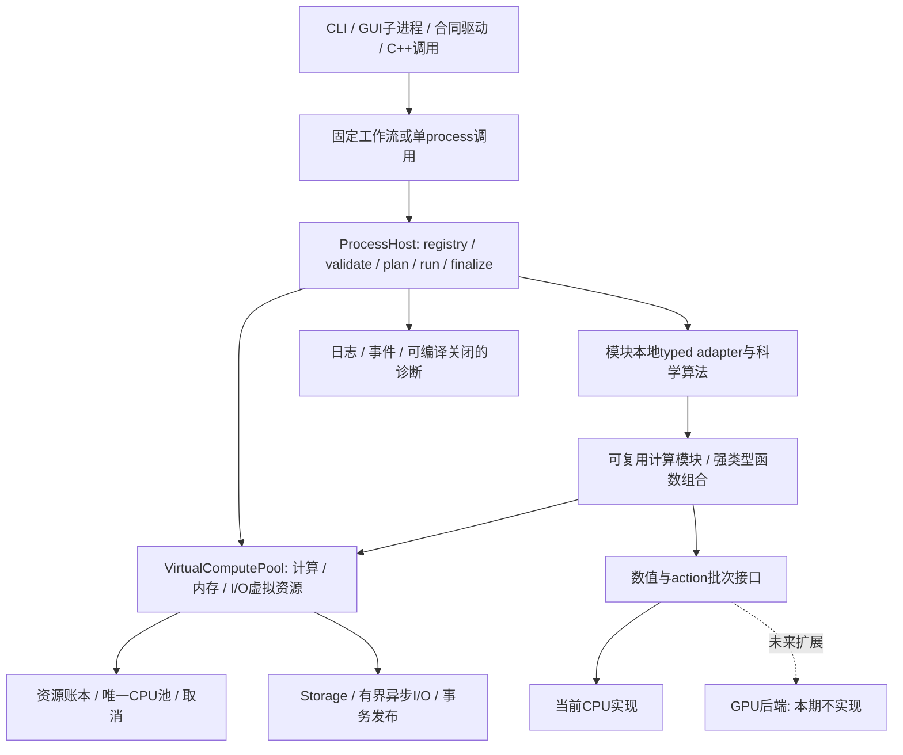

# 固定基建框架

本篇唯一拥有v2程序骨架：模块注册、typed调用边界、生命周期、调度、基建服务、扩展规则和构建装配。科学算法步骤由[各process](processes/README.md)各自拥有，固定命令的数据流在[WORKFLOWS](standards/WORKFLOWS.md)。本轮只改文档；ProcessDescriptor/InvocationPlan/InvocationContext及Task/Pipe的字段、签名已在[FOUNDATION_API](standards/FOUNDATION_API.md)定稿，调度实现步骤在[SCHEDULER](standards/SCHEDULER.md)；当前头文件和程序尚未据此改造。本文早期ProcessContext角色由定稿InvocationContext承接，不再定义第二种上下文。

内部开发允许直接破坏式重构。只维护一套当前接口/对象/产品/配置格式，旧v1及早期v2产物无兼容或转换义务；格式不匹配具名拒绝并由原始输入重新生成。Git提交历史和原始科学证据保留；保存历史不要求保留旧运行接口。

## 结构与职责

Process是可独立维护和调用的科学步骤，一个模块可登记一个或多个内聚operation。科学模块拥有数学及局部状态；框架拥有资源与执行；工作流拥有显式数据边/屏障。纯标量原语、数组read、type构造不强制变成调度节点。一个算法一份实现；CLI、GUI、driver不能另写算法。

### 基建提供的固定服务

| 服务 | 固定责任与约束 | 详细标准 |
|---|---|---|
| Registry / ProcessHost | 装配已编译模块、查找typed binding、校验状态机、统一异常/结果/观测边界 | 本篇、API |
| Resources / CpuExecutor | 进程/command/invocation共享账本，原子准入、唯一CPU池、有界工作队列和归约 | EXECUTION |
| Storage / ArrayBuilder | 输入/输出块、容量转交、不可变对象、spill/cache、原子封存与发布 | OBJECTS、API |
| Cancellation | 停止新任务、在途安全点、清理后返回；不提前释放借用/设备事件 | EXECUTION |
| Diagnostics | 默认invocation性能包围、模块中间数据probe、有界附加D与独立输出 | API、EXECUTION |
| KernelExecutor | 统一批次布局/误差/驻留/完成语义；本期CPU，GPU仅预留合同 | EXECUTION |

基建只见公开模型/服务接口，不调用某个具体天文模块来猜数据单位、权或停止条件。科学模块通过ProcessContext借用上述接口，不链接其具体实现，不新建池/写文件/用可变全局“当前解”。具体context/binding声明后续统一写进公开头；不为每个模块再造一套资源或事件接口。

## 虚拟计算池与硬件抽象

底层采用VirtualComputePool，把硬件能力和额度抽象为虚拟资源。它是现有Resources/CPU executor/Storage I/O队列的统一调度入口，不再创建另一套线程池或重复内存账本。ProcessContext向模块提供compute/arrays/pipes的强类型facade；模块声明需要什么能力和资源，不自己选择OS线程、磁盘队列或设备stream。类似操作系统的资源管理思想用于用户态基建，不实现内核、通用进程隔离或任意代码运行环境。

| 虚拟资源 | 底层绑定与分配标准 |
|---|---|
| compute lane | 当前CPU核心/线程份额与算术能力，按实际运行的work unit租token；任务等待I/O/依赖/pipe时不占CPU token |
| memory domain | 当前host；未来pinned/device仍通过同一allocation/arena/lease，不允许算法私自分配另一份未计费buffer |
| I/O lane | Storage异步读/写的有界请求与字节额度；后端可用原生异步或固定少量阻塞I/O worker实现，不能阻塞科学worker。解压/压缩/hash/host复制的CPU阶段提交同一compute lane并取得CPU token，不由I/O worker绕开计算配额 |
| transfer lane | 当前host块借用/复制/流式spill；未来host↔device传输及事件依赖。传输是可计费任务，不藏在kernel耗时外 |
| cancellation / completion | 统一停止新提交、传播失败、等待实际完成后释放；取消一个future不等于底层传输已停 |

pool只在已声明的数学/精度合同下优化块大小、并发、驻留与传输。可探测CPU能力/内存余量/I/O吞吐用于调度，不自动换科学模型、容差、rank、mask或归约。实际capability必须由可用后端报告；没有GPU时设备资源为0，不能因为有扩展文档就注册可用设备。

### Task、异步I/O与就绪调度

统一Task<T>表示拥有结果/失败与完成依赖的强类型计算；名称为目标角色，后续在公开声明实现。模块用then/when_all/map_blocks/reduce等固定组合器连接，输入类型不匹配编译/装配失败。不是字符串脚本解释器，也不要求把每个scalar helper变成调度节点。进程内/CLI最外层可同步等待最终Result；Host内部run可返回待完成Task，running状态直到所有必需任务/I/O完成才进入finalize，不能把“已提交”当“已完成”。

调度状态为waiting_dependencies→ready→admitted→running→completed；等待配额/pipe的任务停在有界队列，CPU token仅在running持有。就绪任务先联合准入本单元剩余input/output/scratch与计算资源；已存在输入lease计一次。异步read_async/append_async返回Task并强持实际buffer/容量claim到完成，只有读取和hash校验成功才调度消费者。异步写等待期间不占科学worker，finalize必须等其成功才seal。OS无原生异步时也由固定I/O lane履行相同合同，不每个请求建线程。

Task不是占住worker的函数栈。遇到依赖/I/O/pipe等待时，当前执行段结束并释放CPU token，转为suspended；完成回调仅唤醒一个有界continuation，使其回到ready并重新准入，不能在I/O线程上直接运行科学计算。资源等待同样回到waiting_resources，不持CPU token；保留的allocation/arena仍计H。每个Task有success/failed/cancelled终态，但用户停止等待或请求cancel不释放在途operation的buffer；清理依赖强持实际I/O/设备事件直到完成。所有依赖到安全终态后才允许Host最终回收。

异步组合只捕获有寿命的Ref/Block/lease或按值小元数据，不捕获会在调用返回后失效的裸span/栈地址；同步helper可按借用至返回规则使用span。ProcessContext及服务根所有者须活到其所有Task与清理continuation真正结束。I/O计算段申请CPU token失败就入ready队列，不持CPU token等待I/O信用；阻塞磁盘syscall阶段只占I/O信用。输入/输出buffer额度在提交前联合准入，token/信用的转换不持资源锁等待另一类资源。

计算与预取/写回可以重叠，但预取bytes、在途请求与写缓冲均有上限并计H/磁盘；同一块只在版本/hash匹配时复用。CPU cache/NUMA/向量化属于后端优化候选，首期不要求NUMA实现；不把重排归约或改变科学选择当线程优化。反压时暂停上游提交，释放CPU token；不能忙等、持锁等待I/O或由所有worker阻塞等待同一池。

### 内存管道与背压

Pipe<Block<T>>是有界的强类型块通道，携dtype/shape/索引范围/单位/模型版本、数据ready依赖及强lease。每条pipe声明max_items/max_queued_bytes和一读多读策略；顺序语义按固定work-unit key，消费者不得按到达顺序决定科学归约。广播共享只读块，改变数据需新builder。零复制是转交/共享既有lease，不等于不计内存。

pipe的queued_bytes是逻辑背压信用，不是第二份物理内存reserve；物理allocation仍在唯一Resources账本计一次。同一块两次投递各占队列信用，但物理字节不重复计费。消费者被准入并接收后队列信用释放，输入lease移至消费者，仍占H直到最后引用释放；活跃消费者数量和任务元数据也受池上限约束，不能借pop绕过内存限额。

生产者先取得目标pipe空位和本工作单元output/scratch准入，才能产出；消费者只在其剩余output/scratch可行时取走输入，不能取完输入占满H后等输出。plan给每段最小工作集及管道在途上限，Host为至少一个从输入到sink的可推进frontier保留容量arena；其保留额度也计H，不是额外免费内存。若预算无法容纳该最小进展路径，先减少在途/块/并发或spill，仍不可行则在启动前resource_exhausted；不等到闭锁再无限等待。数据依赖扩展也必须保持该进展不变量。

frontier同时保内存与发布信用。要求有序消费的pipe按next_required_key分配发布权：items=1时只有该key能取得slot，高key即使先ready也不能占唯一slot；items>1可在有界重排窗口并行，但始终为最低未完成必需key保留至少一个slot/输出容量。重排缓冲与任务结果计H和队列信用，不能放到无界旁路。消费者按key读取，不按到达顺序归约；低key失败/取消必须交付具名终态并终止或显式处理partial，不永久等待一个不会生产的key。自适应新增key按确定依赖顺序登记，不由完成时序发号。其它独立pipe/command仍可并行，不因某个有序流等待而占住整个pool。

pipe关闭有正常EOF、失败、取消三种显式状态；仅EOF可结束完整流。某段失败沿依赖传播原Issue，停止上游新生产并清理未提交块；允许的科学partial按Host finalize规则封存。异步任务、pipe队列和写者持buffer直到实际完成，不能消费者取消后提前回收。背压不会改变科学分母、丢样或自动降精度。

## 可复用计算模块与函数组合

框架分四层：虚拟计算池/存储/数值基建 → 可复用typed计算模块 → 标准登记的科学process → 固定命令/GUI工作流。每层只调用下层明确接口。可复用模块是普通库函数或typed Task函数，按所属模块维护，消费同一ProcessContext/预算/数据类型；科学process通过它们拼出算法步骤和误差链，而不是每个process重新实现数组变换、CSR、求解、PSF积分和I/O。

公共模块清单及组合标准见[COMPUTE_MODULES](standards/COMPUTE_MODULES.md)。元数据和科学观测登记在process本地descriptor；细小函数不逐个建立运行时registry/对象系统。共享函数可直接调用，只有对外invoke才建立独立process生命周期；内部函数的工作与错误仍归当前invocation。模块依赖无环，函数组合必须显式保留单位/index、噪声根、数值包围和取消依赖，不能只拼名义像素数组。

新模块接入以完整模板包为单位：process文档、typed公共声明、本地descriptor、CPU组合实现、独立反例和构建依赖。目标脚手架可一次生成这些文件并登记构建清单，再由编译生成registry/schema/能力目录；该工具本轮不实现，也不冒充已有命令。独立复制时必须携明确依赖/许可证和公共合同；不能复制某个函数文件就隐含依赖全局Host/旧会话。

## 一次登记与typed绑定

每个模块在自己的编译单元声明唯一只读ProcessDescriptor。构建装配显式列出模块并调用其登记函数，生成或汇总不可变registry；不依赖静态初始化顺序、反射、运行时扫描目录或按字符串加载代码。新增模块只增加本模块声明、构建源清单和文档/验证，不修改ProcessHost算法分支。目录[processes](processes/README.md)是可读索引；以后由登记生成机器schema/能力表，禁止再手工维护第二份运行时registry。

| descriptor项 | 必须声明的语义 |
|---|---|
| process_id、module、semantic_revision | 当前构建内唯一的小写点分ID、所属源码、科学语义身份；revision用于复现，不承诺旧版可执行 |
| operations | 每项唯一operation_id及Request/Response的type_id、输入/输出schema引用、typed binding；重载按公开参数类型区分 |
| data_contract | 单位、index/shape、必需模型能力、输入借用/输出所有权及partial允许范围，科学校验由模块实现 |
| execution_contract | work-unit key/分块轴/halo/归约/屏障、可重入性、最小单元资源上界、可用CPU批次与后端能力 |
| hooks | typed validate、plan、run、finalize；不得在descriptor保存可变scratch或当前run指针 |
| dependencies | 静态模块/服务依赖及输入模型类型；不从process_id推断运行数据边，不创建跨模块单例 |
| probes、documentation、verification | 模块probe声明、唯一process文档路径、独立case/证据入口；默认invocation span不逐模块重复实现 |

一个operation_id精确绑定一个Request/Response类型组合；适配器只负责解码、统一校验、调用现有唯一算法和编码。进程内typed入口与JSON driver走同一binding及资源/状态边界，底层科学函数保强类型并可被helper复用。框架内部若擦除类型，必须带已验证type_id和析构/所有权，不能把未经检查的void指针交给算法。新注册入口是后续重构目标，不意味着现有free函数/CLI已经改造成registry调用；没有维持它们旧签名或wire别名的要求。

registry的键是(process_id,operation_id)，operation_id只在本process内唯一。重载输入类型必须具名为不同operation_id，例如forward.center0与forward.edge0，不能靠运行时猜缺失字段。装配时对重复process或同process重复operation、缺binding/schema/文档、静态依赖环、未知服务、probe ID冲突和不支持的后端声明直接失败；不允许“后登记覆盖前登记”。能力报告由实际链接的registry给出，不因有文档就报告implemented。

## 统一生命周期

| 阶段 | 输入/副作用/保证 |
|---|---|
| resolve | 查找process/operation及CPU能力，分配run/command/invocation身份；未知ID返回unsupported |
| validate | 公共形状/单位/index/版本检查后执行模块科学校验；不产生可发布结果，不更改输入 |
| plan | 给只读InvocationPlan：依赖hash、分块/halo/固定key、资源上界函数和最小可行单元、输出方式；只读已在手元数据，plan自身scratch也计费；不运行PSF/几何等科学预计算 |
| admit | 在进程账本原子预留本单元input/output/scratch/线程/存储；不足缩块/降并发/cache逐出/spill，再无可行最小单元则resource_exhausted；不改变科学目标 |
| run | 在唯一executor上产生私有输出；数据依赖细化按固定key扩展有界任务并计总work，不需plan预知所有细分；模块不阻塞等待自己占满的同一池 |
| finalize | 以Task/continuation等待必要I/O/事件及后续flush/seal，等待时释放CPU token；完成模块元素数/误差/闭包验证，封存immutable输出及Assessment后原子交付，partial按有效域标记 |
| cleanup | 成功/失败/取消均执行noexcept回收；可异步等待在途安全完成，等待不持CPU token。未提交输出撤销，已提交Ref保实际租约；清理故障不覆盖原科学code |

合法状态为created→validated→planned→running→finalized→completed；validate/plan/admit/run/finalize任一步无可验证输出的框架硬失败可到failed，取消到cancelling→cancelled，终态不能再run/finalize。admit与run可按有界单元循环；规划失败也必须有终态和usage。科学code与执行状态分开：nonconverged/precision_exhausted/resource_exhausted若已产生API允许消费的有效partial，属于run结束，必须进入finalize→completed并保原code/未达标Assessment；后续单元admit失败同样可结束已有有效partial。仅无可验证partial或API禁止提供value的hard failure直接failed→cleanup。finalize只能保留/降低可用域，不能把原非ok改成ok；其自身失败则不提交value。取消遵API，不提交可发布value。科学迭代在本invocation内完成；跨阶段几何反馈由工作流提交新invocation，绝不重置祖先work。

ProcessContext只借用resources/storage/cancellation/executor/diagnostics和本次身份，生命周期覆盖所有在途任务。模块内部同步helper继承调用scope，不自动重复生成顶层结果统计。跨process独立invoke创建子scope；父usage聚合后代，报表不再相加。科学模型必须Ref<const T>或严格只读借用；可变scratch、迭代和writer仅本invocation拥有。同一个process允许并发invocation，不能共用临时工作区。

科学执行结束不代表所有目标达标：框架记录执行终态，模块在Assessment标bounded/conditional/unconverged/unknown等实际科学状态。partial不能被工作流自动publish成complete。正式产品commit只由Storage事务服务在整个必需闭包验证后执行；普通process finalize只提交其immutable输出，不强迫每步落盘。

## 调度、多线程与未来后端

框架只按已经声明的数据边、屏障和资源资格安排任务；并行粒度由process给工作单元，CPU线程由唯一池租出。相同semantic key的输入/归约顺序固定，执行块大小、线程数量不改科学量或选择策略。第三方BLAS/OpenMP默认单线程；显式获租约才可内部并行，框架不得嵌套超售。

顶层invoke同步对外返回；内部以Task组合异步执行并由唯一pool推进。内部parallel_for/reduce支持协作执行或调用线程内联；不能让所有worker持租约后阻塞等待同池子任务。资源锁/registry锁不跨kernel或I/O。跨invocation的共享cache只存不可变已验证对象，输入hash/算法/算术/后端入key；逐出只影响性能。

GPU扩展点在批次executor与ArrayBacking，不在每个process继承CUDA类。descriptor声明哪些操作/布局/精度/归约可交给后端；选择由显式ExecutionPolicy与能力决定，无认证包围能力就返回unsupported或按显式许可走CPU。host/pinned/device计费、传输、驻留、完成事件和取消释放合同见EXECUTION。本期不实现GPU backend、不新增CUDA/ROCm依赖、不报告GPU可用或加速。

## 内部开发观测

唯一目标编译开关ACSD_DEV_MODE，默认OFF，独立于优化等级。OFF宏参数零求值，关闭详细writer/计时/策略文件读取；正常日志、科学issue/事件/取消仍工作。ON由ProcessHost统一记录每invocation的validate/plan/run/finalize历时、工作量、分域高水位及I/O；模块只登记科学观测点，不复制计时框架。

所有probe携带process_id、operation_id、invocation_id、span_id、parent_span_id、科学边界tag。默认Host probe采用稳定ID framework.invocation.phase / framework.invocation.usage，phase与invocation是tag；各模块额外probe只观察已有数据。probe名称不按线程或输入动态生成。初始probe登记见[PROBES](standards/PROBES.md)，阶段前缀是语义标签，registry绑定其生产process。

记录另含owner_kind=process/service。科学调用内的Storage/Resources观测归当前invocation；命令最初reader和最终publish/writer等没有科学父调用时，创建command下的具名服务scope，process_id填service.storage或service.resources，operation_id为其typed服务操作，分配独立invocation_id，父span引用真实command span或null。服务scope不伪装科学process、不要求科学plan钩子，但遵同一资源/取消/错误/终态记录；command汇总不重复累加已含服务消耗的科学子域。

性能事件与中间快照写独立诊断root，按显式选择器和D/磁盘/队列配额采集，诊断失败不改科学结果。快照只try-copy已在手host块，不能保科学租约到后台、重算中间值或偷偷读回GPU。完整策略/文件协议见API，预算/flush/异常隔离见EXECUTION。

## 源码依赖、构建与交付

| CMake 目标 / 源码目录 | 直接依赖；责任 |
|---|---|
| acsd_model / src/model | C++20；身份、单位、数组索引及 action recipe 数据，不含 I/O |
| acsd_numerics / src/numerics | model、Eigen、MPFR/GMP；区间、求积、QR/SVD/LSMR、PSD/QP |
| acsd_coordinates / src/coordinates | model、numerics、WCSLIB、ERFA；规范 WCS、历元、曲边 |
| acsd_observation / src/observation | model、operators、uncertainty、numerics、runtime；校准和G（模块组合走同一虚拟计算池的 science Context 桥） |
| acsd_catalogue / src/catalogue | model、coordinates、uncertainty；只读本地索引，Gaia/XP 解码 |
| acsd_sources / src/sources | observation、coordinates、catalogue、uncertainty、numerics；盲解、PSF、科学源 |
| acsd_response / src/response | model、numerics；响应基积分 |
| acsd_photometry / src/photometry | sources、response、uncertainty、numerics；联合尺度及影响 |
| acsd_geometry / src/geometry | coordinates、operators、numerics；唯一生产交叠与支持 Boolean |
| acsd_operators / src/operators | model、numerics；CSR、组合、transpose；消费几何数据，不调用 geometry |
| acsd_uncertainty / src/uncertainty | operators、numerics；根图、协方差、PSD 解 |
| acsd_information / src/information | uncertainty、numerics；V_F/V_B/controls 及三角重建 |
| acsd_sky / src/sky | uncertainty、information、operators；controls、全局相对 sky |
| acsd_coadd / src/coadd | sky、uncertainty、operators；选择和权及混合核 |
| acsd_projection / src/projection | geometry、operators、uncertainty；目标 Q |
| acsd_storage / src/storage | model、CFITSIO、zstd、nlohmann_json；块、products、发布、Array provider |
| acsd_resources / src/resources | model、numerics、Threads；资源子域/预算/租约、CPU KernelExecutor、Storage接口消费者、唯一线程池 |
| acsd_workflows / src/workflows | 上述全部；Normalize/Mosaic/Export 的因果编排与细化控制器 |
| acsd、acsd-contract / apps/cli、apps/contract | workflows；分别用户命令与公开操作调用 |
| acsd-gui / gui（独立 CMake 工程） | Qt6 Core/Widgets/Network；子进程协议，无核心链接 |
| validation / validation | 外部独立 oracle 与进程协议；禁止 include src 或复制旧测试 |

依赖方向按表从下往上追溯，无科学模块链接 resources/storage 的具体实现。

依赖表的完备性由声明合同反查：每个公开结构里出现的 `Ref` 字段，其类型必须能由该模块
或它依赖的模块构造。`CatalogueStar.astrometric_noise/xp_noise` 是 `Ref<CovarianceAction>`，
而 `CovarianceAction` 的唯一构造入口 `make_covariance` 属于 uncertainty；若 catalogue
不依赖 uncertainty，它只能返回空的协方差引用，这与 OBJECTS「除明确列出的可空例外外
Ref 字段必需非空」冲突。因此 catalogue 的依赖补入 uncertainty（传递 operators），
协方差仍只有一份实现，不允许在 catalogue 内复制构造逻辑。该依赖不构成环：
uncertainty 只依赖 operators 与 numerics。科学核只借公开Context/ProcessContext接口。Storage 读产品时构造数据图及 recipe；具体 action 由 workflows 调用 make_action 解码，故 storage 不反向依赖科学库。公开静态入口目标acsd_science聚合科学库；模块本地typed adapter按本篇唯一标准登记为process。采用编译期显式装配的descriptor，不建设动态加载/反射工厂。设计preset验证声明/规范；远端已加入科学实现目标，实际构建/完成范围依现有CMake和阶段报告，本次不变更构建。

生产构建新增ProcessHost/registry装配职责归resources（目标，不是假称当前已有）；模块descriptor归本模块，workflows只选ID/typed operation及绑定数据边。resources只依赖公开模型/服务接口及通用numerics，不include具体科学模块实现；根装配单元链接所有模块并调用登记，避免resources反向链接整个科学树形成环。模块本地adapter与其科学代码同属模块库。

生产 C++20，标准库和成熟数值库。采用 Eigen 3.4 API（MPL2）密集 QR/SVD/稀疏 QR，MPFR4/GMP6（LGPL3+/LGPL3+ 或各上游许可选项）有向区间和精确有理裁剪，CFITSIO4（上游许可证）FITS，WCSLIB8（LGPL3+）解码/外部标准校验，ERFA2（BSD3）历元，nlohmann_json3（MIT）配置，zstd1（BSD3 或 GPL2 取 BSD3）块，Qt6（LGPL3 或商业，GUI独立）。HEALPix 生产索引按科学公式独立实现，禁止复制旧内部文件；不引入 GPL healpix_cxx。源的来源与版本由 third_party 清单登记，构建使用系统/工具链依赖，不在线下载浮动 master。每次实施构建记录精确版本、来源hash、编译选项和 license；首次实现提交即锁定两平台可用版本，不把本轮未安装依赖宣称已测试。

Windows 科学 CLI 优先 MSYS2 UCRT64 GCC14+，MPFR/GMP 与库使用同一 CRT/ABI；Linux GCC14+/Clang18+、glibc，Ninja+系统依赖。GUI Qt6/MSVC独立，不跨 CRT 传 C++ 对象。AVX2/FMA 单独翻译单元运行时检测，baseline x86-64 无可选指令；认证区间禁 fast-math，FP contraction off，SIMD 结果需有向包含证据。库默认串行数值后端，由 Context 租线程。

目标DEV_MODE/CPU注册表与科学库使用同一构建身份，能力来自实际链接目标。安装和双平台检查按VERIFICATION；严格数值原语禁fast-math，baseline x86-64不能静态要求可选AVX指令。

## 修改规则与完成条件

添加/维护科学步骤：修改其process文档、模块本地descriptor/typed adapter/唯一实现及独立反例；自动装配及能力表随构建更新。更改单位/所有权/执行状态等共享规则才修改本篇或公共标准。固定工作流只改WORKFLOWS和组合器，算法步骤不放回框架。

框架首个可用增量必须能在同一Host中登记两个测试process、拒绝重复/错类型、独立调用与组合调用、共享资源计费、取消/异常清理、单/多线程同结果，并自动得到两者性能包围；科学模块随后逐个接入。本期只设计GPU边界，验收不要求GPU设备或SDK。

当前阶段只交付上述设计；后续实施先修统一公开声明、VirtualComputePool/Task/Pipe及registry边界，再同步schema/decoder、CPU/Storage/诊断服务和逐模块接入。允许删除过时接口及重建内部产物，不增加兼容别名、双reader、版本转换器或历史产品迁移模块。

## 直接开发入口

按[DEVELOPMENT](standards/DEVELOPMENT.md)分配M0—M6任务；公共类型/函数以FOUNDATION_API定稿，scope/region/重规划/cleanup规则统一，算法实现只在所属process。完整calibration模块的文件、输入/精确公式、R/F/E、run/finalize/codec登记及故障测试见[实施例](standards/CALIBRATION_WALKTHROUGH.md)。不需要各开发者重新决定资源/注册/Task接口。
