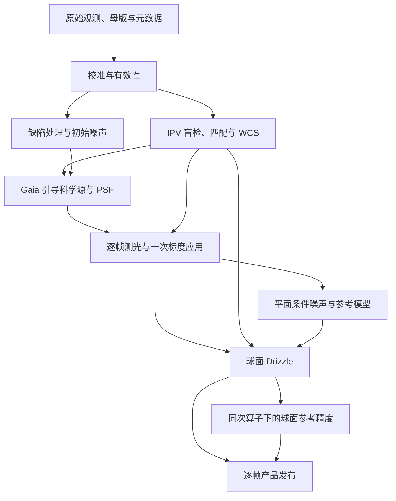

# Normalize：单帧球面观测模型

本分册依据[最高设计](../../ACSD_DESIGN.md)与[统一科学模型](../unified/UNIFIED_SCIENCE_MODEL.md)，说明从传感器像元到单帧 HiPS 的科学因果链。数据字段由[Normalize 数据合同](../../engineering/contracts/NORMALIZE_DATA.md)规定，节点责任见[生产架构](../../engineering/architecture/NORMALIZE_PIPELINE.md)。本文陈述目标模型，实际实现与证据见[实施差异](../../engineering/architecture/SCIENCE_IMPLEMENTATION_DELTA.md)。

## 1. 问题、输入与输出估计量

输入是一帧 CCD/CMOS 观测、与其实际状态匹配的校准输入、本地 Gaia 数据、仪器响应及配置。输出是该帧的**球面已成像线性信号**，附带坐标、光度尺度、PSF、条件噪声、参考精度与有效域，使下游能够解释其测量意义。

Normalize 不求跨帧接缝、不估计最终多帧权重，也不合成马赛克。一个调用可包含多个校准 block；block 表示母版和模型共享范围，不限制用户在 Mosaic 选择不同设备或通带。每个输入 occurrence 有独立身份和状态。

| 量 | 含义 | 单位或域 |
|---|---|---|
| x_j | 已校准且按实际测光状态表达的源像元积分量 | 当前线性积分单位 |
| Ω_j | 未收缩源像元的球面面积 | sr |
| S_p | 球面叶上的已成像面亮度 | [x]/sr |
| P_j | 单位总源通量的像元积分响应 | 1 |
| h=RP | 球面点源响应 | sr⁻¹ |
| F_ref、V_F | 配对参考通量及其条件估计方差 | [F]、[F]² |
| SNR_ref | F_ref/√V_F | 1 |

图像可为原生计数、明确相对标度或响应标定尺度。BUNIT 与实际数值变换一致；未知物理标度不写成 SI 绝对辐亮度。负线性值和有限零合法，缺数据与缺精度分别表达。

## 2. 科学依赖与处理顺序

这是依赖关系，不要求无依赖的初始统计串行执行。最终源表、测光、噪声、Drizzle 和参考精度必须使用同一帧、同一 WCS、标度及有效性版本。下游通过明确对象取数，不由 p1_wcs.json 等文件是否出现猜测依赖完成。

IPV 私有 `solver_detections` 是校准像元上盲检的几何候选，没有已解 WCS 前提。`science_sources` 在 WCS 后由 Gaia 引导形成，服务于质心、通量、PSF 与掩膜；两类目录不能互相冒充。

## 3. 校准、缺陷和观测不确定度

校准先解释 bias、dark、flat 的单位及母版约定。若 D 仍含与亮场共用的 bias B，曝光比例为 γ、归一 flat 为 f，则示例算术为
\[
 y_i=\frac{L_i-B_i-\gamma(D_i-B_i)}{f_i}.
\]
已去偏置 dark 使用对应公式，避免双扣 B。缺少母版表示相应校正能力缺失，不虚构校准或零误差。flat 的归一、低响应处理与曝光线性范围由[校准分册](../calibration/CALIBRATION.md)定义。

在一阶线性化适用域内，输入 z 经 y=f(z) 得
\[
 C_y\approx J_z C_zJ_z^T,\qquad J_z=\partial f/\partial z.
\]
这要求保留母版有限估计误差、共享身份、归一统计量和信号依赖。多个帧共用母版时还有跨帧共同误差。无法取得这些输入时标为 unmodelled 或有来源的 approximate，不能用背景 MAD 替代全部误差。[1]

缺陷掩膜、饱和与修复状态随信号传递。固定修复算子会改变相关性；插值得到数值不等于重新获得独立观测。具体分类、修复偏差与噪声传播见[CCD/CMOS 缺陷](../calibration/CCD_DEFECT.md)。

## 4. 天体测量与科学源

IPV 对校准后的真实像元盲检、匹配本地 Gaia 并求 ICRS TAN/CD 与 SIP。粗指向和尺度可来自 OBJCTRA/OBJCTDEC、RA/DEC、FOCALLEN、XPIXSZ、用户配置或先前已解邻帧；这些只提供 hint。原始 FITS 缺 CRVAL/CD 不代表求解失败。

逐帧记录 hint、星表/历元、检测数、匹配内点、残差、实际尝试和失败原因。已求解 WCS 与合法 `explicit_config` 分开记录来源，后者不能计作 IPV 成功。无解帧为 unsolved，不生成伪球面信号，其它合法帧仍可保留。

内部零基像元中心进入 FITS 一基 WCS 时加一，已为 FITS 坐标的 solver 输出由唯一 adapter 转换；完整 SIP 贯穿两向变换。独立留出 Gaia、外部 WCS reader、边角/手性/尺度/RA 回绕评价与内部往返自洽分别报告。几何定义见[天体测量](../detection/ASTROMETRY.md)。

WCS 后将 Gaia 源投到实际像元，测量质心与通量，保留 frame/source/Gaia ID、估计器、单位、方差能力、饱和、混叠、边缘和失败原因，形成[科学源表](../detection/STAR_DETECTION.md)。

## 5. PSF、逐帧响应与一次标度

P_j 是连续单位总通量 PSF 在真实像元内的积分。实际位置、空间参数与子像元相位都进入响应；有限窗允许 ΣP_j<1，不重新归一。默认总通量估计器为 `analytic_total`；孔径修正必须另记模型及误差。FWHM、检测宽度或拟合质量不能单独定义参考信息量。完整定义见[PSF](../psf/PSF.md)。

帧 k 的光子效率响应 R_k 与 XP 外定标谱 f_λ,s 给出
\[
 Q_{ks}=\frac1{hc}\int f_{\lambda,s}(\lambda)R_k(\lambda)\lambda\,d\lambda.
\]
响应已包含 λ/(hc) 或采用能量约定时使用相应积分，不重复乘。拟合参数包括帧级 a_k（或等价 k_photo）、有支持的空间乘性场 m_k(u)、误差与有效域。[2]

线性图像在本环节应用一次标度；随机协方差按对应二次幂变换，估计标度的共同误差另算。Drizzle 不重复缩放。参考通量、模板、原生 gain 与实际数组单位必须配对。

不同实际 R_k 逐帧绑定或内部分组，不能套用首帧响应。未知曲线可形成明确 native/relative 能力状态，不能伪造绝对零点。共同参考光谱约定不提供未知星云逐像元 SED，恒星色项的适用域和跨通带系统差由[光度分册](../photometry/PHOTOMETRY.md)定义。

## 6. 平面条件噪声与参考定义

局部线性模型为
\[
 y=Fh+Z\beta+n,\qquad \operatorname{Cov}(n)=C.
\]
y、h、C、Z 必须处于同一观测域；平面常量计数与球面常量面亮度不是相同背景基。C 在规定参考源条件下冻结，源 Poisson 取对应非负期望，不把扣天空后的负信号当 Poisson 均值。

正定 C、已知背景时
\[
 V_F=(h^TC^{-1}h)^{-1}.
\]
共同拟合背景且参数满列秩时，A=[h,Z]，有
\[
 V_F=[(A^TC^{-1}A)^{-1}]_{FF},\qquad
 SNR_{\mathrm{ref},k}(u)=F_{\mathrm{ref},k}/\sqrt{V_{F,k}(u)}.
\]
冗余背景不自动使通量不可辨识；半正定 C、参数秩亏与精确约束按[噪声分册](../noise_snr/NOISE_SNR.md)处理，不用任意对角地板制造信息。冻结模型下的条件方差不宣称为所有源亮度的无条件 CRB。

共同参考是具名 SED/response 或显式正有限积分通量，各帧 F_ref,k 由实际响应、标度与单位配对。检出星中位通量只作具名样本诊断。以下对象分别生产：

| 对象 | 解释 |
|---|---|
| source_snr | 某实际源的通量估计除以对应标准差 |
| sparse reference controls | 规定位置、局部 PSF/噪声/背景下固定参考源的条件信息 |
| frame_snr_ref | 空间参考控制的帧级摘要 |

精度缺项如实记录。仅当遗漏项确为 PSD 随机噪声，且模板、有效域、参考和可估计问题保持一致时，才可称条件 SNR 上界；其它未知增益、模板和系统失配按 approximate/unavailable 表达。

## 7. Drizzle 与球面参考精度完成

输入 j 的积分量为 x_j，未收缩面积 Ω_j，drop 面积 A_j，与目标叶 p 交叠 a_jp，令 w_jp=a_jp/A_j，则
\[
 N_p=\sum_jw_{jp}\Omega_j,\quad
 S_p=\frac{\sum_jw_{jp}x_j}{N_p},\quad
 R_{pj}=w_{jp}/N_p,\quad
 C_{\mathrm{sphere}}=RC_{\mathrm{planar}}R^T.
\]
S_p 单位为 [x]/sr。N_p、Σa_jp、覆盖并集和叶面积不能互换；无有效分母不生成有限假亮度。实际算子来自本帧已解 WCS/SIP 和已施加光度的图像。分配闭合、真实曲边误差与科学通量保真分别核验，详见[Drizzle](../drizzle/DRIZZLE.md)。[3]

平面 noise 节点准备条件模型。Drizzle 得到真实几何后，调用同一 noise 库，用**同一次信号算子**形成 h=RP、C=RC_planar Rᵀ 和 Z_sphere，再求 canonical controls；不回写上游造成调度环。不把平面 V_F 改域标签后当成球面结果，也不重复附加相同相关噪声修正。

控制点来自确定性有效 patch 中心，不要求当地有真实星。每点保存 ICRS 位置、参考和响应身份、F_ref/V_F/SNR、PSF/协方差/背景/几何模型、支持域、准确性与缺项。不可辨识点明确 unavailable。空间模型可以用局部算子或因子，不要求持久存储全帧协方差巨矩阵。

帧摘要为不重复 patch 球面支持面积加权的 log SNR 中位数再取 exp，仅作摘要。点源信息 I_F=SNR²/F_ref² 与面亮度权重 1/V_B 经同条件 T=V_B/V_F 连接；参考源条件不能直接替代 actual-scene，本阶段不发布最终多帧权重。

## 8. 发布、能力与生命周期

| 对象 | 正式身份及消费 |
|---|---|
| signal HiPS | 逐帧跨阶段信号，具实际单位、坐标、响应和层级 |
| frame_science.json | 唯一正式精度及模型说明；precision available/unavailable 与原因均明确 |
| WCS/photo/PSF/noise/support 模型 | 与帧同版本，产品内可读引用及身份/哈希 |
| variance/ivar/coverage | 可选且有来源的辅助对象，不能替代参考 controls |
| Catalogue、规整 SNR 网格 | 浏览或兼容视图，不成为第二份 canonical 真源 |
| Runtime 对象、科学 cache/spill | 有输入版本与生命周期的阶段内正式依赖 |
| snapshot/perf | 开发只读旁路，不供科学消费者取数 |

writer 等实际 AIO 完成，核对同帧同版本的 signal、模型和 sidecar，再发布完成 manifest。缺精度模型的合法 signal 与磁盘损坏、发布失败分开表达。运行清单枚举全部预期输入及 succeeded/failed/cancelled，不能把部分成功写成 N/N。

Mosaic 最终单 signal、Export 普通 signal FITS 不要求 Normalize 删除必要模型。工程字段、能力状态、sidecar schema 与读取兼容统一见[数据合同](../../engineering/contracts/NORMALIZE_DATA.md)。

## 9. 独立验证与局限

独立评价分别检验：无 WCS 头帧的真实 IPV 尝试与留出误差；校准共享误差；已知 SED/响应的标度；像元积分 PSF；三类 SNR 的估计量；同次 R 下模板和协方差；真实曲边、孔径通量与相邻相关；模型独立读取和失败发布。

内部坐标往返、序列化一致、库函数存在和命令成功均不能单独证明完整阶段一精度。真实运行、局部数学支持与目标合同的覆盖范围见[实施差异](../../engineering/architecture/SCIENCE_IMPLEMENTATION_DELTA.md)和[收敛记录](../../engineering/governance/NORMALIZE_CONVERGENCE.md)。本轮待统一论证的事项集中在[待推导问题](../../../实验/documentation-refactor/docs/SCIENTIFIC_QUESTIONS.md)。

## 参考文献

[1] JCGM. Guide to the expression of uncertainty in measurement. [GUM 正文](https://www.bipm.org/documents/20126/2071204/JCGM_100_2008_E.pdf)。

[2] Montegriffo, P. et al. Gaia Data Release 3: External calibration of BP/RP low-resolution spectroscopic data. A&A, 674, A3. [论文](https://arxiv.org/abs/2206.06205)。

[3] Fruchter, A. S., Hook, R. N. Drizzle: A Method for the Linear Reconstruction of Undersampled Images. PASP, 114, 144–152. [论文](https://arxiv.org/html/astro-ph/9808087v2)。
